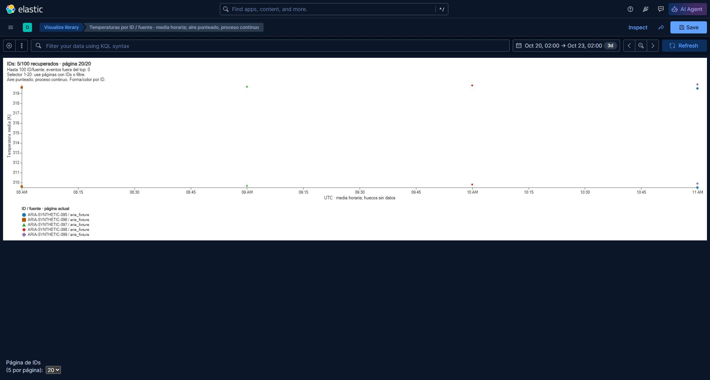

# CG19: nombres ARIA reactivos en SVG — 22-10-2026

Corrección de los dos hallazgos de PR69 sobre `84dd6f2d29951b7b5690b4d462da9560832b4f32`:
P2 de confianza alta (guías ARIA obsoletas) y P3 de confianza alta (PNG de página18
llamada página20). Proyecto educativo; revisión y aceptación humana pendientes.

Se integró mediante merge normal la base PR42
`85cd1d0c8da1b57dd8b1083ee2ff43e4e4e18eab`, sin conflictos. El helper Windows
se conserva. La consulta, el límite de100 identidades, cinco por página,
20 opciones, fuentes, sensores, colores y resultados offline se mantienen.

## Cambio y reproducción

Vega actualiza los atributos de cada elemento SVG, pero sus actualizaciones
puntuales pueden omitir el contenedor de una guía. Su texto visible cambia y su
`aria-label` generado permanece anterior. `toSVG()` crea otra representación y
no detecta ese fallo. No se usa como oráculo sobre el DOM incremental probado.

`guideRevision` reacciona a página, tamaño, respuesta, identidades, dominios y
dimensiones. Su canal `zindex` en cada título individual de guía provoca que
Vega actualice también los contenedores y sus descripciones generadas. Cada
marca afectada tiene un único título; su orden de pintura no cambia. Se
conservan los roles y la información ARIA concreta. También se ajusta la página
al último índice disponible tras reducir resultados y se ordenan explícitamente
las identidades de página y dominios ordinales al actualizar un subconjunto.

La regresión persistente está en `tests/test_lab_dashboard_dom.js`. El runner
`tests/test_lab_dashboard_render.cjs` la incorpora a su `browser.html` junto con
la fixture y el runtime existente. Tras abrirlo, ejecutar:

```javascript
await ready;
await runCG19DomRegression(view, spec, fixture);
```

El mismo ensayo se ejecutó contra fuente original y corregida, manteniendo un
único nodo SVG por ensayo. Compara sus guías con un DOM nuevo independiente,
además de comprobar texto, roles, puntos, IDs y dominios. La versión original
falla; la corregida pasa. Incluye 100→31→1→0→100, páginas1→20→1, última página,
orden inverso, cambio de ventana/omisiones, tamaño de página, valores nulos,
un único timestamp constante y anchos600/1100/1600. Las20 páginas concilian100
identidades, cada una una vez. [Antes](CG19_SVG_ARIA_20261022/dom-before-semantics.json),
[después](CG19_SVG_ARIA_20261022/dom-after-semantics.json).

## Kibana real y captura

Se arrancaron exclusivamente ES y Kibana9.5.4 propios, con imágenes oficiales
ya existentes y `--pull never`, datos y temporales propios en el directorio de
proceso del ensayo. Publicación loopback19279/15679; ningún volumen del autor se
montó. Se cargaron100 documentos sintéticos para visualización, sin modelos,
SMB, Kafka ni suites de migración/pipeline.

La primera red interna no permitía acceder a los puertos publicados; se
recreó solo esa red propia como bridge con bindings loopback. El primer ES
falló al inicializar ML en su temporal montado; se conservó el log y se relanzó
solo ese contenedor con ML desactivado, irrelevante para esta prueba visual.

En el **View SVG real de Kibana**, el mismo DOM pasó20 páginas y las transiciones
de respuesta, orden, ventana y omisiones. Esto es instrumentación de respuestas
visuales después de una carga real ES, diferenciada de los filtros UI:
[prueba del runtime](CG19_SVG_ARIA_20261022/kibana-dom.json).
Los filtros KQL reales devolvieron31/1/0/100 y los botones temporales
Previous/Next vaciaron/restauraron100, con texto y ARIA coincidentes:
[KQL](CG19_SVG_ARIA_20261022/kibana-real-kql-filters.json),
[ventanas](CG19_SVG_ARIA_20261022/kibana-real-time-windows.json).
En vacío se conservan dominios auxiliares finitos y desaparecen las graduaciones;
las guías describen esos dominios actuales, no el intervalo anterior.

T3 preview abrió la visualización y permitió leer/mutar su DOM. Dos snapshots
fallaron con `Preview automation snapshot timed out after 15000ms.` Se usó
entonces una pestaña Chrome propia mediante computer-use para la captura.
[Errores y fallback](CG19_SVG_ARIA_20261022/browser-failures.json).

La captura siguiente muestra página20 e IDs095–099. El JSON registra señal
`page=20`, selector20, título visible y ARIA20/20, IDs de datos y leyenda iguales.
Se aplicó `View.height(480)` durante la prueba de tamaño para mostrar gráfico y
selector juntos; no es una captura de reflow automático de toda la página.
Se comprobó su pintura en una llamada posterior: una captura intermedia anterior
a esa pintura se conserva solo en los originales del ensayo y no acredita el
resize. [DOM y señal](CG19_SVG_ARIA_20261022/kibana-page20-sized-dom.json).



También se conserva la [captura inicial sin resize instrumental](CG19_SVG_ARIA_20261022/kibana-page20.png)
y su [lectura del runtime](CG19_SVG_ARIA_20261022/kibana-page20-dom.json).
La imagen histórica mal nombrada conserva bytes y SHA256:
[registro de renombrado](CG19_SVG_ARIA_20261022/historical-image-rename.json).

## Validación y límites

Fedora Linux44 dentro de WSL `FedoraLinux-43`: Python3.11/3.12, cada uno17 tests
correctos y3 skips de ES deliberados en discovery CG19. Los skips no se presentan
como integración ES. Ruff0.17.1 con selector `E,F,I,PLW1510` y formato; generador
`--check`; renderer Vega5.33.0 (12 combinaciones,87 páginas y KPI250/600/1100)
y pintura real de87 SVG: correctos. Contraste mínimo sobre blanco
**3.4025803501541017:1**. [Matriz](CG19_SVG_ARIA_20261022/renderer-report.json),
[contraste](CG19_SVG_ARIA_20261022/svg-contrast.json).

CG25 y layout se ejecutaron con Git nativo Windows: WSL no interpreta el puntero
Windows `.git` del worktree. No se modificó ese puntero ni se relajaron checks.
El registro durable de la tarea conserva comandos, códigos, head/tree final,
diff completo, inventarios antes/después y hashes. El [manifiesto de pruebas](CG19_SVG_ARIA_20261022/sha256.json)
permite comprobar los bytes publicados.

No se repitieron las pruebas reales anteriores de migración ES, SMB de cuatro
mensajes ni pipeline. No se ejecutaron entrenamiento, modelos de entrega,
test final, CI manual, Copilot, comentarios ni merge. CI y publicación de la
rama se registran por separado en el handoff; este informe no los da por pasados.
Siguen pendientes zoom nativo, NVDA audible, carga sostenida y aceptación humana.
