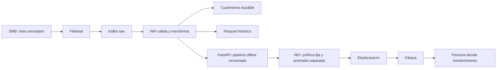

# CG30 justificación de IA, ML y arquitectura

La tarea es IA estrecha: aproxima la etiqueta contemporánea de un dataset
sintético. No tiene razonamiento general, objetivos propios ni autonomía para
controlar maquinaria. Las reglas deterministas validan unidades/formatos y
clasifican alertas; ML aproxima relaciones no lineales entre sensores y etiqueta.
Una regla física permite explicación directa pero exige fijar condiciones;
ML aprende patrones y puede fallar ante cambio de régimen o fuera de distribución.

| Familia | Datos necesarios | Ventaja en CNC | Límite y elección |
|---|---|---|---|
| RF supervisado | Sensores + etiqueta contemporánea | Interacciones no lineales, poca preparación, ablación física | No horizonte temporal por sí solo; elegido por AP OOF |
| Gradient Boosting | Sensores + etiqueta | Ajuste secuencial de errores, buen candidato tabular | Más tuning y riesgo de sobreajuste; comparado conceptualmente, no ejecutado |
| IF no supervisado | Referencia normal defendible | Canal de rareza independiente | Rareza ≠ avería; 1/41 fallos detectados en validación con presupuesto ~1% |
| Autoencoder | Muchos ejemplos de referencia, validación de reconstrucción | Representación no lineal y secuencias si se diseñan | Reconstruye anomalías también, escala/tuning y coste; no implementado |
| Logística / siempre 0 | Mismos splits y etiquetas | Referencias interpretables y trampa de accuracy visible | Frontera lineal / recall nulo del dummy |

Python se elige por pandas/sklearn y coherencia de pipelines con inferencia,
no por ser siempre el más rápido. uv.lock fija el entorno; funciones compartidas
evitan repetir fórmulas en notebook/API. RF no necesita escalar; la escala común
facilita logística y no añade información al RF. Joblib conserva el Pipeline,
pero solo debe cargarse desde procedencia propia: un hash sin raíz confiable
no neutraliza ejecución arbitraria en pickle. FastAPI es la interfaz implementada y comprobada en laboratorio con NiFi;
CG28/CG22 documentan respuestas HTTP y recuperación, sin garantía de producción.

Desbalance: 271/8000 fallos. class_weight modifica el coste de ajuste, no crea
ejemplos; SMOTE sintetiza vecinos y, si se usa, debe estar dentro del train de
cada fold. Se ejecutó SMOTENC dentro de los mismos folds: AP OOF 0,8929 frente a
0,9090 del RF elegido. Se conserva RF sin sobremuestreo; CG08_smotenc.json
registra también el aumento de falsos positivos en validación.
Las features físicas mejoraron AP en la búsqueda; no establecen causalidad.
La selección y threshold tuning optimizan desarrollo; la falta de test nuevo
impide certificar generalización final. Ver CG08/10 y sus JSON, no copiar números
como si fueran garantías. 78,05% recall agregado oculta H=1/2: pocos positivos
impiden conclusiones sólidas por régimen.

## Flujo y autonomía

El camino SMB→Filebeat→Kafka→NiFi→API→ES→Kibana se ejecutó en laboratorio.
Parquet se conserva por herramienta explícita separada; NiFi no escribe Parquet
automáticamente. CG22_live_recovery.json y el índice final delimitan el ensayo.
Offline se entrenan/seleccionan modelos; online se infiere con versión fija, no
se aprende automáticamente de cada alerta. El bucle está abierto respecto a
actuación física: informar no equivale a parar una CNC. Un bucle de control cerrado
exigiría sensores/actuadores, seguridad, plazos y validación distinta. La supervisión
humana conserva la decisión; no enviamos comandos a dispositivos.

## Fuentes docentes examinadas

- ENUNTZIATUA.md: § entrenamiento RF, evaluación económica y fase3 API.
- Rúbrica exacta docs/rubrica/fuente.json: G5/G10/G23/G24/G31/G32/G52.
- Corpus del curso `03_ML_5072/materialak/5072_2_06_Random_Forest.pdf`, páginas
  numeradas 1–3: ensemble supervisado, bagging/bootstrap, sin necesidad de escala.
- `03_ML_5072/materialak/5072_3_Balidazio_Metodologia.pdf`: validación y separación
  train/test; se examinó extracción textual local para contrastar metodología.
- `03_ML_5072/materialak/Sailkapen_Ebaluazio-metrikak.md`: precisión, recall y
  coste de omitir fallos en mantenimiento predictivo.

Decisiones del equipo confirmadas por usuario: AI4I como training, clasificación
actual aceptada por tutor. Elecciones técnicas de esta implementación: AP para
seleccionar candidato, F2 exploratorio, IF cuantíl .99, laboratorio estacional
separado sin modelo de predicción. No se atribuyen esas elecciones al tutor.

Pendiente: cada miembro debe explicar con sus palabras entrada/salida/errores,
revisar el argumento y fechar su conclusión. Ninguna evidencia humana se inventa.
