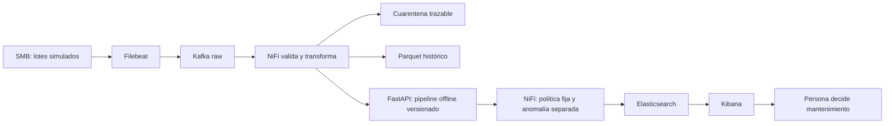

# CG30 justificación de IA, ML y arquitectura

Alcance vigente desde el 20/10/2026: [clasificación contemporánea AI4I](CG17_CURRENT_STATE_SCOPE.md),
cinco sensores y `machine_type`; ETA/RUL/forecast y datasets temporales quedan
como investigación histórica fuera de la entrega. Las métricas siguientes son de
desarrollo; no prueban evaluación final independiente ni aceptación del equipo.

La tarea es IA estrecha: aproxima la etiqueta contemporánea de un dataset
sintético. No tiene razonamiento general, objetivos propios ni autonomía para
controlar maquinaria. Las reglas deterministas validan unidades/formatos y
clasifican alertas; ML aproxima relaciones no lineales entre sensores y etiqueta.
Una regla física permite explicación directa pero exige fijar condiciones;
ML aprende patrones y puede fallar ante cambio de régimen o fuera de distribución.

| Familia | Datos necesarios | Ventaja en CNC | Límite y elección |
|---|---|---|---|
| RF supervisado | Sensores + etiqueta contemporánea | Interacciones no lineales, poca preparación, ablación física | No horizonte temporal por sí solo; elegido por AP OOF |
| Gradient Boosting | Sensores + etiqueta contemporánea | Ajuste secuencial de errores, candidato tabular | Ejecutado en la comparación de desarrollo; no promovido a la API |
| IF no supervisado | Referencia normal defendible | Canal de rareza independiente | Rareza ≠ avería; 1/41 fallos detectados en validación con presupuesto ~1% |
| Autoencoder | Muchos ejemplos de referencia, validación de reconstrucción | Representación no lineal y secuencias si se diseñan | Reconstruye anomalías también, escala/tuning y coste; no implementado |
| Logística / siempre 0 | Mismos splits y etiquetas | Referencias interpretables y trampa de accuracy visible | Frontera lineal / recall nulo del dummy |

La comparación inicialmente conceptual fue ampliada en PR39 con código y
[resultados versionados](CG08_alternatives.json): 19 configuraciones individuales
y dos mezclas. [Diseño, métricas y límites](CG08_ALTERNATIVAS.md): GradientBoosting
depth3 AP OOF 0,913894 frente a RF 0,908965; en nested 3×3, AP outer 0,909436
frente a 0,905673. En ese punto F2, GradientBoosting detecta 160/190 fallos y RF
164/190, con 8 y 25 falsas alarmas respectivamente. Son procedimientos de
desarrollo distintos del umbral histórico ajustado en validación; no deben
mezclarse sus recuentos. La API conserva RF+IF y no carga estos challengers.

Python se elige por pandas/sklearn y coherencia de pipelines con inferencia,
no por ser siempre el más rápido. uv.lock fija el entorno; funciones compartidas
evitan repetir fórmulas en notebook/API. RF no necesita escalar; la escala común
facilita logística y no añade información al RF. Joblib conserva el Pipeline,
pero solo debe cargarse desde procedencia propia: un hash sin raíz confiable
no neutraliza ejecución arbitraria en pickle. FastAPI es la interfaz implementada y comprobada en laboratorio con NiFi;
CG28/CG22 documentan respuestas HTTP y recuperación, sin garantía de producción.

Desbalance: 271/8000 fallos. class_weight modifica el coste de ajuste, no crea
ejemplos; SMOTE sintetiza vecinos y, si se usa, debe estar dentro del train de
cada fold. Se ejecutó SMOTENC dentro de los mismos folds: AP OOF 0,8929 frente a
0,9090 del RF elegido. Se conserva RF sin sobremuestreo; CG08_smotenc.json
registra también el aumento de falsos positivos en validación.
Las features físicas mejoraron AP en la búsqueda; no establecen causalidad.
La selección y threshold tuning optimizan desarrollo; la falta de test nuevo
impide certificar generalización final. Ver CG08/10 y sus JSON, no copiar números
como si fueran garantías. 78,05% recall agregado oculta H=1/2: pocos positivos
impiden conclusiones sólidas por régimen.

## Flujo y autonomía

El camino SMB→Filebeat→Kafka→NiFi→API→ES→Kibana se ejecutó en laboratorio el 19/10,
antes del contrato v4. La corrección de alcance del 20/10 no repitió el E2E
streaming (`streaming_e2e_rerun=false` en su JSON); aquellos contadores no validan
la integración v4. La base reconciliada incorpora la corrección F1 de PR51; el [contrato y plan de migración](ES_V4_CONTRACT_MIGRATION.md) no acredita migración del servicio compartido ni repite aquel E2E.
Parquet se conserva por herramienta explícita separada; NiFi no escribe Parquet
automáticamente. CG22_live_recovery.json y el índice final delimitan el ensayo.
Offline se entrenan/seleccionan modelos; online se infiere con versión fija, no
se aprende automáticamente de cada alerta. El bucle está abierto respecto a
actuación física: informar no equivale a parar una CNC. Un bucle de control cerrado
exigiría sensores/actuadores, seguridad, plazos y validación distinta. La supervisión
humana conserva la decisión; no enviamos comandos a dispositivos.

## Fuentes docentes examinadas

- ENUNTZIATUA.md: § entrenamiento RF, evaluación económica y fase3 API.
- Rúbrica exacta docs/rubrica/fuente.json: G5/G10/G23/G24/G31/G32/G52.
- Corpus del curso `03_ML_5072/materialak/5072_2_06_Random_Forest.pdf`, páginas
  numeradas 1–3: ensemble supervisado, bagging/bootstrap, sin necesidad de escala.
- `03_ML_5072/materialak/5072_3_Balidazio_Metodologia.pdf`: validación y separación
  train/test; se examinó extracción textual local para contrastar metodología.
- `03_ML_5072/materialak/Sailkapen_Ebaluazio-metrikak.md`: precisión, recall y
  coste de omitir fallos en mantenimiento predictivo.

Decisiones del equipo confirmadas por usuario: AI4I como training, clasificación
actual aceptada por tutor. Elecciones técnicas de esta implementación: AP para
seleccionar candidato, F2 exploratorio e IF cuantíl .99. La investigación
estacional separada incluye un modelo sintético experimental, documentado en
[CG11 histórico](CG11_ESTACIONAL_V2.md), fuera del modelo/API de entrega.
No se atribuyen esas elecciones al tutor.

Pendiente: cada miembro debe explicar con sus palabras entrada/salida/errores,
revisar el argumento y fechar su conclusión. Ninguna evidencia humana se inventa.

## Versiones y decisiones incorporadas

Reconciliación documental del 21/10/2026 sobre PR42 `e5faf015cc16e2044d25ab59c1ec30c32222d889`. No se ejecuta investigación, entrenamiento ni test final. Las versiones siguientes proceden del lock y de informes ya existentes; no se presenta el entorno histórico CG04 como el entorno actual de la API.

| Decisión | Artefacto/versiones existentes | Argumento y límite |
|---|---|---|
| RF/IF y particiones | [CG04](../CG04_ENVIRONMENT.md), [membresía](CG04_split_membership.json): 8000, split 5600/1200/1200; scikit-learn 1.5.0 y joblib 1.4.2. | RF clasifica estado, IF rareza; AP/umbral son selección de desarrollo. TP32/FN9/FP9/TN1150 es validación reutilizada. No se promueve challenger ni se infiere ETA/RUL. El bundle exige procedencia propia y compatibilidad de entorno, no solo hash. |
| Interfaz y formato columnar | [Compatibilidad registrada](STARLETTE_TESTCLIENT_20261021.md): FastAPI 0.133.0, Starlette 1.7.0 y PyArrow 23.0.1; matriz Python 3.11/3.12. | El cambio de dependencias está integrado. [CG15](CG15_ARCHIVE.md) compara esquema/valores y conserva bytes de Parquet previos 18.1.0↔23.0.1; no reserializa para ocultar corrupción. Windows conserva errores POSIX y aviso loky/WMIC, sin pase global nativo. |
| Conservación y transporte | [CG15 Kafka](CG15_KAFKA_20261021.md): kafka-python 3.0.11 opcional, API broker 3.7 explícita; mock librdkafka 2.16.0 con API 2.0. | Auto-commit off y ack después de persistencia; namespace/partición/offset identifican entrega. El mock no es Apache Kafka real. Permanecen 218 avisos de import en Python 3.11; no se ha remediado aquí ni se promete exactly-once distribuido. |
| Respuesta canónica | [Scoring replay](../SCORING_REPLAY_CONTRACT.md), [pruebas PR61](PR61_ES_FIXTURE_IDENTITY.md): ledger SQLite local, FULL y commit anterior a 200. | Permite recuperar el mismo scored_at tras respuesta incierta; identidad reutilizada con otro contenido devuelve 409. Un escritor serializa workers del mismo ledger; no demuestra capacidad distribuida, backup ni migración de respuestas antiguas. |
| Capacidad y fallos | [CG21](CG21.md), [CG23](CG23.md), [SMB offline](CG05_CG29_OFFLINE_20261021.md). | Separar cortes locales/durabilidad de latencia buffered con espera sintética, y el oráculo SMB de un Filebeat real. No extrapolar microbenchmark a SLA o ahorro observado. |

La distribución seleccionada para esas ejecuciones se llama `FedoraLinux-43`, pero el registro del adaptador y las ejecuciones posteriores informan **Fedora 44**. No se convierte el nombre WSL en prueba de Fedora release 43. PR62 NiFi sigue en revisión sin integrar en esta base; faltan cableado/E2E, migraciones y aceptación humana. La [memoria reconciliada](../memoria/README.md#resultados-incorporados) reúne los resultados y los pendientes por frente. Cada miembro debe revisar este argumento y registrar su propia explicación con fecha.
