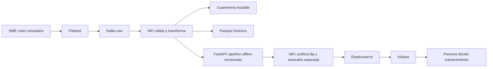

# CG30 justificación de IA, ML y arquitectura

Alcance vigente desde el 20/10/2026: [clasificación contemporánea AI4I](CG17_CURRENT_STATE_SCOPE.md),
cinco sensores y `machine_type`; ETA/RUL/forecast y datasets temporales quedan
como investigación histórica fuera de la entrega. Las métricas siguientes son de
desarrollo; no prueban evaluación final independiente ni aceptación del equipo.

La tarea es IA estrecha: aproxima la etiqueta contemporánea de un dataset
sintético. No tiene razonamiento general, objetivos propios ni autonomía para
controlar maquinaria. Las reglas deterministas validan unidades/formatos y
clasifican alertas; ML aproxima relaciones no lineales entre sensores y etiqueta.
Una regla física permite explicación directa pero exige fijar condiciones;
ML aprende patrones y puede fallar ante cambio de régimen o fuera de distribución.

| Familia | Datos necesarios | Ventaja en CNC | Límite y elección |
|---|---|---|---|
| RF supervisado | Sensores + etiqueta contemporánea | Interacciones no lineales, poca preparación, ablación física | No horizonte temporal por sí solo; elegido por AP OOF |
| Gradient Boosting | Sensores + etiqueta contemporánea | Ajuste secuencial de errores, candidato tabular | Ejecutado en la comparación de desarrollo; no promovido a la API |
| IF no supervisado | Referencia normal defendible | Canal de rareza independiente | Rareza ≠ avería; 1/41 fallos detectados en validación con presupuesto ~1% |
| Autoencoder | Muchos ejemplos de referencia, validación de reconstrucción | Representación no lineal y secuencias si se diseñan | Reconstruye anomalías también, escala/tuning y coste; no implementado |
| Logística / siempre 0 | Mismos splits y etiquetas | Referencias interpretables y trampa de accuracy visible | Frontera lineal / recall nulo del dummy |

La comparación inicialmente conceptual fue ampliada en PR39 con código y
[resultados versionados](CG08_alternatives.json): 19 configuraciones individuales
y dos mezclas. [Diseño, métricas y límites](CG08_ALTERNATIVAS.md): GradientBoosting
depth3 AP OOF 0,913894 frente a RF 0,908965; en nested 3×3, AP outer 0,909436
frente a 0,905673. En ese punto F2, GradientBoosting detecta 160/190 fallos y RF
164/190, con 8 y 25 falsas alarmas respectivamente. Son procedimientos de
desarrollo distintos del umbral histórico ajustado en validación; no deben
mezclarse sus recuentos. La API conserva RF+IF y no carga estos challengers.

Python se elige por pandas/sklearn y coherencia de pipelines con inferencia,
no por ser siempre el más rápido. uv.lock fija el entorno; funciones compartidas
evitan repetir fórmulas en notebook/API. RF no necesita escalar; la escala común
facilita logística y no añade información al RF. Joblib conserva el Pipeline,
pero solo debe cargarse desde procedencia propia: un hash sin raíz confiable
no neutraliza ejecución arbitraria en pickle. FastAPI es la interfaz implementada y comprobada en laboratorio con NiFi;
CG28/CG22 documentan respuestas HTTP y recuperación, sin garantía de producción.

Desbalance: 271/8000 fallos. class_weight modifica el coste de ajuste, no crea
ejemplos; SMOTE sintetiza vecinos y, si se usa, debe estar dentro del train de
cada fold. Se ejecutó SMOTENC dentro de los mismos folds: AP OOF 0,8929 frente a
0,9090 del RF elegido. Se conserva RF sin sobremuestreo; CG08_smotenc.json
registra también el aumento de falsos positivos en validación.
Las features físicas mejoraron AP en la búsqueda; no establecen causalidad.
La selección y threshold tuning optimizan desarrollo; la falta de test nuevo
impide certificar generalización final. Ver CG08/10 y sus JSON, no copiar números
como si fueran garantías. 78,05% recall agregado oculta H=1/2: pocos positivos
impiden conclusiones sólidas por régimen.

## Flujo y autonomía

El camino SMB→Filebeat→Kafka→NiFi→API→ES→Kibana se ejecutó en laboratorio el 19/10,
antes del contrato v4. La corrección de alcance del 20/10 no repitió el E2E
streaming (`streaming_e2e_rerun=false` en su JSON); aquellos contadores no validan
la integración v4. La base reconciliada incorpora la corrección F1 de PR51; el [contrato y plan de migración](ES_V4_CONTRACT_MIGRATION.md) no acredita migración del servicio compartido ni repite aquel E2E.
Parquet se conserva por herramienta explícita separada; NiFi no escribe Parquet
automáticamente. CG22_live_recovery.json y el índice final delimitan el ensayo.
Offline se entrenan/seleccionan modelos; online se infiere con versión fija, no
se aprende automáticamente de cada alerta. El bucle está abierto respecto a
actuación física: informar no equivale a parar una CNC. Un bucle de control cerrado
exigiría sensores/actuadores, seguridad, plazos y validación distinta. La supervisión
humana conserva la decisión; no enviamos comandos a dispositivos.

## Fuentes docentes examinadas

- ENUNTZIATUA.md: § entrenamiento RF, evaluación económica y fase3 API.
- Rúbrica exacta docs/rubrica/fuente.json: G5/G10/G23/G24/G31/G32/G52.
- Corpus del curso `03_ML_5072/materialak/5072_2_06_Random_Forest.pdf`, páginas
  numeradas 1–3: ensemble supervisado, bagging/bootstrap, sin necesidad de escala.
- `03_ML_5072/materialak/5072_3_Balidazio_Metodologia.pdf`: validación y separación
  train/test; se examinó extracción textual local para contrastar metodología.
- `03_ML_5072/materialak/Sailkapen_Ebaluazio-metrikak.md`: precisión, recall y
  coste de omitir fallos en mantenimiento predictivo.

Decisiones del equipo confirmadas por usuario: AI4I como training, clasificación
actual aceptada por tutor. Elecciones técnicas de esta implementación: AP para
seleccionar candidato, F2 exploratorio e IF cuantíl .99. La investigación
estacional separada incluye un modelo sintético experimental, documentado en
[CG11 histórico](CG11_ESTACIONAL_V2.md), fuera del modelo/API de entrega.
No se atribuyen esas elecciones al tutor.

Pendiente: cada miembro debe explicar con sus palabras entrada/salida/errores,
revisar el argumento y fechar su conclusión. Ninguna evidencia humana se inventa.

## Versiones y decisiones incorporadas

Reconciliación documental del 22/10/2026, base PR42 `f770932d61ff55158bb18c9d89120617e8c5db65`. Versiones leídas en `pyproject.toml`/`uv.lock` y resultados atribuidos a los informes; no investigación nueva, entrenamiento ni test final.

| Decisión | Versión/fuente | Justificación y límite |
|---|---|---|
| RF/IF | scikit-learn1.5.0, joblib1.5.3; [PR67](WINDOWS_PORTABILITY_20261022.md) | Estado contemporáneo/rareza; split5600/1200/1200. TP32/FN9/FP9/TN1150 reutilizado para desarrollo, no test final independiente. Pickle exige origen propio y entorno compatible. |
| API/columnar | FastAPI0.133.0, Starlette1.7.0, PyArrow23.0.1, DuckDB2.0.0; [PR66](../DUCKDB_2_MIGRATION.md) | Contratos UTC/ns/NULL; Parquet anterior18/23 conserva bytes. No regenerar hashes ante corrupción. |
| Portabilidad | [Autor PR67](WINDOWS_PORTABILITY_20261022.md), Windows/Fedora44, Python3.11/3.12 | 303 tests estrictos x2 y pytest558+250 subtests por entorno, capas solapadas. Windows ofrece recuperación de proceso, sin promesa ante corte eléctrico. Los fallos POSIX/WMIC anteriores se conservan históricos. |
| Transporte | kafka-python3.0.11+cncguard.1; [corrección PR64](KAFKA311_WARNING_FIX_20261021.md) | Los 218 avisos3.11 históricos fueron corregidos; no se atribuye a esta base el wheel .2 ni el ensayo NiFi de PR68 aún abierta. ACK solo tras persistencia verificable. |
| Replay | [Contrato canónico](../SCORING_REPLAY_CONTRACT.md) | SQLite FULL antes de200; mismo payload devuelve mismo scored_at/bytes, otro payload válido con mismo ID da409; inválido422; bundle ausente503. No migración de respuestas antiguas ni garantía entre réplicas independientes. |
| Panel y fuentes | [Autor PR69](ISOLATED_RUNTIME_20261022.md), [DOM/ARIA](CG19_SVG_ARIA_20261022.md) | Kibana real/ES sintético y SMB/Filebeat/registry→Kafka cuatro mensajes. No prueba de carga/SLA. Zoom nativo/NVDA audible, decisión de operador y defensa humana pendientes. |

La distribución WSL se llama `FedoraLinux-43`; los informes identifican Fedora44. La [memoria](../memoria/README.md#resultados-incorporados) y [matriz de bloqueos](../rubrica/ESTADO_20261022.md) mantienen separación de ensayos del autor, comprobaciones propias, CI, integración y aceptación humana. Cada integrante debe registrar su explicación y fecha; una atribución del usuario al tutor no equivale a acta firmada.
