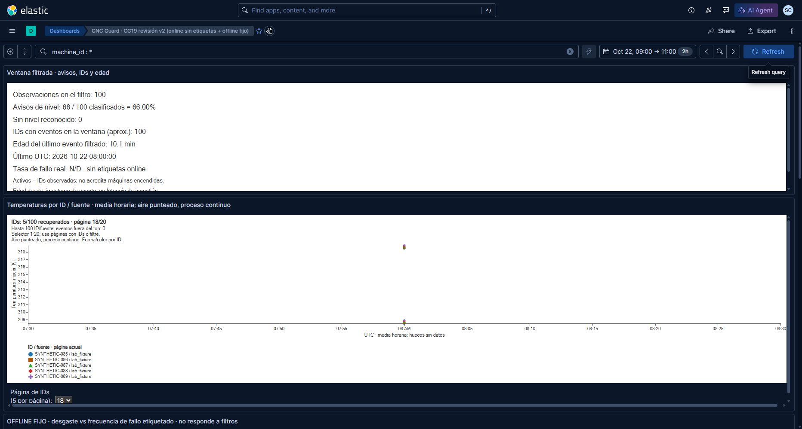
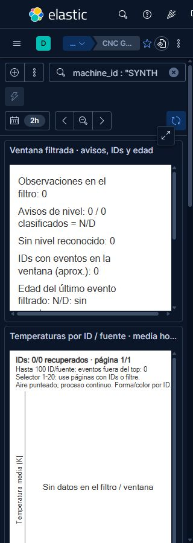

# ES, Kibana y SMB/Filebeat: ensayo aislado del 22-10-2026

Base verificada: `8caf98962175fabcf13fbc1584dc890cf4f0135f`, árbol
`82a69eba2754045619a2c2d218473605183bb9c3` (PR42). Este cambio corrige
contraste, exposición ARIA y reflow del KPI encontrados en **Kibana real**.
La evidencia acredita el laboratorio descrito; la revisión padre y la
aceptación humana siguen pendientes. No se ha modificado infraestructura compartida.

## Entorno, procedencia y aislamiento

WSL `FedoraLinux-43` informa **Fedora Linux 44**, Docker Engine29.9.2.
ES/Kibana9.5.4, Filebeat9.5.4 nativo Windows, Samba4.23.8-r0 desde el paquete
oficial de Alpine3.24 y Apache Kafka3.7.2. Se reutilizaron ES, Alpine y Kafka;
se descargaron Kibana/Filebeat oficiales. Los tamaños sin comprimir y digests
están en [image-provenance.json](ISOLATED_RUNTIME_20261022/image-provenance.json).
El ZIP Windows de Filebeat ocupa54.993.394 bytes y su SHA512 coincide con el
publicado por Elastic: [procedencia](ISOLATED_RUNTIME_20261022/filebeat-windows-origin.json).
Todo quedó en D: o en el almacenamiento WSL existente; no se movieron datos.

Propietario: `t2.lab.owner=t2-cg19-20261022-8caf989-6da1`. Red, cuatro
contenedores y cuatro volúmenes propios. Puertos publicados exclusivamente en
`127.0.0.1`: ES19242, Kibana15642, Samba14442 y Kafka19042. ES/Kibana usaron
autenticación local; el navegador empleó un usuario sintético `viewer`.
La conexión SMB propia solicitó firma y cifrado mediante `New-SmbMapping`,
con puerto14442 y letraW: previamente libre. `Get-SmbConnection` fue denegado
por Windows: no se afirma haber leído su negociación. No se relajó la política
del cliente. Las operaciones de lectura/escritura SMB sí se ejecutaron.

La red `--internal` inicial no activó los puertos publicados en este motor.
Se sustituyó únicamente esa red propia por un bridge propio, manteniendo
autenticación y bindings loopback. Las llamadas WSL directas con muchos argumentos
fallaron con `WSAETIMEDOUT`/4294967295; la invocación explícita de `/bin/sh -c`,
con argumentos escapados, funcionó. No se reinició WSL ni ningún motor ajeno.

## Kibana y Discover reales

Se cargaron100 documentos/IDs sintéticos en el ES propio, sin modelos ni
inferencia. El índice SMB de la vista se dejó vacío; `source.kind=lab_fixture`
identifica los documentos online. Los valores offline del artefacto existente
se reutilizan sin recalcularlos ni evaluar el test final.

- Importación: siete objetos, `success=true`, sin errores ni warnings.
  Exportación/readback: siete identidades únicas, referencias resueltas y specs
  visuales iguales a la fuente final. [Importación](ISOLATED_RUNTIME_20261022/saved-objects-fixed-import.json),
  [readback y hashes](ISOLATED_RUNTIME_20261022/final-readback.json).
- Dashboard: filtros KQL0/1/31/100, estado vacío explícito, conteos/KPI y tabla
  responden. El heatmap **OFFLINE FIJO** conserva sus valores al filtrar.
  Se recorrieron las20 páginas de temperatura:100 identidades únicas alcanzables,
  cinco en la última página, sin omisiones en esta fixture.
  [Cobertura por página](ISOLATED_RUNTIME_20261022/live-ui-page-coverage.json).
- Discover independiente: búsqueda migrada, ocho columnas, dos campos de orden,
  `timestamp DESC,event_id ASC`, límite de muestra50. El total100 se distingue
  de la muestra50. Se observaron31,1 y el estado sin resultados; cambiar a la
  ventana temporal anterior dio vacío y volver restauró100. La tabla virtualiza
  filas: no se presenta el número de nodos DOM como número total de documentos.
  [100](ISOLATED_RUNTIME_20261022/discover-100.txt),
  [31](ISOLATED_RUNTIME_20261022/discover-31.txt),
  [1](ISOLATED_RUNTIME_20261022/discover-1.txt),
  [0](ISOLATED_RUNTIME_20261022/discover-0.txt),
  [ventana anterior](ISOLATED_RUNTIME_20261022/discover-time-empty.txt).
- Los timestamps son UTC; la cabecera del navegador muestra UTC+02.
  La fixture08:00Z era futura al inicio y el KPI lo señaló; después indicó edad.

T3 preview abrió la página, pero dos snapshots fallaron con
`Preview automation snapshot timed out after 15000ms.` Se utilizó entonces
Chrome mediante computer-use, en una pestaña propia posteriormente cerrada.
Las capturas siguientes son de Kibana real, no del renderer offline:

## Defectos corregidos y accesibilidad comprobada

El tema oscuro de Kibana dejaba el KPI oscuro sobre fondo transparente, y
aplicaba colores claros de ejes/títulos sobre el fondo blanco de temperatura.
Ahora cada spec pinta fondo blanco y colores explícitos de texto/ejes/leyenda.
El rendererSVG expone las descripciones de los puntos y del heatmap; sus textos
incluyen fuente, sensor, UTC, kelvin o denominador offline según corresponda.

A320px el KPI original recortaba prosa horizontalmente. Ahora envuelve el texto,
conserva la descripción completa para ARIA y ajusta su altura para desplazarse
verticalmente dentro del panel. Los nueve textos se midieron en el navegador:
ninguno excedió la anchura del SVG278px. [Medidas reales](ISOLATED_RUNTIME_20261022/reflow-summary-320-bounds.json).
La regresión offline comprueba envoltura sin pérdida a250/600/1100px; no usa la
métrica tipográfica aproximada de Node como prueba de límites del navegador.

Se usó teclado para llegar a la página20 y salir conTab, manteniendo un foco
en un control nativo. El árbol nativo de accesibilidad de Chrome expone los
gráficos como `graphics-symbol`, `ignored=false`, con nombres completos:
[extracto](ISOLATED_RUNTIME_20261022/native-ax-graphics.json).
Se probaron viewports640 y320px. El atajo de zoom nativo no cambió DPR/anchura;
[probe](ISOLATED_RUNTIME_20261022/native-zoom-probe.json). **No se declara zoom
nativo verificado**, lectura audible con NVDA ni conformidad WCAG global.
Los gráficos bidimensionales y la tabla conservan su desplazamiento propio.

## Migración ES y rollback

En un índice de ensayo creado con el mapping anterior, un documento con los
tres campos v4 obtuvo400/`strict_dynamic_mapping_exception`. Instalar el
template nuevo no alteró ese índice. Se comprobaron dos procedimientos:

1. Crear destino con el template actual y `_reindex` con `op_type=create`.
   ConservarID, verificar documento, replay del mismoID y cuenta1. Un campo
   desconocido siguió obteniendo400. Cambiar alias al destino y volver al origen
   restauró el documento original con las escrituras detenidas.
2. Añadir exclusivamente `prediction_scope`, `temporal_prediction_enabled` y
   `score_semantics` mediante `PUT /<indice>/_mapping`. El documento anterior
   quedó igual, el replay del nuevoID no aumentó la cuenta y el campo desconocido
   siguió rechazado. Los mappings añadidos no se pueden quitar como rollback;
   para ello se conserva el origen y se usa el procedimiento reindex/alias.

[Reindex/replay/alias](ISOLATED_RUNTIME_20261022/migration-results.json),
[adición in-place](ISOLATED_RUNTIME_20261022/additive-mapping-results.json).
Se probaron documentos sintéticos: no es una migración del servicio compartido,
reprocesado de respuestas reales ni ejecución NiFi.

## SMB, Filebeat, registry y Kafka propios

Samba autenticado sirvió ficheros reales mediante el cliente SMB Windows.
Filebeat9.5.4 mantuvo los IDs, fingerprint offset164/length64, exclusión de
cabecera y opciones `clean_removed=false` de la configuración del proyecto.
Se cambió únicamente la ruta al share propio y, en la primera fase, la salida
a un fichero de evidencia. No es un emulador de registry.

Se ensayaron: fichero pequeño, fichero válido de216B, cabecera sola, última
línea parcial completada, rename, append, caída/reinicio de Samba y reinicio
abrupto de Filebeat con su registry propio. El primer corte de lectura fue
prematuro: había dos mensajes pendientes; once segundos adicionales tras
reanudar dieron cuatro mensajes esperados, cuatro claves, cero ausentes,
cero inesperados y cero duplicados. Se conserva esa diferencia en la evidencia.
El aviso del scanner sobre228B no impidió recibir216B: `growing` es verdadero
por defecto en9.5 y el registry registró `fingerprint_len=52`.
[Conciliación](ISOLATED_RUNTIME_20261022/smb-recovery-results.json).

Después se arrancó **otro broker propio**, independiente del agente Kafka/NiFi.
Con registry nuevo se activó `output.kafka`, `required_acks=-1`, codec de
mensaje raw y clave SHA256 del procesador más byte-offset. Un consumidor real
del topic propio recuperó los cuatro pares clave/mensaje exactos, tanto antes
como después de otra caída SMB y reinicio de Filebeat con el mismo registry.
La cabecera no se publicó. [Resultado Kafka](ISOLATED_RUNTIME_20261022/smb-kafka-results.json).
No se acredita tolerancia a pérdida del broker, carga sostenida, ACK del
productor original, NiFi compartido ni exactly-once distribuido.

## Validación y preservación

- Ruff0.17.1: selector `E,F,I,PLW1510` y format en los dos Python modificados,
  generador `--check` y `git diff --check`: exit0.
- Windows y Fedora, Python3.11/3.12: discoveryCG19 ejecutó20 casos por entorno,
  17 correctos y3 skips ES optativos, con `ResourceWarning` elevado a error.
  Los skips no sustituyen el ensayo ES real descrito arriba.
- Vega5.33.0 offline:12 combinaciones temperatura y87 páginas, más tres
  anchuras de KPI, sin warnings. [Matriz](ISOLATED_RUNTIME_20261022/offline-vega-report.json).
- CG02, CG25 (40 criterios,79 enlaces,55 hashes actuales/18 históricos), layout
  y lock offline: exit0. Los primeros CG25/layout fallaron por ownership Git al
  ejecutarlos como root; se corrigió el usuario de ejecución, sin excepción
  global ni cambio de gates. [Primera matriz](ISOLATED_RUNTIME_20261022/validation-results.json),
  [repetición corregida](ISOLATED_RUNTIME_20261022/followup-validation.json).
  No cambiaron workflows; actionlint no era aplicable. No se ejecutó suite global,
  entrenamiento, modelos de entrega ni test final.

Comandos de producto: `python -m scripts.create_lab_dashboard --check`,
`python -W error::ResourceWarning -m unittest discover -s tests -p 'test_lab_dashboard*.py' -v`,
`node tests/test_lab_dashboard_render.cjs` con el runtimeVega existente,
`python -m scripts.audit_cg02 --check`, `python -m scripts.check_cg25_memory`,
`python scripts/check_repository_layout.py`, `uv lock --check --offline`.
Los argumentos exactos y códigos están en las matrices enlazadas.

Se retiraron solo cuatro contenedores propios, su red y el mappingW: propio.
No quedan listeners ni procesos Filebeat propios. Se conservaron los cuatro
volúmenes propios con datos, imágenes, binarios y evidencia local. Todos los
IDs iniciales de85 contenedores,7 redes y55 volúmenes siguen presentes.
Otros agentes crearon recursos durante el ensayo; no se tocaron.
[Inventario comparado](ISOLATED_RUNTIME_20261022/cleanup-results.json).
Los inventarios ajenos completos y credenciales sintéticas permanecen fuera
del repositorio. Los textos publicados normalizan finales de línea aLF; se
conservan los originales locales. [SHA256 de los artefactos publicados](ISOLATED_RUNTIME_20261022/sha256.json).

Referencias oficiales: [Kibana/Vega y rendererSVG](https://www.elastic.co/docs/explore-analyze/visualize/custom-visualizations-with-vega),
[identidad filestream](https://www.elastic.co/docs/reference/beats/filebeat/file-identity),
[reindex](https://www.elastic.co/docs/reference/elasticsearch/rest-apis/reindex-indices).
