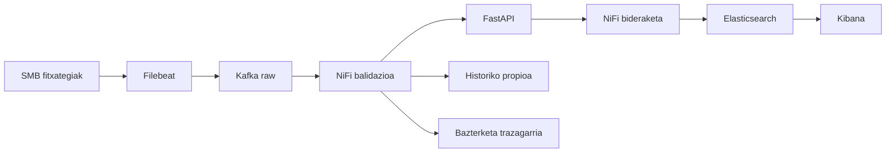

# CG14 NiFi balidazio eta API fluxua

## Helburua

CSV gordina hartu, balioztatu eta inferentzia-zerbitzuarekin lotu.

## Errubrikarekiko lotura

`Zereginak!G41`, `Zereginak!G46`, `Zereginak!G90`, `Zereginak!G92`, `Zereginak!G95`, `Zereginak!G101`. Ikusi [jatorrizko deskribatzaileak](../rubrica/fuente.json) eta [maila aurreratuko matrizea](../rubrica/OBJETIVOS_Y_ETAPAS.md). Irizpide bat lantzeak ez du esan nahi dagoeneko beteta dagoenik.

## Plangintza

- Hasiera: 2026-10-22.
- Amaiera aurreikusia: 2026-10-23.
- Eginkizuna: Integrazioa.
- Lehentasuna: Arrunta.
- Ahalegin-estimazioa: 5 pertsona-egun.
- Mugarria: 2. mugarria · Integrazio berreskuragarria eta panela.

Datak 2026-10-16tik 2026-11-06ra eskatutako lan-leihoaren helburuak dira; ez dira exekuzioaren froga. Jatorrizko ahalegin-estimazioa mantentzen da, berrikusteko. Arduradunak issuearen Assignees eremuan daude. Azaroaren 6ko entrega helburua gaitasunaren eta mendekotasunen berrikuspenaren mende dago.

## Mendekotasunak

[CG05 / #5](https://github.com/AABD-Ethazi-2627/T2-erronka1/issues/5), [CG13 / #13](https://github.com/AABD-Ethazi-2627/T2-erronka1/issues/13), [CG29 / #36](https://github.com/AABD-Ethazi-2627/T2-erronka1/issues/36)

## Pausoz pauso

1. ConsumeKafka instalatutako bertsioarekin.
2. CSVReader/ConvertRecord/JsonRecordSetWriter eta eskema.
3. ValidateRecord edo baliokidearekin eremuak eta motak.
4. InvokeHTTP CG28ko /predict-era.
5. RouteOnAttribute edo baliokidea arrisku/erroreren arabera.
6. Telemetria eta alertak ESra, historikoa CG15era.

## Adibidea edo eskema

Adibide didaktikoa da, ez inplementazio edo proba gainditu baten froga. Kontratuarekin eta instalatutako bertsioekin egokitu. Ez gehitu dependentzia berririk adibidea dagoelako soilik.

## Onarpen irizpideak

- [ ] Fluxu JSON esportatua eta processor bertsioak.
- [ ] 2xx,422,5xx eta timeout ibilbideak frogatu.
- [ ] 422 bazterketa eta 5xx retry mugatuak.
- [ ] Kontagailuak eta provenance, sekreturik gabe.
- [ ] Artefaktuak eta bertsioa, komandoak/prozedura, benetako emaitzak eta mugak lotu.
- [ ] Beste kide batek ebidentzia berrikusi eta ondorioa/data jaso. Ez markatu Eginda diseinu bat edo PR bat izateagatik bakarrik.

## Entrega eta berrikuspena

PRan adierazi: **irizpidea → artefaktua/commit → komandoa → emaitza → muga → berrikuslea**. Eguneratu [errubrikaren jarraipena](../rubrica/SEGUIMIENTO.md). CI mergea prestatzeko unean bakarrik, erabiltzailearen jarraibidearen arabera.

## Ikasteko eta mugak ulertzeko

Kideak bere hitzekin azaldu behar du zer sartzen den, zer ateratzen den eta errore bat gertatzean zer egiten den. Laborategiko datuak simulatuak dira. Ez asmatu 24h aurreikuspena, CNC fisikoaren kontrola, sinadurak, lege-betetze ziurtatua edo industria-aurrezki erreala.

## Iturriak

- `ENUNTZIATUA.md` eta ikastaroko materialak; errubrika espezifikoaren deskribatzaileak lehenetsi.
- Rúbrica: `Erronka1_ikaslearen_errubrika.xlsx`, `Zereginak`, G zutabea; [hash eta testu zehatzak](../rubrica/fuente.json).
- [Lan-egutegia eta gaitasun arriskua](../planificacion/README.md).
