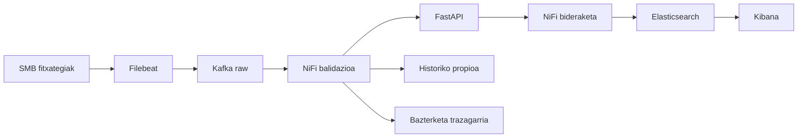

# CG30 IA ML eta diseinu aukeren justifikazioa

## Helburua

Kodeaz gain, zergatik aukeratu dugun ulertzea eta azaltzea.

## Errubrikarekiko lotura

`Zereginak!G5`, `Zereginak!G10`, `Zereginak!G23`, `Zereginak!G24`, `Zereginak!G31`, `Zereginak!G32`, `Zereginak!G52`. Ikusi [jatorrizko deskribatzaileak](../rubrica/fuente.json) eta [maila aurreratuko matrizea](../rubrica/OBJETIVOS_Y_ETAPAS.md). Irizpide bat lantzeak ez du esan nahi dagoeneko beteta dagoenik.

## Plangintza

- Hasiera: 2026-10-19.
- Amaiera aurreikusia: 2026-10-26.
- Ahalegin-estimazioa: 1.5 pertsona-egun (berrikusteko).
- Arduraduna: tears-mysthrala, Angiecrizu.

Datak helburuak dira, ez gaitasunaren edo exekuzioaren froga. Azaroaren 6ko entrega helburua mantentzen da; benetako ahalegina berrikusi.

## Mendekotasunak

[CG01 / #1](https://github.com/AABD-Ethazi-2627/T2-erronka1/issues/1)

## Pausoz pauso

1. IA ahula/AGI eta arauak/ML alderatu CNC kasuan.
2. Supervised/unsupervised datu-beharrak.
3. RF/Gradient Boosting eta IF/Autoencoder abantailak eta mugak alderatu.
4. Python, serializazioa, FastAPI eta desoreka tratamendua justifikatu.
5. Offline/online eta autonomia mailak azaldu.

## Adibidea edo eskema

Adibide didaktikoa da, ez inplementazio edo proba gainditu baten froga. Kontratuarekin eta instalatutako bertsioekin egokitu. Ez gehitu dependentzia berririk adibidea dagoelako soilik.

## Onarpen irizpideak

- [ ] Konparazio-taula eta arkitektura-diagrama.
- [ ] Beste modeloak alderatzeak ez du denak inplementatzea eskatzen.
- [ ] Ikastaroko iturri zehatzak eta taldearen erabakiak.
- [ ] Kide bakoitzak bere hitzekin azal dezala.
- [ ] Artefaktuak eta bertsioa, komandoak/prozedura, benetako emaitzak eta mugak lotu.
- [ ] Beste kide batek ebidentzia berrikusi eta ondorioa/data jaso. Ez markatu Eginda diseinu bat edo PR bat izateagatik bakarrik.

## Entrega eta berrikuspena

PRan adierazi: **irizpidea → artefaktua/commit → komandoa → emaitza → muga → berrikuslea**. Eguneratu [errubrikaren jarraipena](../rubrica/SEGUIMIENTO.md). CI mergea prestatzeko unean bakarrik, erabiltzailearen jarraibidearen arabera.

## Ikasteko eta mugak ulertzeko

Kideak bere hitzekin azaldu behar du zer sartzen den, zer ateratzen den eta errore bat gertatzean zer egiten den. Laborategiko datuak simulatuak dira. Ez asmatu 24h aurreikuspena, CNC fisikoaren kontrola, sinadurak, lege-betetze ziurtatua edo industria-aurrezki erreala.

## Iturriak

- `ENUNTZIATUA.md` eta ikastaroko materialak; errubrika espezifikoaren deskribatzaileak lehenetsi.
- Rúbrica: `Erronka1_ikaslearen_errubrika.xlsx`, `Zereginak`, G zutabea; [hash eta testu zehatzak](../rubrica/fuente.json).
- [Lan-egutegia eta gaitasun arriskua](../planificacion/README.md).
