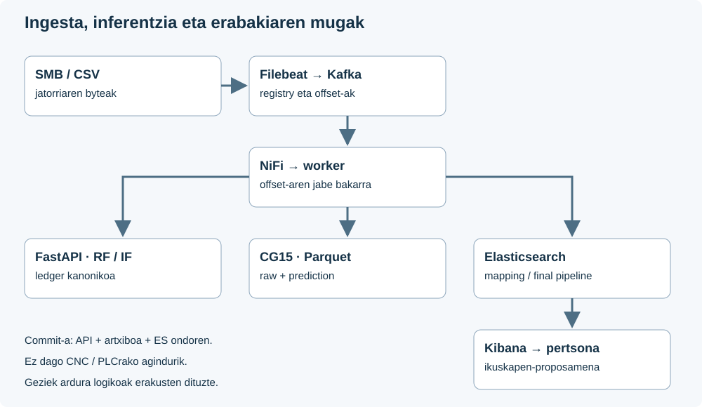
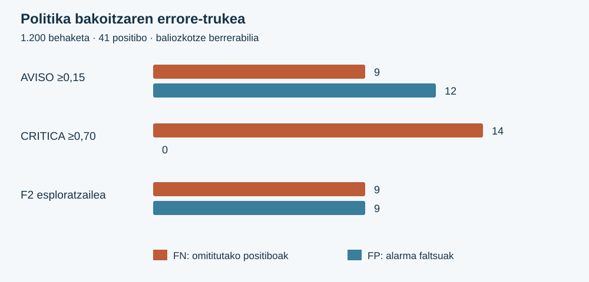

# CNC Guard: memoria teknikoa eta errubrikaren justifikazioa

**B taldea · Proiektuaren amaierarako dokumentazio teknikoa · 2026-11-05**

**Dokumentuaren egoera:** berrikuspen teknikorako prestatua. Taldeak edukia, terminologia eta benetako ekarpenen esleipena berrikusi behar ditu entregatu aurretik. Agiri honek ez du sinadurarik, ahozko defentsarik edo irakaslearen onarpenik ordezkatzen.

**Aztertutako kode-oinarria:** `c34cabe0c851ba4b7688e1a3a4448d9898002f1e`; Git zuhaitza: `ff380a45bbb2dc358e95f7c156ab137f0e5ff2de`. Tokiko checkout-a aztertu da; urruneko adarrak eta uneko CI egoera ez dira kontsultatu. `exports/` eta `prototypes/` aurretik zeuden eta Git-en jarraipenetik kanpo daude. Azaroaren 4ko ikerketa osagarriak tokiko artefaktu gisa identifikatzen dira.

**Irakurketa-gakoa:** «inplementatua» kodean dagoena da; «historikoki probatua» datatutako txosten batek jasotakoa; «dokumentu honetan egiaztatua» amaierako egiaztapen-agiriak benetan frogatutakoa. «Giza baliozkotzea» taldearen edo irakaslearen ekintza erreala da. Maila horiek ez dira baliokideak.

## Aurkibidea

1. Helburua, irismena eta ekarpena.
2. Ebidentziaren metodoa eta errubrikaren interpretazioa.
3. Arkitektura eta teknologiak hautatzeko arrazoiak.
4. Datuen jatorria, kalitatea eta historikoa.
5. Ezaugarriak, partizioak eta datu-ihesaren prebentzioa.
6. Ereduak, esperimentazioa eta hautaketa.
7. Ebaluazio estatistikoa eta emaitzen interpretazioa.
8. Kostuak, atalaseak eta mantentze-erabakia.
9. APIa, kontratuak eta inferentzia errepikagarria.
10. Ingesta automatikoa, iraunkortasuna eta berreskuratzea.
11. Elasticsearch, Kibana eta BI.
12. Karga, latentzia eta eskalagarritasuna.
13. Segurtasuna, pribatutasuna eta erantzukizuna.
14. Erreproduzigarritasuna, ingurunea eta kalitate-kontrola.
15. Errubrikaren 40 irizpideen justifikazio xehea.
16. Itxiera, mugak eta defentsa prestatzeko gida.
17. Glosarioa eta iturri nagusiak.

# 1. Helburua, irismena eta ekarpena

CNC Guard-ek telemetria tabularra jasotzeko, baliozkotzeko, sailkatzeko, gordetzeko eta erakusteko laborategiko sistema eraikitzen du. Erabiltzaileari sentsoreen neurketak eta ereduaren irteera batera aurkezten dizkio, ikuskapen-proposamen bat arrazoitu ahal izateko. Proiektuaren ekarpena kate osoaren koherentzia da: datu baten jatorria ezagutzea, inferentziaren bertsioa identifikatzea, birsaiakeretan emaitza kontserbatzea eta aginte-koadroko informazioaren esanahia azaltzea.

Izen historikoak «mantentze prediktiboa» aipatzen badu ere, gauzatutako ML atazak **uneko egoeraren sailkapena** egiten du. Emandako AI4I datu sintetikoek une bereko sentsoreak eta `machine_failure` etiketa dituzte. Ez dute makina fisiko beraren denborazko jarraipen fidagarririk, etorkizuneko hutsegite-datarik edo esposizio-denborarik eskaintzen. Hortaz, ereduak ezin du 24 orduren barruko averia, ETA, RUL edo bizitza erabilgarria frogatu. `failure_score` ez da etorkizuneko hutsegite-probabilitate kalibratua.

Muga hori softwarean ere loteslea da: [scoring/scope.py](../../scoring/scope.py) fitxategiak `AI4I_CURRENT_STATE_ONLY`, `temporal_prediction_enabled=false`, sei sarrera onartuak eta entrenamendu-iturriaren SHA-256 finkatzen ditu. Manifestu okerra duen bundle-a baztertzen da. Honela, azalpen akademikoak eta APIaren kontratuak esanahi bera dute.

Sistema IA estuaren adibidea da. Ereduak ataza mugatu bat ebazten du; ez du arrazoiketa orokorrik, helburu propiorik edo industria-prozesua kontrolatzeko baimenik. Offline ikaskuntzak parametroak doitzen ditu; online inferentziak parametro finkoak aplikatzen ditu. Alerta bat jasotzeak ez du eredua automatikoki berrentrenatzen. Erabakiaren azken urratsa pertsona batek egiten du; ez dago CNC, PLC edo aktuadore fisikoetara agindurik.

**Oinarria:** [enuntziatua](../../ENUNTZIATUA.md), [irismen aktiboa](../evidence/CG17_CURRENT_STATE_SCOPE.md), [justifikazio kontzeptuala](../evidence/CG30.md). Azken txostena historikoa da: autoencoderra ezarrita ez dagoela dioen pasartea CG34 ikerketak gainditu du; dokumentu honek bertsio horiek bereizten ditu.

# 2. Ebidentziaren metodoa eta errubrikaren interpretazioa

Erreferentzia [fuente.json](../rubrica/fuente.json) da: `Erronka1_ikaslearen_errubrika.xlsx` kopia lokaletik ateratako `Zereginak` orriko **40 deskribatzaile**, G zutabeko maila aurreratua. Jatorrizko Excelaren SHA-256 hau da: `e3e05d6fe408e163f6f8247cd7054f2a4ce4de6aa5757048ba432cd682139463`. Ez da online bertsioa berriro egiaztatu. Irizpideen testua 15. kapituluan hitzez hitz mantentzen da, akats tipografikoak barne.

Ez da notarik kalkulatzen. Pisu batzuek formatu anbiguoa dute (`15%%`), beste batzuk zenbakizkoak dira eta beste batzuk hutsik daude. Modulu arteko pisuak batzeak edo falta direnak asmatzeak zehaztasun faltsua emango luke. [Helburuen interpretazioa](../rubrica/OBJETIVOS_Y_ETAPAS.md) eta [A01–A07 argibideak](../rubrica/ACLARACIONES_20261023.md) erabiltzen dira zalantzak agerian uzteko.

Ebidentzia-katea honela osatzen da: **eskakizuna → erabaki teknikoa → kodea edo konfigurazioa → proba edo neurketa → interpretazioa → muga**. Kodeak zer egin dezakeen azaltzen du; exekuzio-erregistroak, berriz, noiz eta zein bertsio/datuekin egin den. Test automatikoak kontratu bat egiazta dezake, baina ez du berez taldeko kide baten ulermena frogatzen. PM onarpen dokumentatua ez da irakaslearen kalifikazioa.

Bi iturri-multzo erabiltzen dira. Lehenengoa checkout-eko kode eta dokumentazio versionatua da, batez ere [2026-10-28ko matrizea](../rubrica/ESTADO_20261028.md) eta datatutako ebidentziak. Bigarrena [2026-11-04ko konparaketa lokala](../../exports/estudio-multimodelo-2026-11-04/COMPARATIVA.md) da. Bigarren multzoa ikerketa osagarria da eta ez du APIan zerbitzatutako eredua ordezkatzen. Iturrien hashak `ITURRIAK.json` fitxategian daude.

Matrize zahar batean «zain» agertzea ez da automatikoki uneko akatsa. Adibidez, CG32 karga-kanpaina geroago egin zen; hemen haren emaitza zehatza erabiltzen da, aurretiko zigilua aldatu gabe. Alderantziz, txosten berri batek ere ezin ditu atzeraeraginez sinadurak, bilerak edo entregak egiaztatu.

# 3. Arkitektura eta teknologiak hautatzeko arrazoiak



## 3.1. Osagaien erantzukizunak

| Osagaia | Erantzukizuna | Hautaketaren arrazoia eta muga |
|---|---|---|
| SMB irakurketa / tokiko spool-a | Sortutako CSV lotea kopiatu eta osotasuna kontrolatu | Jatorria irakurketa hutsez tratatzen da. Sareko eskuragarritasuna eta kopia osoa bereizten dira; SMB ez da NFS. |
| Filebeat | Fitxategi-lerroak irakurri eta Kafka-ra bidali | Registry iraunkorrak irakurketa-posizioa gordetzen du. Registry galtzeak replay-a eragin dezake. |
| Kafka | Ekoizlea eta kontsumitzailea desakoplatu | Buffer eta offset-ak eskaintzen ditu. ACK batek ez du inferentzia edo ES dokumentua frogatzen. |
| NiFi | Ziklo mugatuak programatu eta diagnostikoak gorde | Grafo automatikoak worker-a exekutatzen du. Ez da `ConsumeKafka`/`InvokeHTTP` natiboen exekuzio gisa aurkezten. |
| Worker iraunkorra | Baliozkotzea, proiekzioa, APIa, artxiboa eta ES koordinatu | Offset-aren jabe bakarra eta egoera iraunkorra ditu; transakzio banatu bakarra ez dago. |
| FastAPI + RF/IF | Kontratu zorrotzeko inferentzia | Ereduak abioan kargatzen dira; hutsegitean ez da emaitza ordezkorik asmatzen. |
| Parquet + DuckDB | Historikoa kontserbatu eta analisi tabularra egin | Zutabe-biltegiratzea eta SQL lokala. Ez da kluster banatu edo HA sistema. |
| Elasticsearch | Telemetria eta inferentzia indexatu | Mapping zorrotzak, identitate egonkorra eta pipeline finala. |
| Kibana | Bilaketa, agregazioak eta erabakirako aurkezpena | Filtroen, hutsuneen eta datu-adinaren esanahia esplizitua da. |

## 3.2. Python eta moduluen banaketa

Python hautatu da pandas, NumPy, scikit-learn, PyArrow eta FastAPI ekosistemak datu-prestaketa, modelizazioa eta zerbitzua hizkuntza berean lotzen dituelako. Java egokia izan daiteke NiFi osagai natiboetarako, eta JVM ekosistemak fluxu-operazioa errazten du; hala ere, Python-eko estimatzailea beste hizkuntza batean berridazteak koherentzia eta mantentze-kostua handituko lituzke. SQLek agregazioa adierazteko balio du, baina ez du HTTP kontratua edo entrenamendu osoa ordezkatzen.

Banaketak egiaztapena errazten du: `scoring/preparation.py` ezaugarriez arduratzen da; `scoring/scope.py` irismenaz; `scoring/score_api.py` HTTP interfazeaz; `scoring/response_ledger.py` erantzun kanonikoaz; `scripts/` direktorioak esperimentuak eta eragiketa-tresnak jasotzen ditu. Notebook-ak azalpen eta esploraziorako dira. APIak ez du eskaera bakoitzean entrenamendua exekutatzen. FastAPIren HTTP konkurrentzia erabiltzeak ez du RF inferentziaren CPU kostua desagerrarazten edo latentzia determinista bermatzen.

## 3.3. Aukeratutako automatizazioaren baliokidetasuna

[CG14 grafo automatikoak](../CG14_AUTOMATIC_GRAPH.md) NiFi 2.12 erabiltzen du `GenerateFlowFile → ExecuteStreamCommand` bidez worker-aren zikloa abiatzeko eta emaitzak gordetzeko. Kafka kontsumoa Python egokitzaileak egiten du. Horrela offset-aren jabetza eta artxibo/ES baldintzak puntu bakarrean bateratzen dira. Ordainetan, deploy-ak Python ingurune eta bide lokalen koherentzia behar du. PMren onarpena dokumentatuta egoteak ez du NFS edo InvokeHTTP literalaren balorazio akademikoa ebazten: A03 irekita dago.

# 4. Datuen jatorria, kalitatea eta historikoa

## 4.1. Bi jatorri bereizi

Entrenamendua emandako AI4I CSV murriztuarekin bakarrik egiten da: **8.000 errenkada**, SHA-256 `1cce2859f4833b63dbf0992868884e5deac6f79e4d74a245abbc484d34e396ce`. Fitxategiaren byteak eta eskema kontrolatzen dira, beste dataset bat isilean ordezka ez dadin. 271 etiketa positibo daude, %3,3875. «Beti negatiboa» iragartzen duen erreferentziak %96,6125 accuracy izango luke eta hutsegite positiboen recall-a zero: horregatik accuracy bakarrak ez du erabilgarritasuna azaltzen.

Operazioko sarrera SMB lote/snapshot simulatuak dira. Entrenamendu-iturriaren eta lote operatiboen identitatea ez da nahasten. `machine_id`, igorpen-data eta fitxategiaren izena trazabilitaterako baliagarriak dira, baina ez dute makina fisiko beraren bizitza-zikloa frogatzen. Fitxategi batek elkarren antzeko errenkadak edukitzeak ez du datu berrien independentzia estatistikoa bermatzen.

## 4.2. Kalitate-kontrolen eragina

Kateak UTF-8/CSV framing-a, derrigorrezko eremuak, datu motak, zenbaki finituak eta sentsore-barruti kontraktualak egiaztatzen ditu. Tenperaturak Kelvin positiboak dira; rpm, momentua eta tresnaren erabilera-minutuak ez-negatiboak. Data UTC erreala izan behar da. `NaN`, infinitua edo derrigorrezko sentsore hutsa ez dira «normaltasun» bihurtzen. Ikaskuntza-pipeline bateko imputazio konfiguratua eta API zorrotzeko sarrera-bazterketa bi erabilera desberdin dira.

Kopia laburra edo aldakorra onartzeak erregistro moztua sor lezake; formatua oker interpretatzeak unitate-aldaketa edo ezaugarri okerra; etiketa bat X-n sartzeak ebaluazio artifizialki ona. Horregatik egiaztapenak inferentziaren aurretik egiten dira, eta bazterketak jatorrizko edukiarekin lotuta kontserbatzen dira. Kopia atomikoak amaitu gabeko fitxategia kontsumitzea murrizten du; ez du berez sareko ekoizlearen aldaketa guztien aurkako edo elektrizitate-etenaren aurkako bermerik ematen.

## 4.3. Bronze, Silver eta Gold

[CG06](../evidence/CG06.md) historikoak hiru geruza ditu. **Bronze** geruzak jatorrizko byteak eta hashak gordetzen ditu; **Silver** geruzak normalizatutako errenkadak Parquet-en gordetzen ditu, igorpen-data UTCren arabera; **Gold** geruzak DuckDB bidezko agregazio deskriptiboak sortzen ditu. Jatorrizko artxiboa berriz prozesatzeak ez ditu errenkadak bikoiztu behar; hash berriko igorpen batek, ordea, bere jatorri propioa mantentzen du, balioak berdinak badira ere.

Hasierako txostenak lau iturri eta 40 errenkadako kasua jasotzen du; eguneratzeak SMBtik deskargatutako bi lote eta 20 errenkada bereizi jasotzen ditu. Eskala horiek historikoaren koherentzia probatzen dute, ez industria-bolumen handien etengabeko atzematea. Gold-en `groupby` egitea analisi deskriptiboa da. Makina bakoitzeko rolling leiho kausalak eraikitzeko identitate fisikoa, benetako denbora-ordena eta baliozkotze tenporala beharko lirateke; hemen ez dira asmatu.

# 5. Ezaugarriak, partizioak eta datu-ihesaren prebentzioa

## 5.1. Sarrera eta adierazpen fisikoa

| Sarrera | Unitatea / mota | Ekarpena eta interpretazio-muga |
|---|---|---|
| `air_temp_K` | K | Ingurune termikoaren egoera; ez da operadorearen datua. |
| `process_temp_K` | K | Prozesuaren tenperatura eta airearekiko aldea. |
| `rpm` | bira/min | Biraketa-erregimena; zero balio onartua da kontratuan. |
| `torque_Nm` | N·m | Momentu mekanikoa; rpm-rekin interakzioa izan dezake. |
| `tool_wear_min` | min | Datasetak emandako erabilera/desgaste kovariablea; ez RUL. |
| `machine_type` | H/M/L | Kategoria; ez da eskala jarraitu gisa interpretatzen. |

[Prestaketa partekatuak](../../scoring/preparation.py) hiru eratorri kalkulatzen ditu: `temp_diff = process_temp_K − air_temp_K`; `power_W = rpm × torque_Nm × 2π/60`; `wear_torque = tool_wear_min × torque_Nm`. Lehenak gradiente termikoa adierazten du. Bigarrenean momentua abiadura angeluarrarekin biderkatzen da: rpm=60 eta momentua=10 izanda, emaitza 20π W da. `rpm × torque` soilak ez ditu watt unitateak. Hirugarrena min·N·m unitateko proxy bat da, ez higadura fisikoaren neurketa edo kausa frogatua.

`machine_failure`, `failure_*` motako emaitzak, `machine_id` eta timestamp-ak ez dira estimatzailearen sarrerak. Etiketa y-ren parte da edo normal-proxy multzoa definitzeko erabiltzen da; ezaugarri bihurtuz gero, ereduak erantzuna ikusiko luke. Machine ID bateko zenbakietatik ez da egoerarik, kokapenik edo diagnostikorik sortzen.

## 5.2. Partizioen kontratua

8.000 errenkadak seed 42 eta estratifikazioarekin banatzen dira: **5.600 fit**, **1.200 garapen-baliozkotze**, **1.200 aurretik ikuskatutako test baztertu**. [Indizeen zerrendak](../evidence/CG04_split_membership.json) kidetza gordetzen du. Azken 1.200ak ezin dira berriro test independente gisa aurkeztu, eta seed aldatzeak ez du galdutako independentzia berreskuratzen.

Garapen-baliozkotzea lehenago atalase-hautaketan erabili da. Bertako metrikak garapen-emaitzak dira. CG34 ikerketak 5.600 fit errenkaden barruko 3 outer × 3 inner baliozkotze gurutzatua erabiltzen du; ez ditu gainerako bi multzoak berriro puntuatzen. Nested diseinuak hautaketa eta kanpoko ebaluazio-urratsa bereizten ditu, baina aurretik aztertutako dataset sintetikoaren domeinu-muga mantentzen da.

## 5.3. Pipeline eta SMOTENC

Imputazioa, eskalatzea, kategoria-kodeketa eta hautatutako tratamendua entrenamendu-zatiaren barruan doitzen dira. Baliozkotze-datuek ez dituzte medianak, eskalak, auzokide sintetikoak edo atalaseak erabakitzen. Zuhaitzek ez dute eskalatzea behar, baina beste algoritmoekin alderatzeko pipeline propioak koherentzia bermatzen du.

`class_weight`-ek akatsen pisua aldatzen du; ez du behaketa berririk sortzen. SMOTENC esperimentu bereizian erabili da, fold bakoitzeko train-ean soilik: H/M/L kategoria mantendu, jatorrizko sentsoreak sintetizatu eta eratorri fisikoak ondoren birkalkulatu dira. Horrela potentzia ez da beste ezaugarriekin batera modu fisikoki inkoherentean interpolatzen. [CG08](../evidence/CG08.md) txostenak ez du hobekuntza orokorrik frogatzen eta ez du sobremuestreoa isilean APIra eramaten. Errubrikako «SMOTE» aipamena metodoa ulertu eta frogatzeko erabiltzen da, hobetu ez duen tratamendua derrigorrez sustatzeko ordez.

# 6. Ereduak, esperimentazioa eta hautaketa

## 6.1. Eredu-familien egokitasuna

| Familia | Zer ikasten du / zer datu behar ditu | Zergatik aztertu da | Kontuan hartu beharreko muga |
|---|---|---|---|
| Random Forest | Etiketadun adibideen zuhaitz-multzoa | Erlazio ez-linealak eta sentsore-interakzioak, oinarri sendo tabularra | Interpretazioak ez du kausalitatea frogatzen; score-a ez da automatikoki kalibratua. |
| Gradient Boosting / XGBoost / LightGBM / CatBoost | Akatsak sekuentzialki murrizten dituzten zuhaitzak | Konplexutasun, kategoria eta kostu/recall konpromisoak alderatu | Hiperparametro eta atalasearen hautaketak emaitzan eragiten du. |
| Logistika / CART | Erabaki-funtzio sinpleagoa | Erreferentzia ulergarria eta konplexutasunaren kontrola | Linealtasuna edo zuhaitz bakarraren bariantza. |
| IF / LOF / One-Class SVM / PCA | Erreferentziako datuetatik desbideratzea | Etiketarik gabeko arrarotasun-kanala aztertu | Arrarotasuna ez da hutsegitearen sinonimoa. |
| Autoencoder | Sarreraren berreraikuntza | Adierazpen ez-lineala eta berreraikuntza-errorea aztertu | Eskala, entrenamendua eta normal-proxy fidagarria behar ditu; anomalia ere ondo berreraiki dezake. |
| Dummy erreferentziak | Konstanteak / arau sinpleak | Accuracy tranpa eta benetako balio erantsia erakutsi | Ez dute erabilgarritasuna frogatzen. |

RF/IF bikoteak bi galdera bereizten ditu: «etiketa positiboaren antzeko egoera al da?» eta «erreferentziarekin alderatuta arraroa al da?». Anomalia alerta bat ez da RFren ground truth alternatiboa. Anomalia-etiketa independenteak falta direnean, hutsegite-etiketarekiko gainjartzea diagnostikoa da, ez anomalia-detektorearen benetako precision/recall neurketa.

## 6.2. CG34 azterketa sistematikoa

[Sarrera nagusia](../../scripts/ml_study.py), [eredu-katalogoa](../../scripts/ml_study_models.py) eta [CG34 txostena](../evidence/CG34_EXPLORACION_20261023.md) bereizten dira. Azterketak 40 konfigurazio gainbegiratu eta 10 arrarotasun-konfigurazio jasotzen ditu; 150 screening unitate, 600 nested unitate, 8 pilotu, 72 kalibrazio eta RF azken refit bat, guztira 831 entrenamendu-unitate. Hau ez da 831 eredu-familia desberdinen zenbaketa.

Hautaketa-kostua eta gutxieneko recall baldintza inner scores OOFen bidez erabakitzen dira. Outer zatia prozedura horren emaitza neurtzeko erabiltzen da, ez haren atalasea optimizatzeko. A politikak atalase ikasia du; B politikak 0,15 finkoa; C politikak 0,70 finkoa. Hautatzaile batek outer bakoitzean eredu desberdina aukera dezake: haren emaitza agregatua ez da azken bundle finko baten errendimendu ziurtatua.

Kalibrazioak score-en interpretazioa hobetu nahi du; bere ebaluazioa ere prestaketa/hautaketa barruan gorde behar da. Kalibratzea ez da etorkizuneko horizontea sortzea. Azterketako abisuak eta konbergentzia-mugak jatorrizko txostenean mantentzen dira. Ez dira ezkutatzen algoritmo bat errubrikaren izenarekin bat datorrelako.

## 6.3. Azaroaren 4ko hedapena

[Konparaketa osagarriak](../../exports/estudio-multimodelo-2026-11-04/COMPARATIVA.md) score historikoak berrerabiltzen ditu; oinarrizko ereduak ez dira berriro entrenatu hedapen horretan. 2.998 konfigurazio/arau aztertzen dira outer bakoitzeko: 40 banakako, 2.340 bikote ponderatu, 560 hirukote, 10 komite, 18 stacking eta RF+arrarotasuneko 30 arau. 54 meta-eredu logistiko berri entrenatu dira stacking-erako. Konfigurazio, politika eta entrenamendu-unitate kopuruak kontzeptu desberdinak dira.

Stacking-ek oinarrizko OOF scores erabiltzen ditu, baina haren A atalasea meta-ereduaren entrenamenduko irteerekin doitzen da: barneko estimazioa baikorra izan daiteke. Outer urratsak prozedura hori neurtzen du. Milaka emaitza ikusi ondoren «onena» aukeratzeak hautaketa-alborapena sortzen du; ranking horren goiko lerroa hipotesi berri gisa erabil daiteke, ez baieztapen independente gisa.

Dokumentu honetan ez da kandidaturik promozionatzen. Kontserbazioaren arrazoia ez da RF beti irabazlea izatea, baizik eta hobekuntzen tamaina, ziurgabetasuna, konplexutasuna eta ebaluazio/provenientzia gehigarriaren beharra batera baloratzea.

# 7. Ebaluazio estatistikoa eta emaitzen interpretazioa

## 7.1. Metrikak eta izendatzaileak

`Recall = TP/(TP+FN)` positiboetatik zenbat aurkitu diren da. `Precision = TP/(TP+FP)` alertetatik zenbat benetako positibo diren da. `F1 = 2PR/(P+R)` oreka simetrikoa da; `F2 = 5PR/(4P+R)` recall-ari pisu handiagoa ematen dion laburpena. FPRren izendatzailea negatibo guztiak dira; FNRrena positibo guztiak. Accuracy handiak positibo gutxiko dataset batean errore larrien kopurua ezkuta dezake.

ROC-AUC-ek rankingaren diskriminazioa laburtzen du; average precision-ek precision/recall erlazioa eta prebalentziarekiko sentikortasuna hobeto erakusten ditu. AP ez da accuracy, eta PR kurbaren edozein integralekin ez da automatikoki zenbaki bera. Metrika global on batek ere ez du beste makina-erregimen bateko portaera edo denborazko generalizazioa frogatzen.

## 7.2. Garapen-baliozkotzeko politika historikoak

[CG10 zuzenketak](../evidence/CG10_PRECISION_20261022.md) eta [JSON aktiboak](../evidence/CG10_results.json) 1.200 errenkadako kohorte bera erabiltzen dute: 41 positibo eta 1.159 negatibo.

| Politika / score-atalasea | TP | FN | FP | TN | Recall | Precision |
|---|---:|---:|---:|---:|---:|---:|
| AVISO, ≥0,15 | 32 | 9 | 12 | 1.147 | %78,05 | %72,73 |
| CRITICA, ≥0,70 | 27 | 14 | 0 | 1.159 | %65,85 | %100,00 |
| F2 esploratzailea, ≥0,19082281465428477 | 32 | 9 | 9 | 1.150 | %78,05 | %78,05 |



CRITICAren precision %100 izateak kohorte honetako FP=0 adierazten du, ez errore gabeko sistema unibertsala. Gainera, 14 positibo galtzen ditu. F2 puntuak AVISOk baino hiru FP gutxiago ditu kohorte honetan, baina baliozkotzea atalasearen garapenean erabili zen. Ez da automatikoki atalase operatibo berri bihurtzen.

Zehaztasun numerikoak benetako akats bat azaldu zuen: CSV parser lehenetsiak `0.19082281465428477` tokena balio apur bat txikiago bihurtzen zuen eta `>=` alderaketan berdintasuna galtzen zen. `float_precision="round_trip"` erabiliz eta mugako balioen erregresioarekin konpondu zen. Ez zen atalasea mugitu edo tolerantzia bat asmatu. Horrek erakusten du txosten/irudi eta kodearen arteko koherentzia ere lan teknikoaren parte dela.

## 7.3. Nested ikerketaren kohorte bereizia

CG34ko 5.600 train errenkaden outer scores-ek 190 positibo dituzte. Irakaslearen matrizearen kostu-eszenatokian RF B-k TP=168, FN=22, FP=63 eta TN=5.347 ditu: recall %88,42 eta precision %72,73. Ez da aurreko %78,05aren zuzeneko hobekuntza-seriea: kohorte, entrenamendu eta ebaluazio-prozedura desberdinak dira. Bi ehunekoak elkarren ondoan «lehen/ondoren» jartzeak ondorio okerra emango luke.

Azaroaren 4ko B bikote-hautatzaileak TP=169, FN=21, FP=55 eta TN=5.355 ditu outer kohorte berean. RF B-ren aurrean positibo bat gehiago aurkitzen du netoan eta zortzi FP gutxiago sortzen ditu. «Netoan» hitza garrantzitsua da: bi positibo berreskuratzen ditu, baina RFk aurkitutako beste bat galtzen du. Emaitza agregatuak kasu bakoitzeko aldaketak ezkutatu ditzake.

Predikzio finkoen bootstrap pareatu baldintzatuak bikote−RF kostu-diferentziaren %95 tarte deskriptiboa −4.410,71 eta +1.607,14 €/1.000 artean kokatzen du. Zero barne dago. Remuestreo horrek ez du entrenamendu, fold-menpekotasun edo milaka bilaketen ziurgabetasun guztia jasotzen; ezin da nagusitasun estatistiko ziurtatu gisa irakurri. Baliabide eta datu berri baimenduen ebaluazioa proposamena da, ez egindako proba.

# 8. Kostuak, atalaseak eta mantentze-erabakia

## 8.1. Bi kostu-markoren kronologia

Hasierako enuntziatuak 1.200 €/h geldialdia aipatzen du. Eszenatoki horretan `C = FP × ikuskapen-kostua + FN × geldialdi-orduak × 1.200` kalkula daiteke, betiere orduak eta ikuskapen-kostua hipotesi gisa etiketatuta. Euro/ordu unitatea ezin da zuzenean FN bakoitzeko kostu finko bihurtu esposizio edo iraupen-suposiziorik gabe.

Ondoren, erabiltzaileak irakasleari egotzitako foro-testua eman zuen: FN=5.000 €, FP=200 €, TP=300 €, TN=0 €. [Iturri-erregistroak](../evidence/DOCENTE_FORO_20261023.md) eta [business-summary.json](../evidence/CG34_20261023/business-summary.json) parametro horiek ariketarako gordetzen dituzte. Ez dira industria-kontuen auditoria edo benetan aurreztutako dirua. Txosten honek bi eszenatokien kronologia mantentzen du; ez ditu fitxategi historikoak berridazten.

## 8.2. Kostu marginal zuzena

Ariketako matrizearekin `C = 5.000 FN + 200 FP + 300 TP`. `TP + FN = P` konstantea denez, `C = 4.700 FN + 200 FP + 300 P`. FN bat TP bihurtzean 5.000 €ko emaitza 300 €ko mantentzearekin ordezkatzen da: hobekuntza **4.700 €** da, ez 5.000 €. Beste guztia berdina izanda, TP gehigarri batek 23,5 FPren kostua orekatzen du; 23 FPrekin konpentsatzen du, 24rekin ez.

Hori da geldialdi programatuaren arrazoibidea: alerta zuzenak ere kostua du, baina programatutako ikuskapen/mantentzea hutsegite omitituaren ondorio hipotetikoa baino merkeagoa izan daiteke. Ez da «alerta gehiago beti hobe»; `4.700 × ΔTP > 200 × ΔFP` erlazioa eta ikuskapen-gaitasuna batera aztertu behar dira.

RF B-ren outer kostua `22×5.000 + 63×200 + 168×300 = 173.000 €` da, edo 30.892,86 €/1.000 behaketa. B bikote-hautatzailearena `21×5.000 + 55×200 + 169×300 = 166.700 €`: 6.300 €ko edo %3,64ko alde hipotetikoa kohorte horretan. Ez da %3,64ko precision-hobekuntza eta ez du industria-aurrezkia frogatzen.

## 8.3. Alerta-politika eta ereduaren ebaketa

`OK` score<0,15 denean, `AVISO` 0,15≤score<0,70 denean eta `CRITICA` score≥0,70 denean kalkulatzen da. `risk_alert` manifestuko `risk_threshold`-arekin konparatutako beste booleanoa da; F2 ebaketa eta arrarotasunaren atalasea ere kontzeptu bereiziak dira. Panelak eremu horiek nahasten baditu, erabilgarritasunaren esanahia aldatu dezake.

Score-a ondo kalibratutako posteriorra eta bi ekintzako kostu-matrizea osoa balira, ebaketa ekonomiko teorikoa `200/(5.000−300+200)=0,040816` izango litzateke. Baldintza horiek ez daude automatikoki beteta. Zenbaki hori ez da RF score gordinean ezarri, ez da 0,15/0,70 ordezkatu eta ez da atalase berri bat onartu.

Pertsonak alertaren jatorria, sentsoreak, datuen adina, modeloa eta testuingurua aztertzen ditu. FP batek alferrikako ikuskapena eragin dezake; FN batek hutsegitea oharkabean utz dezake. Alertarik eza ez da segurtasun-egiaztagiria. Ikuskapen-kapazitatea, alerta errepikatuen taldekatzea eta benetako mantentze-emaitzak etorkizuneko baliozkotze baten parte izango lirateke.

# 9. APIa, kontratuak eta inferentzia errepikagarria

## 9.1. Sarreraren eta abioaren kontratua

[APIak](../../scoring/score_api.py) `/health` eta `/predict` ditu. Pydantic eredu zorrotzek eremu gehigarriak debekatzen dituzte; horrek etiketa edo CSV crudoa isilean estimatzailera iristea eragozten du. `event_id`-k 64 karaktere hexadezimal behar ditu, `machine_id`-k `CNC-NNN` formatua, `machine_type`-k H/M/L eta timestamp-ak UTCko `Z` amaiera. Sintaxia ez ezik, dataren baliozkotasuna ere kontrolatzen da.

Abioan manifestuko irismena, sklearn bertsioa, RF/IF hashak eta atalase finituak egiaztatzen dira, deserializazioaren aurretik. Gero proba nominal batek irteera finituak egiaztatzen ditu. Ereduak prozesuaren memorian mantentzen dira; eskaerak ez du berrentrenamendurik edo pickle-karga errepikaturik egiten. Joblib/pickle jatorri fidagarritik bakarrik kargatu behar da: hash batek byteak identifikatzen ditu, baina ez du fitxategi arrotz baten kode-exekuzio arriskua neutralizatzen.

`/health`-ek prest dagoen bundle-a adierazten du. Bundle-a falta edo baliogabea bada, 503 ematen du; ez du Kafka, ES, NiFi edo SMB kate osoaren osasuna frogatzen. Datu-produktu batek egoera degradatua erakutsi behar du iturria falta denean, balio sinesgarri sintetikoekin hutsunea estali ordez.

## 9.2. Erantzunaren identitatea

Erantzunak jatorrizko telemetria eta provenientziaz gain `failure_score`, `alert_level`, RF eta IF alertak, `policy`, `model_version`, `scored_at`, artefaktu-hasha eta score-aren semantika gordetzen ditu. `X-CNC-Manifest-SHA256` eta `X-CNC-Contracts-SHA256` aurrebaldintzek worker eta APIaren bertsio-desadostasuna detekta dezakete.

[Erantzun-ledgerrak](../../scoring/response_ledger.py) SQLite iraunkorrean erantzun kanonikoa gordetzen du HTTP 200 baino lehen. Sareak erantzuna galtzen badu, eskaera berdinak byte berdinak eta `scored_at` bera berreskuratzen ditu. Ez da bigarren inferentzia bat emaitza «berri» gisa sortzen. ID bera beste payload edo inferentzia-identitate batekin berrerabiltzea 409 gatazka da.

## 9.3. Erroreen semantika

| Egoera | Esanahia | Jarduera arrazoitua |
|---|---|---|
| 200 | Erantzun kanonikoa lortuta | Ez du berez downstream artxiboa edo ES baieztatzen. |
| 409 | ID, payload, manifestu edo kontratu-gatazka | Blokeatu eta kausa aztertu; ID berria sortuz gatazka ez estali. |
| 422 | Sarrera kontratuarekiko baliogabea | Bazterketa trazagarria; ez erantzun arrunt faltsurik sortu. |
| 413 | Gorputz handiegia | Ez tratatu 422 arrunt gisa; grafoaren blokeoa eta konfigurazioa aztertu. |
| 503 / 5xx / timeout | Prestasunik eza edo akats iragankorra izan daiteke | Saiakera mugatuak, jatorrizko identitatea eta byteak mantenduz. |

[Replay kontratuak](../SCORING_REPLAY_CONTRACT.md) eta [testek](../../tests/test_scoring_replay.py) semantika hori lotzen dute. SQLite lokala workers partekatuek erabil dezakete baldintza horietan; ez da SMB/NFS gaineko SQLite edo erreplika independenteen arteko koherentzia-berme gisa aurkezten.

# 10. Ingesta automatikoa, iraunkortasuna eta berreskuratzea

## 10.1. ACK mailak bereiztea

Filebeat-en `required_acks: -1` ezarpenak Kafka-ren berrespena eskatzen du konfiguratutako erreplikazioaren arabera. Horrek ez du artxibo iraunkorra, inferentzia edo Elasticsearchen kontsultagarritasuna frogatzen. Kontsumitzailearen offset-a berrestea beste une bat da: aurreko mezuen derrigorrezko helmugak bete direla adierazi behar du.

Grafo automatikoak auto-commit desgaitzen du. Worker-a taldearen offset-aren jabe bakarra da; NiFik haren zikloa programatzen du. `kafka-owner.lock` eta `automatic-owner.lock` tokiko prozesuen arteko bazterketa ematen dute. Konfigurazioa, namespace-a, manifestua eta kontratuak egoera iraunkorrari lotzen zaizkio. Beste erro batean kanpoko kontsumitzaile bat sortzea ez dute magikoki eragozten: operadoreak talde esklusiboa eta nodo bakarreko erroa mantendu behar ditu.

## 10.2. Konpromisoaren ordena

1. Jatorrizko edukia eta journal iraunkorra kontserbatu.
2. Telemetria-proiekzioa baliozkotu, etiketa eta sarrera arriskutsuak kenduta.
3. APIko erantzun kanonikoa eta worker-aren outbox/egoera gorde.
4. Jatorrizko datuaren eta predikzioaren artxibo-jasotzeak `stored` edo `duplicate` eta hash zehatza dituztela egiaztatu.
5. ES `_create` onartu, edo 409ren ondorengo GETean `_source` zehazki berdina dela egiaztatu.
6. Job-a amaitutzat markatu, Kafka esleipena indarrean dagoela egiaztatu eta offset esplizitua berretsi.

Horrela, downstream osatu aurretik offset-a aurreratzeak eragingo lukeen galera-arriskua murrizten da. Baina bitarteko egoerak existitzen dira: API erantzuna gordeta egon daiteke ES blokeatuta dagoen bitartean. Horregatik replay-ak aurretik egindako urratsak berrerabiltzen ditu eta helmugen egoera berriro kontrastatzen du. Artxiboaren `rejected` jasotze iraunkorra ez da hurrengo retry batean automatikoki onartutako emaitza bihurtzen.

## 10.3. Bikoizketak, ustelkeria eta transakzio-muga

Birsaiakerak espero diren egoerak dira. Identitate egonkorra, hashak eta `_create` idempotentzia erabiliz azken dokumentu bikoiztuak saihesten dira egiaztatutako kasuetan. ID bereko payload desberdinak gatazka izan behar du, ez azken-idazketa-isilaren bidezko ordezkapena. Fitxategi edo jasotze ustela aurkituz gero, sistema gelditzen da; hashak aldatzea ustelkeria «onartzeko» ez da konponketa.

Kafka, API, SQLite, Parquet eta ES-k transakzio independenteak dituzte. Diseinu honek ez du exactly-once transakzio banatu bakarra, HA edo elikadura-etenaren aurkako iraunkortasun fisikoa frogatzen. Prozesu-etenetik berreskuratzea eta host osoa galtzea domeinu desberdinak dira. Retentzioa, disko fidagarria, namespace-a eta egoera-fitxategien kontserbazioa berreskuratze-baldintzak dira.

Kontabilitatea `observed = saved + rejected + pending` da behatutako job bakarrentzat. Kafka-n oraindik irakurri gabeko mezuak ez dira observed barruan sartzen. `replay` ez da gertaera berri bat; `completed` zikloak ez du brokerreko lag-a zero dela esan nahi. Iturriaren, Kafka-ren, artxiboaren eta ESren ID multzoak alderatzea kontagailu orokor bat baino sendoagoa da.

**Iturriak:** [grafo automatikoa](../CG14_AUTOMATIC_GRAPH.md), [protokolo iraunkorra](../CG14_DURABLE_PIPELINE.md), [CG15 artxiboa](../evidence/CG15_ARCHIVE.md), [berreskuratze-probak](../../tests/test_cg14_durable_pipeline.py).

# 11. Elasticsearch, Kibana eta BI

## 11.1. Biltegiratze-kontratua

[ES prozedurak](../../elasticsearch/README.md) ingest pipeline-a template-aren aurretik instalatzea eskatzen du. `index.final_pipeline` bidez baliozkotzea azken urratsean ezartzen da; default pipeline bat `_none` bidez saihesteko aukera ez da baliokidea. Mapping zorrotzak eremu, mota eta dataren interpretazioa kontrolatzen ditu. Indize baten existentziak ez du haren pipeline bertsioa eta mapping zuzena frogatzen; worker-aren preflight-ak biak egiaztatzen ditu.

Telemetriak eta inferentziak identitatea, timestamp-a, iturria eta model/policy provenientzia partekatzen dituzte. Kontsulta batek bateragarriak diren jatorri, eredu eta politika multzoak aukeratu behar ditu. Bestela, eredu zaharren eta berrien score-ak batera agregatzeak konparazio faltsua sortuko luke. Replay-aren ES 409 bat berdintasun zehatzarekin bakarrik onartzen da.

## 11.2. Bistaratze bakoitzaren zeregina

Tenperatura-grafikoak airea eta prozesua K unitateetan erakusten ditu, UTC agregazioarekin eta identitate/iturri bereizketarekin. Datu-hutsuneak ez dira lerro jarraitu batekin lotzen. 31 edo 100 identitate aldi berean erakusteak irakurgarritasuna hondatzen duenez, iragazkia eta paginazioa erabiltzen dira. Serie simulatuak ez dira makina fisiko baten kausa-ondoriozko historia gisa aurkezten.

Desgaste-bandaren eta H/M/L kategoriaren heatmap-ak baliozkotze offlineko etiketa maiztasuna deskribatzen du. «Ez dago laginik» eta «0/n positibo» ez dira egoera bera. Ez da denbora-unitateko hutsegite-tasa, eta ez du higaduraren kausalitatea frogatzen. Offline irudi finkoak horrela identifikatzen dira, erabiltzaileak filtro global batek haiek ere aldatu dituela pentsa ez dezan.

Azken 50 gertaeren taulak ID osoa, timestamp-a, iturria eta inferentzia erakusten ditu; ordena `timestamp DESC, event_id ASC` da. KPIek alerta-kopurua eta behatutako identitateen kopurua erakuts ditzakete, baina cardinality agregazioak hurbilketa izan dezake. Datu-adinak azken timestamp filtratuarekiko distantzia adierazten du; leiho hutsa `N/D` da eta etorkizuneko data arazo gisa azaldu behar da. Etiketa operatibo errealik gabe ez dago online FP/FN edo benetako hutsegite-tasarik.

## 11.3. Froga-mailak eta beste panelaren egoera

[CG19ko jatorrizko hautaketak](../evidence/CG19_2026-10-21.md), [render zuzenketak](../evidence/CG19_render_2026-10-21.md), [ARIA eguneratzeak](../evidence/CG19_SVG_ARIA_20261022.md) eta [CG32 Discover jasotzeak](../evidence/CG32_CAMPAIGN_20261028.md) froga desberdinak ematen dituzte. ES query baten arrakasta ez da Kibana render osoa; spec lokal bat renderizatzea ez da saved objects-ak benetako instantzian inportatzea. DOM/ARIA egiaztapenak ez du NVDA entzunezko proba edo WCAG auditoria osoa ordezkatzen.

`dashboard_laneki/` aparteko interfaze gisa dago. Dokumentu honek ez dio automatikoki Kibana-ren edo `/predict` kontratuaren onarpena transferitzen. Datuak ordezkatzen dituen demo modua, APIren kontsumo kanonikoa eta benetako integrazioa bereizita aztertu behar dira. UI erakargarri bat ez da jatorri- eta esanahi-koherentziaren froga.

# 12. Karga, latentzia eta eskalagarritasuna

## 12.1. Kanpaina integratuaren emaitzak

[2026-10-28ko CG32 kanpainak](../evidence/CG32_CAMPAIGN_20261028.md) berreraikitako kandidatuaren identitatea gordetzen du. Ez ditu CG26 bundle historikoaren byteak ordezkatzen. Zazpi saiotan 1.860 gertaera nominal eskaini eta gorde ziren, azken ID bikoizturik, galerarik edo pending egoerarik gabe behatutako kasuetan. Pausaren eta SIGKILLaren kasuek 20/20 gertaera berreskuratu zituzten. Hori ez da hutsegite posible guztietarako galera-zero teorema.

| Saioa | Eskaini/gorde | HTTP p95 (ms) | E2E p95 (s) | Lag max/amaiera |
|---|---:|---:|---:|---:|
| batch32-base-1 | 600/600 | 14,958 | 82,747 | 340/0 |
| batch32-base-2 | 600/600 | 15,116 | 83,859 | 340/0 |
| batch32-base-3 | 600/600 | 14,365 | 78,135 | 340/0 |
| batch32-kill | 20/20 | 15,905 | 39,762 | 20/0 |
| batch32-pause | 20/20 | 13,414 | 25,728 | 18/0 |
| batch32-pilot | 10/10 | 13,577 | 12,162 | 9/0 |
| rebuilt-pilot | 10/10 | 19,906 | 25,928 | 9/0 |

HTTP p95 zerbitzariaren denbora da. E2E neurketak CSV lerroaren fsync-etik ES dokumentua lehen polling-ean ikusi arte neurtzen du, refresh eta polling tartea barne. Ez dira bi zenbaki berdin edo batu beharreko percentile-ak. Corpusetako inguruneak eta Python bertsioak ere jatorrizko jasotzeetan bereizten dira.

## 12.2. Zer frogatzen duen eta zer ez

Hiru base saioak 10 gertaera/s × 60 s eskaintzen dute. HTTPren ≤100 ms helburua betetzen da; E2Eren ≤1 s helburua ez. Drenajea barne throughput-a 4,1–4,3 gertaera/s ingurukoa da, eta max_records=32 konfigurazioak backlog-a metatzen du. Beraz, «10/s bidali dira» eta «10/s jasaten dira etengabe» baieztapen desberdinak dira. Emaitza erabilgarria da botila-lepoa identifikatzeko: zerbitzu lokal azkarrak ez du kate osoaren gaitasuna bermatzen.

50/s baldintzapeko fasea ez zen exekutatu, 10/s-k jada backlog-a sortzen zuelako. Ez da omititutako proba gainditutzat ematen. Batch1 eta batch32 pilotuen A/B konparaketak errepikapen bakarra du baldintza bakoitzean; behaketa deskriptiboa da. CPU laginketa eta Docker `MemUsage` maximoa ez dira CPU piko zehatz edo RSS neurketa zehatza.

Hobekuntza posibleak zikloaren scheduling-a, batch tamaina, helmugen throughput-a eta polling/refresh politika neurtuz aztertuko lirateke. Paralelismoa gehitzeak offset-jabetza, ordena eta idempotentzia berrikustea eskatzen du. Ez da kontsumitzaile gehiago martxan jarri edo segurtasun-kontrolik kendu dokumentu honen bidez.

## 12.3. Nodo bakarra eta klusterra

Nodo bakarrean prozesu bat berrabiatzeak lokalki kontserbatutako journal eta diskoarekin funtziona dezake. Host edo disko bera galtzeak egoera guztia eraman dezake. Kluster erredundanteak failure domain bereiziak, erreplikazio-faktorea, quorum/ISR politika, biltegiratze erreplikatua, backup eta restore entsegua eta sare-zatiketen kudeaketa behar ditu. Kontainer anitz host berean egoteak ez ditu domeinu horiek bereizten.

Kafka talde bereko kontsumitzaileek partizioak banatzen dituzte; ez dute artxibo osoaren erreplika bana sortzen. NiFi multinodoan tokiko lock-ak eta SQLite partekatzea ez dira jabetza banatu segururako nahikoak. Horregatik arkitektura honen nodo bakarreko kontratua esplizitua da. G85erako kluster baten garrantzia ulertu eta justifikatzen da, kluster industriala eraikita dagoela esan gabe.

# 13. Segurtasuna, pribatutasuna eta erantzukizuna

## 13.1. Diseinuko mehatxuak eta kontrolak

| Arriskua | Kontrola | Geratzen den muga |
|---|---|---|
| Etiketa edo sarrera ustela inferentzian | Schema, Pydantic zorrotza, eremu gehigarrien debekua, finitudea eta irismen-kontratua | Eskema betetzen duen datu faltsu batek jatorriaren autentikotasuna behar du. |
| Modelo desegokia edo aldatua | Artefaktu/manifestu hashak eta runtime bertsioa | Hashak ez du fitxategi arrotzaren jatorri fidagarria ordezkatzen. |
| Replay/gatazka isila | ID egonkorra, ledger kanonikoa eta 409 | Egoera eta namespace-ak kontserbatu behar dira. |
| Sareko esposizioa | Loopback/barne-sarea, sarbidearen konfigurazio esplizitua | Benetako hedapeneko autentikazioa eta TLS aparte egiaztatu behar dira. |
| Birsaiakera infinitua edo gorputz kaltegarria | Tamaina/sakonera mugak, saiakera mugatuak, diagnostiko kontrolatuak | Muga aplikatzeak ez du DoS erresistentzia osoa ziurtatzen. |
| Sekretuen filtrazioa | `.env` eta kredentzialak artxiboetatik kanpo, errore-sarrera mugatuak | Log eta exporten edukia berrikusi behar da partekatu aurretik. |
| Mendekotasun zaharkitua | Lock-ak, bertsio-kontrola eta audit/scan prozedurak | Scan historikoa ez da gaurko irudiaren garbitasun-ziurtagiria. |

[LAN gida](../LAN_ACCESS.md), [CG14 segurtasun-checklista](../CG14_SECURITY_CHECKLIST.md) eta segurtasun-testak diseinuaren osagarriak dira. Dokumentu hau prestatzeko ez dira portuak ireki, ziurtagiriak aldatu edo sarbide-politikak aldatu.

## 13.2. Privacy by Design eta erabilera-mugak

Dataset sintetikoaren sensoreak ez dira berez operadore baten identitatea. Hala ere, benetako ingurunean timestamp, makina, txanda eta langileen zerrenda elkartzeak pertsonak identifikatzeko aukera sor lezake. Helburua mantentze-lana da; telemetria ez litzateke ezkutuan lan-errendimendua sailkatzeko edo langileak zigortzeko erabili behar. Beharrezko datuak bakarrik gordetzea, sarbideak rol bidez mugatzea, retentzioa zehaztea eta datu pertsonalen elkarketak kontrolatzea diseinu-irizpideak dira.

Industria-sekretuen babesa eta datu pertsonalen babesa ez dira gauza bera. Produkzio-erritmo, prozesu-errezeta edo bezero baten trazak konfidentzialak izan daitezke pertsonalak ez izan arren. Artxibo teknikoen esportazioek eta errore-mezuek ere informazio hori ager dezakete. Horregatik jatorria kontserbatzea eta zabalkundea mugatzea batera diseinatzen dira.

## 13.3. Araudiaren azterketaren kokapena

[CG24 txostenak](../evidence/CG24.md) AI Act, CE makineriaren esparrua, pribatutasuna, industria-sekretuak eta fabrikatzaile/erabiltzailearen erantzukizunak aztertzen ditu, 2026-10-22ko bere iturri eta baldintzekin. Dokumentu honek lan horren existentzia, arrazoibidea eta irismena azaltzen ditu; ez du araudiaren egungo testua berriz egiaztatu eta ez du lege-irizpen berririk ematen. Entrega honetako segurtasun eta pribatutasunaren diseinu-justifikazioa ez da lege-betetze unibertsalaren ziurtagiria.

Laborategiko aholku-sistema eta makina baten segurtasun-funtzioan integratutako produktu bat eszenatoki desberdinak dira. Bigarrenean erabilera-helburua, hornitzaile/integratzaile/erabiltzaile rolak, arrisku-analisiak eta aplikagarritasuna berriz aztertu behar dira. Ez dago CE adostasun-deklaraziorik edo makina fisikoaren onarpenik dokumentazio hau sortze hutsagatik. G16/G17/G19/G20ren defentsak kontrol zehatzak eta baldintzak azaldu behar ditu.

# 14. Erreproduzigarritasuna, ingurunea eta kalitate-kontrola

## 14.1. Inguruneen identitatea

[pyproject.toml](../../pyproject.toml) eta [uv.lock](../../uv.lock) dira checkout honetako paketeen erreferentzia. Python tartea ≥3.11 eta <3.13 da. Tokiko fitxategiak, besteak beste, NumPy 1.26.4, sklearn 1.5.0, PyArrow 23.0.1 eta DuckDB 2.0.0 finkatzen ditu. Ikerketa zigilatuak bere requirements eta ingurunea izan ditzake; ez da aplikazioaren runtimearekin isilean nahasten. Historiako txosten bateko bertsioa haren neurketaren parte da.

[DuckDB migrazioak](../DUCKDB_2_MIGRATION.md) timestamp UTC, unitatea, nanosegundoak eta NULL balioak kontserbatzeko Arrow bidezko bihurketa dokumentatzen du. Timestamp naive bati zona asmatzea edo ns zehaztasuna µs-ra moztea ez da onargarria. Parquet zaharraren byteak ez dira birsortzen ustelkeria edo bateragarritasun-arazoa ezkutatzeko. Datu-base iraunkor baten downgrade-a eta Parquet irakurketa bi kontratu desberdin dira.

## 14.2. Proba-mailen piramidea

Unitate-testek ezaugarri-formulak, eskema, atalasaren berdintasuna eta erantzunaren identitatea isolatzen dituzte. Fitxategi/SQLite probek benetako tokiko iraunkortasuna aztertzen dute. Protokolo-mockek Kafka bezeroaren portaera azter dezakete broker errealik gabe. Kontainer isolatuek zerbitzu errealekin laborategiko froga ematen dute. Nabigatzailearen erregistroak render konkretua frogatzen du. Maila bakoitzak aurrekoen gaineko osagarri bat ematen du, baina ez ditu gainerakoen mugak ezabatzen.

Txosten zaharretako test kopuruak ez dira batzen froga independente gehiago baleude bezala: suiteek kasu berak parteka ditzakete. CI gainditzeak commit jakin baten workflowa gainditu dela esan nahi du; ez du SMB bizirik, edo erabiltzailea panelarekin moldatzen dela frogatzen. Dokumentu honen egiaztapen berriek dokumentua bera aztertzen dute; ez dira zerbitzuen berrentsegu gisa etiketatzen.

## 14.3. Egiaztapen seguruen gida

Jada prest dagoen eta lock-arekin bateragarria den ingurune batean, komando hauek erreferentziako egiaztapenak dira. Hemen erakusteak ez du exekuzioa frogatzen; benetako emaitzak `EGIAZTAPENA.json` fitxategian bereizten dira.

```bash
python -B -m scripts.check_cg25_memory
python -B -m unittest discover -s tests -p 'test_preparation.py' -v
python -B -m unittest discover -s tests -p 'test_current_state_scope.py' -v
python -B -m unittest discover -s tests -p 'test_scoring_replay.py' -v
python -B -m unittest discover -s tests -p 'test_contract_validation.py' -v
git diff --check
```

Integrazio-laborategia martxan jartzea beste prozedura bat da: baliabide, namespace, portu eta helmuga propioak behar ditu. Dokumentuaren egiaztapenak ez du horrelako ingurunerik abiarazten. Kredentzialak ez dira txostenean sartzen. Entrenamendua, modeloen promozioa eta datu-iturri berrien erabilera ez dira dokumentazioaren azpiproduktu automatikoak.

## 14.4. Azaroko irakurketa-API eta panelaren integrazio-lanak

Biltegiko oinarri honetatik aparte, azaroaren 3–4ko lanen kopiak ere badaude tokiko exportetan. Ondoko azalpenak **gordetako txostenen irismena** jasotzen du; ez du beste adarreko kodea checkout honetara integratuta dagoela edo zerbitzuak gaur martxan daudela baieztatzen. Horrela azken integrazio-lana dokumentatzen da haren froga-maila galdu gabe.

[Irakurketa-APIaren kontratu gordea](../../exports/sincronizacion-2026-11-04/fuentes/S12-READ_API.md) #106–#108 lanekin lotuta dago. Idazketa-APIa eta erantzun-ledgerra mantenduz, GET irakurketak modu esplizituan aktibatzeko diseinua azaltzen du: makina-zerrenda, KPIak, historikoa eta epe-agregazioak. Kontsulta-esparrua source URI, model hash, policy eta hautatutako risk threshold-ari lotzen zaio. Horrek modelo edo jatorri bateraezinetako emaitzak nahastea eragozteko balio du. Akats batek ez du demo-datuetarako fallback isilik sortzen.

Makinen snapshot-ak eta KPIek `as_of` bera erabili dezakete hautaketa-denborak lerrokatzeko; ESko PIT independenteek, ordea, ez dute eskaera desberdinen arteko transakzio atomiko bakarra sortzen. Berandu iritsitako datuek edukia alda dezakete. Irakurketa-kontratuak ordena eta leihoa definitzen ditu, eta ES dataren milisegundo-ordenaren eta payloadeko mikrosegundoen aldea aitortzen du. Tenperaturak Kelvin-etik Celsius-era 273,15 kenduz proiektatzen dira; falta den sentsorea null da, ez zero. Ez da osasun-indize, bibrazio, korronte elektriko edo RUL sintetikorik sortzen.

Historikoaren irakurleak ledgerrean konprometitutako predikzioak bakarrik aukeratzen ditu. Parquet objektua, Bronze byteak eta onartutako jasotzearen identitatea egiaztatzen ditu. Hautatutako objektuak egiaztatzeak ez du artxibo osoaren osotasuna ziurtatzen: beste iturri edo epeetako objektuak kontsulta horren irismenetik kanpo egon daitezke. Cursor-ak denbora, makina, esparrua eta emaitzaren hatz-marka lotzen ditu; emaitza aldatuz gero 409k paginazioa berrabiaraztea eskatzen du. Honek G65/G66/G77/G100/G101 irizpideetarako provenientzia eta kalitatearen justifikazioa zabaltzen du.

## 14.5. Benetako tokiko zerbitzuen eta panelaren froga mugatuak

[Azaroaren 3ko pipeline/nabigatzaile txostenak](../../exports/sincronizacion-2026-11-04/fuentes/S11-LOCAL_PIPELINE_BROWSER_20261103.md) hiru etapa bereizten ditu. Lehenak HTTP/API/CG15/ES/GET katearen datuak benetako Chromium-en erakusten ditu. Bigarrenak worker iraunkorra stdin bidez probatzen du: job bat, replay bat, inferentzia bakarra eta panelaren identitate kanoniko bera. Hirugarrenak Filebeat → Kafka → worker → API/artxibo/ES/GET kate erreala erabiltzen du eta offset 0 kontsumitu ondoren commit 1 egiaztatzen du. Hirugarreneko Kafka gertaera ez da nabigatzailean egiaztatu, eta staged replay-a ez da brokerreko berrentrega.

Txostenak automatikoki eguneratutako RPM balioa, xehetasun-modalaren pausatzea eta berriz ekitea, mugikorreko scroll/eduki zuzenketak eta ES gelditu/berrabiarazi ondorengo egoera degradatu/berreskuratua jasotzen ditu. Hori G41/G46/G87/G90/G105erako lan erabilgarria da: erabiltzaileak benetako balioa, adina eta identitatea ikusi ahal izatea. Datuak sintetikoak eta eredua esplizituki tokiko probakoa dira. Ez dago SMB sarbidearen, NiFi scheduling-aren, onartutako industria-ereduaren edo irudi guztien segurtasun-itxieraren frogarik. Etapak sekuentzialak dira, ez pila osoaren aldibereko baliabide-proba.

## 14.6. Mendekotasunen eta irudien bateragarritasun-lana

[NiFi blokeoen azterketa gordea](../../exports/sincronizacion-2026-11-04/fuentes/S15-NIFI_CI_BLOCKERS_20261104.md) eta [Wire kandidatuaren berrikuspena](../../exports/sincronizacion-2026-11-04/fuentes/S16-WIRE5_REVIEW_STATUS_20261104.md) G19/G55/G80ren osagarriak dira. Lanak azaleko pakete-zerrendaz harago jo du: nested JAR/NAR objektuak identifikatzea, byte-hashak gordetzea, kontsumitzailearen bytecode/ABI kontrastatzea eta input kaltegarrien erregresioak prestatzea. Major bertsio berri batek constructor bat kentzen badu, runtimea bakarrik ordezkatzeak kontsumitzailea hautsi dezake. Segurtasun-adabakiak konpilazio eta erabilera-kontratuari ere eutsi behar dio.

Wire V2 hautagaiaren txostenak proba hedatuak, jatorrizko bertsioaren kontraadibideak, schema kontsumitzailearen roundtrip-a eta tresna/input/output pinak jasotzen ditu. Jatorrizkoaren portaera okerra erreproduzitzea eta hautagaiak kasu horiek gainditzea osagai-mailako ebidentzia dira. Ez dira NiFi osoaren classloader eta consumer guztien egiaztapena. Rootfs scan batek artefaktua identifikatzea ez da azken irudia osatu eta eskaneatzearen ordezkoa.

Ondorio dokumentala prestaketa eta blokeoa bereiztea da: jatorrizko berrikuspenak promozioa blokeatu zuen; ondorengo hautagaiak ez du berrikuspen independentearen onespen berririk jasota txosten horretan. Irudiaren muntaketa, nested inbentario osoa, kontsumitzaile errealak eta azken scanak irekita daude. Dokumentu honek ez du gatea arindu, salbuespenik gehitu edo hautagaia integratutako konponketa gisa aurkeztu. Txostenak historikoak dira; ez da gaurko advisory edo CI egoera berriz egiaztatu.

# 15. Errubrikaren 40 irizpideen justifikazio xehea

Atal bakoitzak jatorrizko deskribatzailea, lanaren justifikazioa, diseinuaren arrazoia, kode/ebidentzia/proba eta ondorioaren muga lotzen ditu. Proba baten estekak haren existentzia adierazten du; ez du dokumentu hau sortzean exekutatu dela esan nahi. Zenbaketa dokumental hau ez da nota edo irizpide guztiak akademikoki gainditutzat ematea.

## Zereginak!G5 — Ikaskuntza, inferentzia eta autonomia

**Jatorrizko deskribatzailea:**

> Bikain identifikatu eta justifikatu ditu printzipio guztiak: denbora errealeko inferentziaren eta offline ikaskuntzaren bereizketa, itxitako kontrol-begizta eta erabakiak hartzeko autonomia-mailak xehetasunez aztertuz.

**Azalpen teknikoa eta egindako lana.** Offline entrenamenduak parametroak eta prestaketa doitzen ditu; online eskaerak bundle finkoarekin inferitzen du. Kafka/NiFi ingestak ez du berez ikaskuntza jarraitua esan nahi. Sentsoreak, score-a eta pertsonaren berrikuspena kate berean kokatzen dira, baina ez dago aktuadoreetara itzulitako agindurik. Horregatik kontrol fisikoaren begizta irekita dago.

**Erabakiaren justifikazioa.** Diseinuak inferentzia, alerta-politika eta mantentze-erabakia banatzen ditu: ereduaren score-ak ez du pertsonaren baimena ordezkatzen. Garapen tekniko osoa: 1, 3 eta 9. kapituluak.

**Trazabilitatea.** Inplementazioa edo diseinua: [scoring/score_api.py](../../scoring/score_api.py). Emaitza edo testuingurua: [docs/evidence/CG30.md](../../docs/evidence/CG30.md). Egiaztapen-kasua: [tests/test_current_state_scope.py](../../tests/test_current_state_scope.py).

**Muga eta onarpena.** Lau kideek bere hitzekin azaldu behar dute bereizketa. Guiona edukitzeak ez du azalpen hori egiaztatzen.

## Zereginak!G10 — Eredu gainbegiratuak eta arrarotasun-ereduak

**Jatorrizko deskribatzailea:**

> Bikain eta sakon sailkatu ditu ereduak: algoritmo gainbegiratuak (Random Forest, Gradient Boosting) eta anomalia-detekzioko eredu ez-gainbegiratuak (Isolation Forest, Autoencoder) alderatu ditu, bakoitzaren abantailak eta erabilera-kasuak CNC telemetrian zehaztuz.

**Azalpen teknikoa eta egindako lana.** RF eta boosting familiak etiketadun sailkapenerako alderatu dira; IF, PCA, LOF, SVM eta autoencoderra arrarotasun-kanal gisa aztertu dira. CG34k 40 konfigurazio gainbegiratu eta 10 arrarotasun-konfigurazio jasotzen ditu. Familia, konfigurazio eta doikuntza-unitate kopuruak bereizten dira.

**Erabakiaren justifikazioa.** RF/IF banaketak bi irteeren esanahia babesten du. Anomalia ez da etiketatutako hutsegitearen baliokidea eta ez zaio ground truth independentea asmatzen. Garapen tekniko osoa: 6 eta 7. kapituluak.

**Trazabilitatea.** Inplementazioa edo diseinua: [scripts/ml_study_models.py](../../scripts/ml_study_models.py). Emaitza edo testuingurua: [docs/evidence/CG34_EXPLORACION_20261023.md](../../docs/evidence/CG34_EXPLORACION_20261023.md). Egiaztapen-kasua: [tests/research/test_ml_study.py](../../tests/research/test_ml_study.py).

**Muga eta onarpena.** Ikerketan algoritmo bat probatzeak ez du APIan erabiltzen dela esan nahi. CG30eko autoencoder ez inplementatuaren aipamena historikoa da.

## Zereginak!G14 — Kostua eta scoring-aren bideragarritasuna

**Jatorrizko deskribatzailea:**

> Bikain baloratu du sistemaren egokitasuna: hutsegite baten kostu ekonomikoa (1.200 €/h) eta mantentze-kostuak kuantifikatu ditu, probabilitate-atalaseak arriskuaren arabera doitu ditu eta denbora errealeko scoring-erako bideragarritasuna guztiz frogatu du.

**Azalpen teknikoa eta egindako lana.** Geldialdiaren 1.200 €/h agertokia eta ondoren jasotako FN/FP/TP/TN kostu-matrizea bereizita kalkulatu dira. APIaren eta kate integratuaren latentzia ere bereizi da: HTTP azkarra izan arren, CG32 E2E denborak askoz luzeagoak dira.

**Erabakiaren justifikazioa.** Bideragarritasuna erabaki ekonomikoaren eta baliabideen arteko baldintzapeko ebaluazioa da. Atalasea jaistea ez da automatikoki aukerarik onena: FP gehigarriak eta ikuskapen-gaitasuna kontatu behar dira. Garapen tekniko osoa: 8 eta 12. kapituluak.

**Trazabilitatea.** Inplementazioa edo diseinua: [scripts/business_ml_study.py](../../scripts/business_ml_study.py). Emaitza edo testuingurua: [docs/evidence/CG32_CAMPAIGN_20261028.md](../../docs/evidence/CG32_CAMPAIGN_20261028.md). Egiaztapen-kasua: [tests/research/test_business_ml_study.py](../../tests/research/test_business_ml_study.py).

**Muga eta onarpena.** Ez da denbora erreal zorrotzeko bermerik edo industria-errentagarritasun egiaztaturik adierazten. E2E ≤1 s helburua ez da bete.

## Zereginak!G16 — Lege-arriskuak eta erantzukizunen banaketa

**Jatorrizko deskribatzailea:**

> Bikain eta sakon argudiatu du: EBko AI Act-en sailkapena, CE markaketa eta erantzukizun zibilaren esleipena (fabrikatzailea vs erabiltzailea) xehetasunez jorratu ditu, eta mantentze prediktiboan langileen gaineko kontrol ezkutua ekiditeko irizpide etiko sendoak finkatu ditu.

**Azalpen teknikoa eta egindako lana.** CG24 azterketak erabilera akademikoa, produktu industriala eta segurtasun-funtzio batean txertatzea eszenatoki bereizi gisa tratatzen ditu. AI Act, CE eta fabrikatzaile/erabiltzaile rolak bere datatutako iturrietan arrazoitzen dira. Operadoreen kontrol ezkutua saihesteko erabilera-muga azaltzen da.

**Erabakiaren justifikazioa.** Aplikagarritasuna erabilera-helburuaren eta benetako integrazioaren araberakoa dela erakusten da; ez da algoritmoaren izenetik soilik ondorioztatzen. Garapen tekniko osoa: 13. kapituluak.

**Trazabilitatea.** Inplementazioa edo diseinua: [docs/CG14_SECURITY_CHECKLIST.md](../../docs/CG14_SECURITY_CHECKLIST.md). Emaitza edo testuingurua: [docs/evidence/CG24.md](../../docs/evidence/CG24.md). Ez dago irizpide honetako argudio juridikoa automatikoki ziurtatzen duen unitate-testik; iturri eta baldintzen berrikuspena behar da.

**Muga eta onarpena.** Dokumentu honek ez du lege-testuen gaurkotasuna berriz egiaztatu. Azterketa historikoaren justifikazioa da, ez ziurtagiri edo lege-irizpen berria.

## Zereginak!G17 — Pribatutasuna eta industria-sekretuak

**Jatorrizko deskribatzailea:**

> Bikain ezagutu eta garatu du: Privacy by Design printzipioak txertatu ditu arkitekturan, industria-sekretuen babesa zorrotz definitu du, eta telemetria-datuak operadoreen lan-errendimenduarekin modu irregularrean ez gurutzatzeko berme legal eta teknikoak ezarri ditu.

**Azalpen teknikoa eta egindako lana.** Sensore sintetikoak eta pertsona baten datuak bereizten dira. Hala ere, makina, timestamp eta langile-txanda elkartzeak identifikagarritasuna sor dezakeela azaltzen da. Helburu mugaketa, sarbide kontrolatua eta export/logetan sekreturik ez sartzea diseinuaren parte dira.

**Erabakiaren justifikazioa.** Datu-minimizazioak erabilera operatiboa mantentzen du, langileen errendimenduaren profilaketa ezkutua gehitu gabe. Industria-sekretuen konfidentzialtasuna pertsonen pribatutasunetik bereizten da. Garapen tekniko osoa: 13. kapituluak.

**Trazabilitatea.** Inplementazioa edo diseinua: [scripts/private_files.py](../../scripts/private_files.py). Emaitza edo testuingurua: [docs/evidence/CG24.md](../../docs/evidence/CG24.md). Egiaztapen-kasua: [tests/test_private_files.py](../../tests/test_private_files.py).

**Muga eta onarpena.** Ez da benetako enpresa baten tratamendu-erregistro, retentzio edo sarbide-auditoria osoa egiaztatu.

## Zereginak!G19 — Security by Design

**Jatorrizko deskribatzailea:**

> Diseinuaren atal osoan kontuan hartu eta horrela jaso da da.

**Azalpen teknikoa eta egindako lana.** Arriskuak sarrera-baliozkotzean, bundlearen jatorrian, sareko esposizioan, replay gatazketan eta artxiboaren ustelkerian aztertzen dira. Kontrolak schema zorrotza, hashak, 409, saiakera mugatuak eta ACKaren aurreko helmuga-egiaztapena dira.

**Erabakiaren justifikazioa.** Segurtasuna katearen muga bakoitzean txertatuta dago; ez da amaierako pasahitz bakar batera mugatzen. Test zehatzek kontrol bat haustea erregresio gisa detektatzen dute. Garapen tekniko osoa: 9, 10 eta 13. kapituluak.

**Trazabilitatea.** Inplementazioa edo diseinua: [scoring/score_api.py](../../scoring/score_api.py). Emaitza edo testuingurua: [docs/CG14_SECURITY_CHECKLIST.md](../../docs/CG14_SECURITY_CHECKLIST.md). Egiaztapen-kasua: [tests/test_cg14_hardening.py](../../tests/test_cg14_hardening.py).

**Muga eta onarpena.** Tokiko kontrolak ez dira irudi eta zerbitzu guztien egungo segurtasun-auditoria osoa. Ez da mendekotasunen gaurko kalteberatasun-egoera ziurtatzen.

## Zereginak!G20 — Privacy by Design diseinu osoan

**Jatorrizko deskribatzailea:**

> Diseinuaren atal osoan kontuan hartu eta horrela jaso da da.

**Azalpen teknikoa eta egindako lana.** Jatorrizko datua, inferentzia eta aurkezpena banatzean eremu bakoitzaren helburua zehazten da. Etiketa eta emaitza inferituaren arteko aldea, sarbideak eta langile-datuekin gurutzatzearen arriskua jasotzen dira.

**Erabakiaren justifikazioa.** Pribatutasuna ingestatik exportera mantendu behar da; panel bateko diagnostikoek edo errore-mezuek ere beharrezkoa ez den informazioa zabal dezakete. Garapen tekniko osoa: 4, 11 eta 13. kapituluak.

**Trazabilitatea.** Inplementazioa edo diseinua: [scripts/private_files.py](../../scripts/private_files.py). Emaitza edo testuingurua: [docs/evidence/CG24.md](../../docs/evidence/CG24.md). Egiaztapen-kasua: [tests/test_private_files.py](../../tests/test_private_files.py).

**Muga eta onarpena.** Errubrikaren betetze orokorraren literalak ez du froga gabeko adostasun unibertsala baimentzen; benetako erabilera berriak bere ebaluazioa behar du.

## Zereginak!G23 — IA estua eta IA orokorra

**Jatorrizko deskribatzailea:**

> Berezitasun kontzeptual eta teknikoak sakonki aztertzen ditu; CNC Guard AA ahularen (ataza espezifikorako eredu optimizatua) paradigma gisa bikain justifikatzen du, AA orokorraren egungo mugekin eta industria-errealitatearekin alderatuz.

**Azalpen teknikoa eta egindako lana.** RF-k sarrera tabular mugatuetatik uneko etiketa hurbiltzen du. Ez du helburu propiorik, jakintza orokorrik edo egoera ezezagun guztietan arrazoitzeko gaitasunik. Arrarotasun-detektorea gehitzeak ez du IA orokor bihurtzen.

**Erabakiaren justifikazioa.** Aplikazioaren adimena eredu estatistikoaren, arauen eta giza testuinguruaren arteko konposizioan kokatzen da, gaitasun orokorrak atribuitu gabe. Garapen tekniko osoa: 1 eta 6. kapituluak.

**Trazabilitatea.** Inplementazioa edo diseinua: [scoring/scope.py](../../scoring/scope.py). Emaitza edo testuingurua: [docs/evidence/CG30.md](../../docs/evidence/CG30.md). Egiaztapen-kasua: [tests/test_current_state_scope.py](../../tests/test_current_state_scope.py).

**Muga eta onarpena.** Kontzeptuen ulermen indibiduala defentsan frogatu behar da; dokumentuak ez du parte-hartzea ordezkatzen.

## Zereginak!G24 — Arau deterministak eta ikaskuntza estatistikoa

**Jatorrizko deskribatzailea:**

> AI sinboliko/klasikoaren (arau estatikoak, atalase finkoak) eta Machine Learning-aren (patroi konplexuen ikaskuntza estatistikoa) arteko mugak, abantailak eta mugak sakonki arrazoitzen ditu CNC industriako mantentze-lanen ikuspegitik.

**Azalpen teknikoa eta egindako lana.** Schema eta alerta-mugak deterministak dira; RF-ren zuhaitzak datuetatik doitu dira. Arau batek Kelvin positiboa exijitu dezake etiketarik gabe; ML-k sentsoreen arteko eredu ez-lineala ikasten du. Bi mekanismoek errore mota desberdinak dituzte.

**Erabakiaren justifikazioa.** Arauak kontratu eta politika ulergarri gisa mantentzeak ML-ren erroreak datu-formatuaren erroreetatik bereizten ditu. Atalase finko bat erabiltzea ez da modeloaren ikaskuntza ezabatzea. Garapen tekniko osoa: 1, 6 eta 8. kapituluak.

**Trazabilitatea.** Inplementazioa edo diseinua: [scoring/score_api.py](../../scoring/score_api.py). Emaitza edo testuingurua: [docs/evidence/CG30.md](../../docs/evidence/CG30.md). Egiaztapen-kasua: [tests/test_policy.py](../../tests/test_policy.py).

**Muga eta onarpena.** Politika aldatzeak kostu/errore konpromisoa aldatzen du; ez da hobekuntza automatiko edo onartutako promozioa.

## Zereginak!G31 — Ikaskuntza-motak eta datu-beharrak

**Jatorrizko deskribatzailea:**

> Ikaskuntza mota bakoitzaren ezaugarriak, datu-beharrak eta industria-erabilerak sakonki zehazten ditu, CNC Guard-en zergatik aukeratu den ikaskuntza gainbegiratua (etiketatutako akats historikoak) beste moten aurrean bikain justifikatuz.

**Azalpen teknikoa eta egindako lana.** Etiketa bitarrak sailkapen gainbegiratua ahalbidetzen du. IF/PCA moduko metodoek erreferentziako banaketa aztertzen dute; normal-proxyaren definizioak emaitzaren esanahia baldintzatzen du. Errefortzu bidezko ikaskuntzak ekintza, sari eta ingurune-interakzio egokiak beharko lituzke, hemen ez daudenak.

**Erabakiaren justifikazioa.** Datuen egiturari egokitzen zaio metodoa: ez da ikaskuntza tenporala edo politika autonomoa aukeratzen behar duen ground truth-rik ez badago. Garapen tekniko osoa: 4 eta 6. kapituluak.

**Trazabilitatea.** Inplementazioa edo diseinua: [scripts/ml_study_models.py](../../scripts/ml_study_models.py). Emaitza edo testuingurua: [docs/evidence/CG17_CURRENT_STATE_SCOPE.md](../../docs/evidence/CG17_CURRENT_STATE_SCOPE.md). Egiaztapen-kasua: [tests/test_anomaly.py](../../tests/test_anomaly.py).

**Muga eta onarpena.** Etiketatutako AI4I behaketak sintetikoak dira; ez dira automatikoki benetako hutsegite industrial historikoak.

## Zereginak!G32 — Tresnen ekosistema eta integrazioa

**Jatorrizko deskribatzailea:**

> Tresnen ekosistema osoa (datuen analisia, desoreka zuzentzea, modelizazioa, serializazioa eta inferentzia-zerbitzua) eta algoritmoak sakonki xehatzen ditu, teknologiak hautatzeko irizpideak bikain arrazoituz.

**Azalpen teknikoa eta egindako lana.** pandas/NumPy datu-tratamenduan, sklearn pipeline eta estimatzaileetan, joblib serializazioan, FastAPI kontratuan, Parquet/DuckDB historikoan eta Kafka/NiFi garraioan erabiltzen dira. uv.lock-ek ingurunea identifikatzen du.

**Erabakiaren justifikazioa.** Tresna bakoitza ardura bati lotzeak notebook, esperimentu eta APIaren arteko bikoizketa murrizten du; prestaketa partekatua da formula fisikoen erreferentzia. Garapen tekniko osoa: 3, 5, 6 eta 14. kapituluak.

**Trazabilitatea.** Inplementazioa edo diseinua: [pyproject.toml](../../pyproject.toml). Emaitza edo testuingurua: [docs/REPOSITORY_LAYOUT.md](../../docs/REPOSITORY_LAYOUT.md). Egiaztapen-kasua: [tests/test_preparation.py](../../tests/test_preparation.py).

**Muga eta onarpena.** Ikerketa-ingurunea eta serving-ingurunea ez dira berdintzat hartzen; artxibo zigilatuak bere bertsioak ditu.

## Zereginak!G36 — EDA eta etiketadun datuen prestaketa

**Jatorrizko deskribatzailea:**

> Datuen tratamendu eta azterketa sakona egin du (EDA), ezaugarriak ezin hobeto prestatuz.

**Azalpen teknikoa eta egindako lana.** Eskema, null/inf balioak, klase-prebalentzia eta ezaugarri fisikoak aztertzen dira. Positibo gutxiko populazioak accuracy erreferentzia altu baina baliogabea sortzen duela erakusten da. Etiketa y gisa gordetzen da, X-tik kanpo.

**Erabakiaren justifikazioa.** Datuen jatorri baimendua eta partizioen kidetza prestaketaren parte dira; CSV irakurtze hutsak ez du EDA osoa ordezkatzen. Garapen tekniko osoa: 4 eta 5. kapituluak.

**Trazabilitatea.** Inplementazioa edo diseinua: [scoring/preparation.py](../../scoring/preparation.py). Emaitza edo testuingurua: [docs/evidence/CG06.md](../../docs/evidence/CG06.md). Egiaztapen-kasua: [tests/test_audit_cg02.py](../../tests/test_audit_cg02.py).

**Muga eta onarpena.** EDA notebook-eko output historikoak ez dira DuckDB 2.0 ingurunean berriro exekutatutako emaitzatzat aurkezten.

## Zereginak!G38 — Feature engineering eta leakage prebentzioa

**Jatorrizko deskribatzailea:**

> Datuen azterketa sakona egin du, feature engineering aurreratua garatu du (`temp_diff`, `power_est`), ezaugarrien garrantziaren interpretazio fisiko/industriala egin du eta datuen filtrazioa (data leakage) erabat saihestu du SMOTE entrenamenduan soilik aplikatuz.

**Azalpen teknikoa eta egindako lana.** temp_diff, power_W eta wear_torque formulak eta unitateak esplizituak dira. Etiketak, IDak eta datak estimatzailetik kanpo geratzen dira. Imputazioa, eskala eta SMOTENC train-foldaren barruan doitzen dira.

**Erabakiaren justifikazioa.** Sentsore originalen gaineko SMOTENCren ondoren eratorriak birkalkulatzeak ezaugarri fisikoen koherentzia mantentzen du. Ablazioak eratorrien ekarpena azter dezake, kausalitatea frogatu gabe. Garapen tekniko osoa: 5. kapituluak.

**Trazabilitatea.** Inplementazioa edo diseinua: [scoring/preparation.py](../../scoring/preparation.py). Emaitza edo testuingurua: [docs/evidence/CG07.md](../../docs/evidence/CG07.md). Egiaztapen-kasua: [tests/test_smotenc.py](../../tests/test_smotenc.py).

**Muga eta onarpena.** SMOTENC probatua izateak ez du aukeratua denik esan nahi; RFren erreferentzia ez da haren ondorioz isilean aldatu.

## Zereginak!G39 — Baliozkotzea eta nahasmen-matrizea

**Jatorrizko deskribatzailea:**

> Ebaluazio ezin hobea: Recall, Precision eta Confusion Matrix sakonki interpretatu ditu.

**Azalpen teknikoa eta egindako lana.** CG10en hiru ebaketak kohorte berean alderatzen dira. Recall, precision, FPR eta FNRren izendatzaileak azaltzen dira. CRITICAren FP=0 emaitza eta FN=14 kostua batera aurkezten dira, metrika onena isolatu gabe.

**Erabakiaren justifikazioa.** CSV round-trip zuzenketak kalkulu eta aurkezpenaren koherentzia egiaztatzen du; berdintasun zehatza testarekin lotzen da. Garapen tekniko osoa: 7. kapituluak.

**Trazabilitatea.** Inplementazioa edo diseinua: [scripts/report_thresholds.py](../../scripts/report_thresholds.py). Emaitza edo testuingurua: [docs/evidence/CG10_PRECISION_20261022.md](../../docs/evidence/CG10_PRECISION_20261022.md). Egiaztapen-kasua: [tests/test_report_thresholds.py](../../tests/test_report_thresholds.py).

**Muga eta onarpena.** Baliozkotzea berrerabilia da. Emaitzek ez dute test independente berririk edo populazio industrialaren bermerik ematen.

## Zereginak!G41 — Inferentzia-zerbitzu sendoa

**Jatorrizko deskribatzailea:**

> Inplementazio profesional eta sendoa garatu du: APIak eredua memorian behin kargatzen du abioan, sarrerak zorrotz baliozkotzen ditu, erroreak kudeatzen ditu, alerta-mailak kalkulatzen ditu (`OK`, `AVISO`, `CRITICA`) eta NiFi fluxuarekin denbora errealean integratuta dago.

**Azalpen teknikoa eta egindako lana.** Bundlea abioan baliozkotu eta kargatzen da; /predict-ek sei sarrera onartuak erabiltzen ditu. Schema, gorputz-muga eta erantzun kanonikoak erroreak eta retry-ak kontrolatzen dituzte. /health-ek prestasuna bereizten du.

**Erabakiaren justifikazioa.** APIak score-a bakarrik ematea baino kontratu zabalagoa eskaintzen du: eredua, politika, iturria eta inferentziaren identitatea itzultzen ditu. Garapen tekniko osoa: 9 eta 10. kapituluak.

**Trazabilitatea.** Inplementazioa edo diseinua: [scoring/score_api.py](../../scoring/score_api.py). Emaitza edo testuingurua: [docs/SCORING_REPLAY_CONTRACT.md](../../docs/SCORING_REPLAY_CONTRACT.md). Egiaztapen-kasua: [tests/test_api.py](../../tests/test_api.py).

**Muga eta onarpena.** NiFi/worker integrazioak bere froga du; API unitate-testak ez dira SMBtik panelerainoko exekuzioa.

## Zereginak!G45 — Desoreka, recall eta egokitasun ekonomikoa

**Jatorrizko deskribatzailea:**

> Algoritmoen egokitasunaren balorazio bikaina: klase-desoreka larriaren aurrean Recall-a (%76+) lehenestea justifikatzen du, False Negative (1.200 €/h geldialdia) eta False Positive (alferrikako ikuskapena) kostu ekonomikoak alderatuz, eta ereduaren egokitasun industriala guztiz bermatuz.

**Azalpen teknikoa eta egindako lana.** Recall %76+ erreferentzia literala eta FN/FP/TP kostuak batera interpretatzen dira. %96,6 accuracy duen beti-negatibo erreferentziak positibo guztiak galtzen ditu. RF B eta bikote-hautatzailearen konparaketak errore-truke zehatza erakusten du.

**Erabakiaren justifikazioa.** Egokitasuna kohortean, politika eta kostu-hipotesi jakinetan arrazoitzen da. 4.700 €/200 € erlazio marginalak recall gehiagoren prezioa neurtzen du. Garapen tekniko osoa: 7 eta 8. kapituluak.

**Trazabilitatea.** Inplementazioa edo diseinua: [scripts/business_ml_study.py](../../scripts/business_ml_study.py). Emaitza edo testuingurua: [docs/evidence/CG34_20261023/business-summary.json](../../docs/evidence/CG34_20261023/business-summary.json). Egiaztapen-kasua: [tests/research/test_business_ml_study.py](../../tests/research/test_business_ml_study.py).

**Muga eta onarpena.** Errubrikako egokitasun industriala guztiz bermatzearen adierazpena ez dago datu sintetikoekin frogatuta; balorazio akademikoa bereizita geratzen da.

## Zereginak!G46 — Sistema osoaren ebaluazio praktikoa

**Jatorrizko deskribatzailea:**

> Sistema adimendunaren aplikazio praktikoa bikain ebaluatu du: osagaien desakoplamendua (Kafka buffer), datu-galerarik gabeko transferentzia (NiFi), scoring-aren latentzia baxua, eta muturretik muturrerako fidagarritasuna (sentsoretik mantentze-alertara) sakonki baliozkotuz.

**Azalpen teknikoa eta egindako lana.** Kafka buffer-ak desakoplatzen du; worker-ak helmugak offsetaren aurretik egiaztatzen ditu; APIak inferentzia kanonikoa eskaintzen du. CG32k ID multzoak eta latentzia E2E neurtzen ditu.

**Erabakiaren justifikazioa.** Fidagarritasuna helmuga eta egoera-trantsizio bakoitzari lotzen zaio. HTTP p95 eta azken dokumentuaren eskuragarritasuna bereizteak botila-lepo erreala erakusten du. Garapen tekniko osoa: 3, 10 eta 12. kapituluak.

**Trazabilitatea.** Inplementazioa edo diseinua: [scripts/run_automatic_graph.py](../../scripts/run_automatic_graph.py). Emaitza edo testuingurua: [docs/evidence/CG32_CAMPAIGN_20261028.md](../../docs/evidence/CG32_CAMPAIGN_20261028.md). Egiaztapen-kasua: [tests/test_automatic_graph.py](../../tests/test_automatic_graph.py).

**Muga eta onarpena.** Behatutako galerarik eza ez da sare, host edo disko-hutsegite guztien aurrean zero galera bermatzea.

## Zereginak!G49 — Informazio-erauzketa automatikoa

**Jatorrizko deskribatzailea:**

> Ekoizpen-mailako ikaskuntza konputazional automatikoa garatu du: streaming etengabeko datu-bolumen handiak prozesatzen ditu (NFS -> Filebeat -> Kafka), NiFik atributuak automatikoki ateratzen ditu, ereduak denbora errealean balioesten du eta informazio egituratua (KPIak, agregazioak, alertak) indexatzen da Elasticsearchen giza esku-hartzerik gabe.

**Azalpen teknikoa eta egindako lana.** Loteak Filebeat/Kafka bidez iristen dira; NiFik worker-zikloa programatzen du, eta worker-ak proiekzioa, inferentzia eta ES idazketa koordinatzen ditu. Irteera egituratuak KPI eta alerta kontsultagarriak ahalbidetzen ditu.

**Erabakiaren justifikazioa.** Automatizazioak giza eskuzko urratsak kentzen ditu ziklo arruntean; hala ere, konfigurazioa, erroreen ebazpena eta mantentze-erabakia operadorearen ardurak dira. Garapen tekniko osoa: 3, 10 eta 11. kapituluak.

**Trazabilitatea.** Inplementazioa edo diseinua: [scripts/run_automatic_graph.py](../../scripts/run_automatic_graph.py). Emaitza edo testuingurua: [docs/CG14_AUTOMATIC_GRAPH.md](../../docs/CG14_AUTOMATIC_GRAPH.md). Egiaztapen-kasua: [tests/test_automatic_graph.py](../../tests/test_automatic_graph.py).

**Muga eta onarpena.** SMB erabiltzen da, ez NFS. Ez da ekoizpen-mailako bolumen handiko zerbitzu etengabea ziurtatzen; A03 balorazio akademikoa ebazteke dago.

## Zereginak!G52 — Python hautatzeko justifikazioa

**Jatorrizko deskribatzailea:**

> Bikaintasunez eta sakonki justifikatzen du Python-en egokitasuna: datuen aurreprozesamendurako eta modelizaziorako liburutegiak, FastAPI-k eskaintzen duen asinkronia eta REST integrazio azkarra, eta industria-ingurunean pipeline osoarekin (NiFi, Docker) konektatzeko malgutasuna aztertzen ditu, beste aukera batzuekin konparazio arrazoitua eginez.

**Azalpen teknikoa eta egindako lana.** Hizkuntza bakarrean prestaketa, estimatzailea eta HTTPa partekatzeak formula eta serializazio desadostasunak murrizten ditu. Java/NiFi eta SQL/DuckDB osagarri gisa erabiltzen dira, ardura egokietan.

**Erabakiaren justifikazioa.** Hautaketa ekosistema eta mantengarritasunaren araberakoa da; ez da Python hizkuntzarik azkarrena den baieztapenean oinarritzen. FastAPIren konkurrentzia ez da CPU inferentziaren kostuaren ezabaketa. Garapen tekniko osoa: 3 eta 14. kapituluak.

**Trazabilitatea.** Inplementazioa edo diseinua: [pyproject.toml](../../pyproject.toml). Emaitza edo testuingurua: [docs/evidence/CG30.md](../../docs/evidence/CG30.md). Egiaztapen-kasua: [tests/test_api.py](../../tests/test_api.py).

**Muga eta onarpena.** Benetako throughput-a neurtu behar da: hizkuntza edo frameworkaren aukerak ez du SLA bat frogatzen.

## Zereginak!G55 — Programa modularra eta kontratu zorrotzak

**Jatorrizko deskribatzailea:**

> Bikaintasunez egituratutako programa: arkitektura garbia eta modularra, entrenamendua eta ekoizpen-APIa erabat bereizita, Pydantic mota-egiaztapen sendoak, errore- eta salbuespen-kudeaketa aurreratua, eta kode-estilo garbia (PEP8 eta praktika onak errespetatuz).

**Azalpen teknikoa eta egindako lana.** Prestaketa, irismena, inferentzia HTTPa eta ledgerra modulu bereizietan daude. Pydantic strict mode eta extra=forbid ereduak moten eta eremu osagarrien kontrola ematen du.

**Erabakiaren justifikazioa.** Arduren banaketak inferentzia-zerbitzua entrenamendu-scripten albo-ondorioetatik isolatzen du. Errore kudeaketak prestasunik eza eta gatazka identifikagarriak bihurtzen ditu. Garapen tekniko osoa: 3 eta 9. kapituluak.

**Trazabilitatea.** Inplementazioa edo diseinua: [scoring/score_api.py](../../scoring/score_api.py). Emaitza edo testuingurua: [docs/REPOSITORY_LAYOUT.md](../../docs/REPOSITORY_LAYOUT.md). Egiaztapen-kasua: [tests/test_contract_validation.py](../../tests/test_contract_validation.py).

**Muga eta onarpena.** Estilo edo test historiko gaindituak ez dira uneko CI osorako baieztapen gisa erabiltzen.

## Zereginak!G60 — Ereduaren definizio matematiko eta operatiboa

**Jatorrizko deskribatzailea:**

> Bikaintasunez eta sakontasunez definitutako eredua: adibidez, ereduaren egokitasuna hiperplano ez-linealetan, datu-desorekaren efektu larriak (laginen %3,4 bakarrik hutsegiteak), SMOTE eta klase-pisuen eragina, eta negozioaren errealitatearekin bat datozen erabakiak (threshold tuning) eta metrikak (Recall eta ROC-AUC vs Accuracy tranpa) modu zehatzean definitu ditu.

**Azalpen teknikoa eta egindako lana.** RF-k banaketa ez-linealak eta interakzioak ikasten ditu. Klase-pisuek eta SMOTENCk desoreka modu desberdinean tratatzen dute; atalaseak entrenatutako score-a erabaki bihurtzen du. Hiperparametroa eta politika ez dira gauza bera.

**Erabakiaren justifikazioa.** Accuracy, ROC-AUC, AP eta recall/cost konpromisoa bereizteak negozioaren helburua ebaluazioaren diseinuan sartzen du. Garapen tekniko osoa: 5, 6 eta 8. kapituluak.

**Trazabilitatea.** Inplementazioa edo diseinua: [scripts/ml_study_models.py](../../scripts/ml_study_models.py). Emaitza edo testuingurua: [docs/evidence/CG34_EXPLORACION_20261023.md](../../docs/evidence/CG34_EXPLORACION_20261023.md). Egiaztapen-kasua: [tests/research/test_ml_study.py](../../tests/research/test_ml_study.py).

**Muga eta onarpena.** Ez da probabilitate kalibratua, etorkizuneko arriskua edo makina guztietarako muga fisiko unibertsala suposatzen.

## Zereginak!G61 — Aplikazioaren inplementazioa eta alerta-politika

**Jatorrizko deskribatzailea:**

> Bikaintasunez inplementatutako soluzioa: eredua hiperparametro egokiekin entrenatua, serializazio garbia, FastAPI zerbitzu sendoa `/health` eta `/predict` bideekin, alerta-atalase zehatzak (>=0.15 AVISO, >=0.7 CRITICA), eta denbora errealeko probekin egiaztatutako errendimendu sendoa. Threshold tuning egokiarekin findu du eredu matematikoa "geldialdi programatuaren paradoxa" justifikatuz.

**Azalpen teknikoa eta egindako lana.** /health eta /predict, hash bidezko karga eta 0,15/0,70 alerta-mailak inplementatuta daude. Programatutako mantentzearen kostua TP kasuan ere kontuan hartzen da; atalase ekonomiko teorikoak kalibrazio-baldintzak ditu.

**Erabakiaren justifikazioa.** API kontratuak bundle, politika eta eredua bereizten ditu, eta hutsegitean 503 edo akatsa ematen du score ordezkorik asmatu gabe. Garapen tekniko osoa: 8 eta 9. kapituluak.

**Trazabilitatea.** Inplementazioa edo diseinua: [scoring/score_api.py](../../scoring/score_api.py). Emaitza edo testuingurua: [docs/evidence/CG10_PRECISION_20261022.md](../../docs/evidence/CG10_PRECISION_20261022.md). Egiaztapen-kasua: [tests/test_policy.py](../../tests/test_policy.py).

**Muga eta onarpena.** F2 threshold tuning-a eta abisu-mailak ez dira isilean berdintzen. Kanpaina bateko errendimendua ez da produkzio-bermea.

## Zereginak!G62 — Feature engineering, CV eta doikuntzaren ebaluazioa

**Jatorrizko deskribatzailea:**

> Ereduaren hasierako emaitzak (Nahasmen-matrizea) ikusi ondoren, emaitzak hobetzeko aplikatu dezaketen "teknika desberdin" onenetarikoa aldagai berriak sortzea da (Feature Engineering). Makina bakoitzaren historikoa groupby bidez kalkulatzea emaitzak hobetzeko eta ebaluazio borobil bat egiteko ezinbesteko tresna da. Datu ezazagunen aurreko portaera aztertzeko balidazio-gurutzatua egin du. Justifikatu ditu ebaluazioak. Fine tuning bidez eta teknika desberdinak baliatuz ereduaren hiperparametroak doitu ditu. Nahasmen-matrizeak eta eta sailkapen-txostenen emaitzak aztertu eta interpretatu ditu erabakiak justifikatzeko (threshold tuning). 

**Azalpen teknikoa eta egindako lana.** Ezaugarri fisikoak, ablazioak eta nested CV erabili dira. Doikuntza eta ebaluazioa train multzoaren barruan bereizten dira. Nahasmen-matrizeak eta score finkoen interpretazioa txostenekin lotzen dira.

**Erabakiaren justifikazioa.** Groupby deskriptiboa erabil daiteke historikoaren laburpenetarako, baina identitate eta denbora fisikorik gabeko AI4In ez da rolling historia kausal bat asmatzen. Garapen tekniko osoa: 5, 6 eta 7. kapituluak.

**Trazabilitatea.** Inplementazioa edo diseinua: [scoring/preparation.py](../../scoring/preparation.py). Emaitza edo testuingurua: [docs/rubrica/ACLARACIONES_20261023.md](../../docs/rubrica/ACLARACIONES_20261023.md). Egiaztapen-kasua: [tests/research/test_cg40_partitions.py](../../tests/research/test_cg40_partitions.py).

**Muga eta onarpena.** G62ren makina bakoitzeko historikoaren literalaren baliokidetasuna A04n argitu gabe dago. Alternatiba fisiko/CV hori justifikatzen da; ez da eskakizuna isilean ezabatzen.

## Zereginak!G65 — Telemetriatik informazio operatibora

**Jatorrizko deskribatzailea:**

> Datuak automatikoki prozesatu eta informazio operatibo zein prediktibo bihurtzen ditu, sentsoreen datuak eta inferentziaren emaitzak uztartuz. Makinen arrisku-egoerak, joerak eta alertak identifikatzeko informazio erabilgarria eskaintzen du, mantentze-erabakiak errazteko.

**Azalpen teknikoa eta egindako lana.** Sentsoreak, score-a, alerta eta jatorria dokumentu kontsultagarri batean lotzen dira. KPIek alerta-banaketak eta leihoan ikusitako gertaerak laburtzen dituzte, ID eta timestamp bidez egiaztagarri.

**Erabakiaren justifikazioa.** Erabiltzaileak agregaziotik gertaera jakinera itzul daiteke; horrek ikuskapen-proposamena defendatzea ahalbidetzen du. Garapen tekniko osoa: 10 eta 11. kapituluak.

**Trazabilitatea.** Inplementazioa edo diseinua: [scripts/create_lab_dashboard.py](../../scripts/create_lab_dashboard.py). Emaitza edo testuingurua: [docs/evidence/CG19_2026-10-21.md](../../docs/evidence/CG19_2026-10-21.md). Egiaztapen-kasua: [tests/test_lab_dashboard.py](../../tests/test_lab_dashboard.py).

**Muga eta onarpena.** Denbora-grafikoak igorpenaren deskribapena dira; ez dute etorkizuneko joera edo benetako makina baten degradazioa frogatzen.

## Zereginak!G66 — Iturri eta formatuen koherentzia

**Jatorrizko deskribatzailea:**

> Datuen egitura osoan koherentzia bermatzen du, eta telemetria eta inferentziaren emaitzak integratzeko formatu egokia definitu eta egiaztatzen du.

**Azalpen teknikoa eta egindako lana.** CSV jatorritik JSON telemetriara eta predikzio egituratura pasatzean unitate, identitate eta jatorriaren eremuak mantentzen dira. Parquet historikoa eta ES indexazioa tratamendu desberdinetarako proiekzioak dira.

**Erabakiaren justifikazioa.** Telemetria eta inferentziaren join-a identitatearen bidez egiteak balioak makina-zenbakitik edo ausazko demo batetik asmatzea eragozten du. Garapen tekniko osoa: 4, 9 eta 11. kapituluak.

**Trazabilitatea.** Inplementazioa edo diseinua: [contracts/telemetry.schema.json](../../contracts/telemetry.schema.json). Emaitza edo testuingurua: [docs/SCORING_REPLAY_CONTRACT.md](../../docs/SCORING_REPLAY_CONTRACT.md). Egiaztapen-kasua: [tests/test_contract_validation.py](../../tests/test_contract_validation.py).

**Muga eta onarpena.** Schema bateragarriak ez du berez sareko iturriaren autentikotasuna edo panel guztien kontsumo kanonikoa egiaztatzen.

## Zereginak!G68 — Indizeak eta ingest pipeline-a

**Jatorrizko deskribatzailea:**

> Indizeak eta ingest-pipelineak ezin hobeto sortu ditu datuak zuzen gordetzeko.

**Azalpen teknikoa eta egindako lana.** Pipeline-a template-aren aurretik instalatzen da; index.final_pipeline ezarpenak azken baliozkotzea lotzen du. Mapping zorrotza eta identitate egonkorra egiaztatzen dira, eta proba-eskemek idazketa okerrak baztertzen dituzte.

**Erabakiaren justifikazioa.** ES dokumentuaren sorreran guard bat izateak APIz kanpoko idazketa batek eremu okerrak sartzeko arriskua murrizten du. Garapen tekniko osoa: 11. kapituluak.

**Trazabilitatea.** Inplementazioa edo diseinua: [scripts/build_es_ingest_pipeline.py](../../scripts/build_es_ingest_pipeline.py). Emaitza edo testuingurua: [elasticsearch/README.md](../../elasticsearch/README.md). Egiaztapen-kasua: [tests/test_es_ingest_pipeline.py](../../tests/test_es_ingest_pipeline.py).

**Muga eta onarpena.** Instalazio propioan egindako proba ez da indize partekatu baten migrazio edo gaurko zerbitzuaren egiaztapen automatikoa.

## Zereginak!G71 — Bistaratze-tekniken hautaketa

**Jatorrizko deskribatzailea:**

> Kibanako bistaratze-teknikak modu arrazoituan alderatu eta hautatu ditu, denbora-serieak, makinen arteko konparazioak eta alerta-adierazleak irudikatzeko. Grafikoen konfigurazioa (denbora-tarteak, agregazioak eta iragazkiak) egokia dela egiaztatu eta justifikatu du.

**Azalpen teknikoa eta egindako lana.** Denbora-seriea tenperaturarako, heatmap-a desgaste/kategoria maiztasunerako, taula azken gertaeren trazabilitaterako eta KPIak laburpenerako erabiltzen dira. Hutsune, zero eta N/D egoerak bereizten dira.

**Erabakiaren justifikazioa.** Grafiko bakoitza galdera bati lotzen zaio. Serie gehiegi erakusteko paginazioa/filtroa erabiltzeak identifikagarritasuna eta irakurgarritasuna babesten ditu. Garapen tekniko osoa: 11. kapituluak.

**Trazabilitatea.** Inplementazioa edo diseinua: [scripts/create_lab_dashboard.py](../../scripts/create_lab_dashboard.py). Emaitza edo testuingurua: [docs/evidence/CG19_render_2026-10-21.md](../../docs/evidence/CG19_render_2026-10-21.md). Egiaztapen-kasua: [tests/test_lab_dashboard_contrast.py](../../tests/test_lab_dashboard_contrast.py).

**Muga eta onarpena.** Heatmap offlineak ez ditu filtro onlineak jarraitzen. DOM/ARIA egiaztapena ez da irisgarritasun-auditoria osoa.

## Zereginak!G72 — Sentsoreak eta mantentze-helburua

**Jatorrizko deskribatzailea:**

> Sentsoreen datuak eta negozio-helburua modu arrazoituan erlazionatzen ditu, eta monitorizazioaren emaitzetatik mantentze-erabaki erabilgarriak proposatzen ditu.

**Azalpen teknikoa eta egindako lana.** Alerta bat azaldu aurretik neurketak, jatorria, datu-adina eta modelo/politika begiratzen dira. FP eta FN kasuek ikuskapenaren kostua eta isiltasunaren arriskua erakusten dute.

**Erabakiaren justifikazioa.** Mantentze-proposamena datuetan oinarritutako giza erabakia da: egiaztatu sentsorea eta testuingurua, ez bidali makina gelditzeko agindua score hutsetik. Garapen tekniko osoa: 8 eta 11. kapituluak.

**Trazabilitatea.** Inplementazioa edo diseinua: [scripts/build_cg19_evaluation.py](../../scripts/build_cg19_evaluation.py). Emaitza edo testuingurua: [docs/evidence/CG19_2026-10-21.md](../../docs/evidence/CG19_2026-10-21.md). Egiaztapen-kasua: [tests/test_type_diagnostics.py](../../tests/test_type_diagnostics.py).

**Muga eta onarpena.** Ez dago esku-hartze industrialaren onura behaturik edo etiketarik gabeko online alerten precision kalkulu fidagarririk.

## Zereginak!G77 — Erauzketa eta biltegiratze sendoa

**Jatorrizko deskribatzailea:**

> Datuen erauzketa eta biltegiratze-prozesu sendoa garatzen du, telemetria eta alertak hainbat tratamendu-agertokitarako antolatuz, eta datuen osotasuna eta erabilgarritasuna egiaztatuz.

**Azalpen teknikoa eta egindako lana.** SMB kopia irakurketa hutsez egiten da; Bronze byteak, Silver Parquet-a eta ledger/receipts kontserbatzen dira. Replay eta ustelkeria-kontrolak historikoaren identitatea babesten dute.

**Erabakiaren justifikazioa.** Jatorrizkoa eta proiekzio analitikoa bereizteak berreraikuntza ahalbidetzen du eta fitxategi berridatzi batek aurreko ebidentzia ordezkatzea eragozten du. Garapen tekniko osoa: 4 eta 10. kapituluak.

**Trazabilitatea.** Inplementazioa edo diseinua: [scripts/capture_smb.py](../../scripts/capture_smb.py). Emaitza edo testuingurua: [docs/evidence/CG15_ARCHIVE.md](../../docs/evidence/CG15_ARCHIVE.md). Egiaztapen-kasua: [tests/test_history.py](../../tests/test_history.py).

**Muga eta onarpena.** Snapshot bat eskuratzeak ez du SMBren etengabeko erabilgarritasuna edo epe luzeko retentzioa frogatzen.

## Zereginak!G80 — Karga eta baliabide/segurtasun ebaluazioa

**Jatorrizko deskribatzailea:**

> Sistemaren portaera karga-proba sinpleekin egiaztatu du, hobekuntza egokiak proposatu ditu eta segurtasun-neurri oinarrizkoak justifikatu ditu (sarbideak, portuak, kredentzialak eta datuen babesa).

**Azalpen teknikoa eta egindako lana.** CG23 microbenchmark-a eta CG32 kate integratuaren kanpaina bereizten dira. CG32k HTTP, E2E, lag eta drenajea jaso ditu. Sarbideak, portuak, kredentzialak eta datuen babesa diseinuan aztertzen dira.

**Erabakiaren justifikazioa.** 10/s eskaintzaren aurrean backlog-a eta azken drenajea neurtzeak gaitasunaren muga praktikoa identifikatzen du. Helburua huts egitea ere emaitza tekniko baliagarria da. Garapen tekniko osoa: 12 eta 13. kapituluak.

**Trazabilitatea.** Inplementazioa edo diseinua: [scripts/cg32_load.py](../../scripts/cg32_load.py). Emaitza edo testuingurua: [docs/evidence/CG32_CAMPAIGN_20261028.md](../../docs/evidence/CG32_CAMPAIGN_20261028.md). Egiaztapen-kasua: [tests/test_cg32_observability.py](../../tests/test_cg32_observability.py).

**Muga eta onarpena.** 50/s ez da exekutatu; MemUsage lagina ez da RSS; ez dago SLA industrialik edo gaurko scan emaitza berririk.

## Zereginak!G85 — Biltegiratze banatua eta erredundantzia

**Jatorrizko deskribatzailea:**

> Soluzioaren mugak aztertzen ditu, eta nodo bakarreko ingurunearen eta kluster erredundante baten arteko desberdintasunak teknikoki justifikatzen ditu.

**Azalpen teknikoa eta egindako lana.** Nodo bakarraren diskoko journal eta egoerak prozesuaren berreskuratzea ahalbidetzen dute, baina host beraren galera ez dute estaltzen. Klusterrak failure domain, quorum eta erreplikazio koherentea behar ditu.

**Erabakiaren justifikazioa.** Kafka talde bereko kontsumitzaileek lana banatzen dute; ez dute automatikoki artxibo osoaren kopia bana. Kontainer asko ez dira host independente asko. Garapen tekniko osoa: 12. kapituluak.

**Trazabilitatea.** Inplementazioa edo diseinua: [docs/CG14_AUTOMATIC_GRAPH.md](../../docs/CG14_AUTOMATIC_GRAPH.md). Emaitza edo testuingurua: [docs/PLATFORM_SUPPORT.md](../../docs/PLATFORM_SUPPORT.md). Egiaztapen-kasua: [tests/test_retention_recovery.py](../../tests/test_retention_recovery.py).

**Muga eta onarpena.** HA klusterra ez da desplegatu edo egiaztatutzat ematen. Tokiko lock/SQLite kontratua ez da multinodoa.

## Zereginak!G87 — Aginte-koadro argia eta osoa

**Jatorrizko deskribatzailea:**

> Aginte-koadro oso eta argia garatu du, bistaratze egoki eta kalitatezkoekin.

**Azalpen teknikoa eta egindako lana.** Azken gertaerak, tenperaturak, offline heatmap-a, alerta-adierazleak eta interpretazio-panela lotzen dira. Rango huts eta identitate askoko egoeren zuzenketak daude; 50 gertaeren ordena esplizitua da.

**Erabakiaren justifikazioa.** Edukia eta irakurgarritasuna batera ebaluatzen dira: unitateak, UTC, iturria eta online/offline etiketa gabe grafiko eder batek esanahi okerra eman lezake. Garapen tekniko osoa: 11. kapituluak.

**Trazabilitatea.** Inplementazioa edo diseinua: [scripts/create_lab_dashboard.py](../../scripts/create_lab_dashboard.py). Emaitza edo testuingurua: [docs/evidence/CG19_SVG_ARIA_20261022.md](../../docs/evidence/CG19_SVG_ARIA_20261022.md). Egiaztapen-kasua: [tests/test_lab_dashboard.py](../../tests/test_lab_dashboard.py).

**Muga eta onarpena.** Benetako erabiltzailearen onarpena, NVDA entzunezko proba eta WCAG auditoria osoa ez dira dokumentu hau sortzean egin.

## Zereginak!G90 — Kafka kontsumoa eta offset kudeaketa

**Jatorrizko deskribatzailea:**

> Datu-irenste sistema sendoa garatu du, Kafka-ren desakoplamendu-funtzioa eta kontsumitzaile independenteak egoki erabiliz. Kontsumitzaileen etenaldiak eta berrabiarazteak probatu ditu, offset-en kudeaketa eta datuen jarraitutasuna egiaztatuz.

**Azalpen teknikoa eta egindako lana.** Ekoizlearen ACK eta kontsumitzailearen commit bereizten dira. Auto-commit desgaituta dago eta offset-a helmuga iraunkorren ondoren baieztatzen da. Talde esklusiboa eta jabe bakarra mantentzen dira.

**Erabakiaren justifikazioa.** Pausa eta berrabiatzeak jatorrizko identitatearekin berreskuratzea probatzen dute; ID multzoak eta lag amaiera konparatzeak jarraitutasuna defendatzen du. Garapen tekniko osoa: 10 eta 12. kapituluak.

**Trazabilitatea.** Inplementazioa edo diseinua: [scripts/run_automatic_graph.py](../../scripts/run_automatic_graph.py). Emaitza edo testuingurua: [docs/CG14_AUTOMATIC_GRAPH.md](../../docs/CG14_AUTOMATIC_GRAPH.md). Egiaztapen-kasua: [tests/test_kafka_archive.py](../../tests/test_kafka_archive.py).

**Muga eta onarpena.** Mock protokoloaren emaitza eta Kafka errealeko kanpaina ez dira froga bera. Beste kanpoko kontsumitzaile bat konfiguratzearen arriskua operatiboa da.

## Zereginak!G92 — Prozesamendu eta inferentziaren automatizazioa

**Jatorrizko deskribatzailea:**

> Datuen prozesamendu- eta inferentzia-fluxu osoa modu sendoan automatizatu du: datuak eraldatu eta balioztatzen ditu, InvokeHTTP bidez scoring-APIaren emaitzak jasotzen ditu, RouteOnAttribute edo baliokidea erabiliz arrisku-mailaren arabera bideratzen ditu, eta telemetria zein alertak Elasticsearch-en egoki biltegiratzen direla egiaztatzen du. Erroreen kudeaketa eta fluxuaren funtzionamendua probatu ditu.

**Azalpen teknikoa eta egindako lana.** NiFik ExecuteStreamCommand bidez zikloa abiatzen du; worker-ak baliozkotu, APIa deitu, emaitza gorde eta ESra bidaltzen du. Erroreak terminal eta iragankor gisa tratatzen dira identitatea mantenduz.

**Erabakiaren justifikazioa.** Ardura-banaketa esplizituak commit goiztiarra saihesteko koherentzia-puntua ematen du. Ez da InvokeHTTP/RouteOnAttribute natiboekin exekutatutako grafo gisa aurkezten. Garapen tekniko osoa: 3, 9 eta 10. kapituluak.

**Trazabilitatea.** Inplementazioa edo diseinua: [scripts/build_automatic_graph_flow.py](../../scripts/build_automatic_graph_flow.py). Emaitza edo testuingurua: [docs/CG14_AUTOMATIC_GRAPH.md](../../docs/CG14_AUTOMATIC_GRAPH.md). Egiaztapen-kasua: [tests/test_automatic_graph.py](../../tests/test_automatic_graph.py).

**Muga eta onarpena.** PMk onartutako baliokidetasuna eta errubrikaren balorazio akademikoa bereizten dira; A03ren erantzuna ez da asmatu.

## Zereginak!G95 — Datu-kalitatearen ondorioak

**Jatorrizko deskribatzailea:**

> Datuen kalitate-kontrolak probatu eta dokumentatu ditu (balio falta direnak, formatu okerrak, bikoizketak), eta errore horiek ondorengo analisian eta inferentzian izan dezaketen eragina azaltzen du.

**Azalpen teknikoa eta egindako lana.** Balio falta, mota oker, CSV moztu eta bikoizketen kasuak aztertzen dira. Inferentziaren kontratuak datu baliogabea baztertzen du, eta bazterketak ez du predikzio faltsurik sortzen.

**Erabakiaren justifikazioa.** Kalitate-arazoak ez dira soilik analisiaren estetika: sentsore-unitate okerrak score-a alda dezake, etiketa sartzeak leakage-a eta replay-ak KPI inflazioa sor ditzake. Garapen tekniko osoa: 4, 5 eta 9. kapituluak.

**Trazabilitatea.** Inplementazioa edo diseinua: [scripts/capture_smb.py](../../scripts/capture_smb.py). Emaitza edo testuingurua: [docs/SMB_FILEBEAT_LAB.md](../../docs/SMB_FILEBEAT_LAB.md). Egiaztapen-kasua: [tests/test_smb_filebeat_contract.py](../../tests/test_smb_filebeat_contract.py).

**Muga eta onarpena.** Tamaina/prefix berdina duen urruneko mutazioa ekoizlearen protokoloaren araberakoa izan daiteke; offline orakulua ez da sareko portaera guztien froga.

## Zereginak!G96 — Galera eta bikoizketen aurkako neurriak

**Jatorrizko deskribatzailea:**

> Etenaldi edo karga-probak egiten ditu, datu-galerak eta bikoizketa posibleak egiaztatzen ditu, eta horiek murrizteko neurri egokiak proposatu eta aplikatzen ditu.

**Azalpen teknikoa eta egindako lana.** Pausa, SIGKILL, replay eta kargaren kasuek helmugen IDak kontrastatzen dituzte. ACK aurreko jasotze iraunkorra eta ES idempotentzia erabiltzen dira, erroreak ezkutatu gabe.

**Erabakiaren justifikazioa.** At least once garraioarekin berrentrega espero da; helburua egoera bera berreskuratzea eta azken erregistro bikoiztua ez sortzea da egiaztatutako kontratuan. Garapen tekniko osoa: 10 eta 12. kapituluak.

**Trazabilitatea.** Inplementazioa edo diseinua: [scripts/durable_pipeline.py](../../scripts/durable_pipeline.py). Emaitza edo testuingurua: [docs/evidence/CG32_CAMPAIGN_20261028.md](../../docs/evidence/CG32_CAMPAIGN_20261028.md). Egiaztapen-kasua: [tests/test_cg14_durable_pipeline.py](../../tests/test_cg14_durable_pipeline.py).

**Muga eta onarpena.** Ez da justu HTTP/commit arteko eten bat behatu dela esaten; txostenak benetako SIGKILL unea mantentzen du. Powercut/host-galera ez dira egiaztatu.

## Zereginak!G100 — BIrako datu-hautaketa

**Jatorrizko deskribatzailea:**

> Datu-hautaketa estrategikoa egin du, sentsoreen neurketak, makinen metadatuak eta inferentziaren emaitzak (hutsegite-probabilitatea eta alerta-maila) integratuz. Aldagai bakoitzaren erabilgarritasuna justifikatu du eta hautatutako datuek mantentze prediktiboaren analisian eta erabakiak hartzeko prozesuan duten ekarpena frogatu du.

**Azalpen teknikoa eta egindako lana.** Bost sentsore eta machine_type ereduaren sarrerak dira; ID, timestamp eta source trazabilitatea; score/alert/model/policy inferentziaren emaitzak. Etiketa offline ebaluazioan geratzen da.

**Erabakiaren justifikazioa.** Eremu bakoitzaren zeregina azaltzeak informazio operatiboa eta ground truth-a nahastea saihesten du. Identifikadore zenbakia ez da ezaugarri fisiko berria. Garapen tekniko osoa: 4, 5 eta 11. kapituluak.

**Trazabilitatea.** Inplementazioa edo diseinua: [scoring/scope.py](../../scoring/scope.py). Emaitza edo testuingurua: [docs/evidence/CG07.md](../../docs/evidence/CG07.md). Egiaztapen-kasua: [tests/test_current_state_scope.py](../../tests/test_current_state_scope.py).

**Muga eta onarpena.** Errubrikako probabilitate hitza score ez-kalibratu gisa zehazten da. Bost sentsore vs seigarren kategoria literalaren A04 balorazioa ebazteke dago.

## Zereginak!G101 — Garbiketa eta eraldaketaren koherentzia

**Jatorrizko deskribatzailea:**

> Garbiketa- eta eraldaketa-fluxu sendoa garatzen du, balio baliogabeak bereiziz eta datuen koherentzia egiaztatuz, biltegiratzean eta scoring-APIarekin integratzean.

**Azalpen teknikoa eta egindako lana.** CSV proiekzioak kontratu bakarreko telemetria sortzen du; JSON validazioak eta ES pipelineak mota eta semantika kontrolatzen dituzte. UTC, null eta unitateen bihurketa prozedurak ez dira inprobisatzen.

**Erabakiaren justifikazioa.** Garbitzeak ez du jatorrizko edukia suntsitzen: Bronze eta bazterketa gordetzeak errore bat ondoren azaltzea ahalbidetzen du. Garapen tekniko osoa: 4, 9 eta 11. kapituluak.

**Trazabilitatea.** Inplementazioa edo diseinua: [scripts/build_es_ingest_pipeline.py](../../scripts/build_es_ingest_pipeline.py). Emaitza edo testuingurua: [docs/DUCKDB_2_MIGRATION.md](../../docs/DUCKDB_2_MIGRATION.md). Egiaztapen-kasua: [tests/test_duckdb_output.py](../../tests/test_duckdb_output.py).

**Muga eta onarpena.** ES mapping egokia izateak ez du iturriaren egia fisikoa edo erabiltzaile bakoitzaren panelaren datu-kontsumoa frogatzen.

## Zereginak!G104 — Alerten interpretazio kritikoa eta kostua

**Jatorrizko deskribatzailea:**

> Alerten emaitzak kritikoki interpretatzen ditu, alerta okerren ondorioak eta geldialdien kostua aztertzen ditu, eta datuetan oinarritutako mantentze-jarduera arrazoituak proposatzen ditu.

**Azalpen teknikoa eta egindako lana.** FP baten ikuskapen alferrikakoa eta FN baten hutsegite omititua aztertzen dira. TPren 300 € ere sartuta 4.700 €ko onura marginala kalkulatzen da; 23,5 FP/TP oreka ez da 25ekin nahasten.

**Erabakiaren justifikazioa.** Netoko hobekuntza eta kasu bakoitzeko aldaketa batera aztertzen dira. Bikote batek positibo bat gehiago detekta dezake netoan, baina aurrekoak aurkitutako positibo bat galdu. Garapen tekniko osoa: 7, 8 eta 11. kapituluak.

**Trazabilitatea.** Inplementazioa edo diseinua: [scripts/business_ml_study.py](../../scripts/business_ml_study.py). Emaitza edo testuingurua: [docs/evidence/DOCENTE_FORO_20261023.md](../../docs/evidence/DOCENTE_FORO_20261023.md). Egiaztapen-kasua: [tests/research/test_business_ml_study.py](../../tests/research/test_business_ml_study.py).

**Muga eta onarpena.** Euroak ariketako eszenatokia dira. Ez dago mantentze-jarduera erreal baten aurrezki edo onura frogaturik.

## Zereginak!G105 — BI simulazioa eta erabakiaren aurkezpena

**Jatorrizko deskribatzailea:**

> Erabakiak denbora errealean hartzea ahalbidetzen duen dashboard ikusgarri eta zehatza sortu du.

**Azalpen teknikoa eta egindako lana.** Aginte-koadroak alerta jakinaren datuak, jatorria eta testuingurua erakusteko balio du. Defentsa-gidoiak datuaren bidea, bazterketa, replay-a eta kostu-erabakia azaltzeko ordena prestatzen du.

**Erabakiaren justifikazioa.** Erabiltzaileari erabaki arrazoitua proposatzea da emaitza: datua identifikatu, muga ulertu eta ikuskapena proposatu. Grafikoak ezin du pertsonaren onarpena edo etorkizuneko segurtasuna ordezkatu. Garapen tekniko osoa: 8, 11 eta 16. kapituluak.

**Trazabilitatea.** Inplementazioa edo diseinua: [scripts/create_lab_dashboard.py](../../scripts/create_lab_dashboard.py). Emaitza edo testuingurua: [docs/demo/ENTSEGU_PRESTATUA_20261028.md](../../docs/demo/ENTSEGU_PRESTATUA_20261028.md). Egiaztapen-kasua: [tests/test_lab_dashboard.py](../../tests/test_lab_dashboard.py).

**Muga eta onarpena.** Ahozko defentsa, lau azalpen indibidualak eta entrega-jasotzea benetan egin ondoren bakarrik egiaztatu daitezke.

# 16. Itxiera, mugak eta defentsa prestatzeko gida

## 16.1. Dokumentazio honek defendatzen duen lana

Dokumentazioak eskakizunaren, kodearen eta datatutako emaitzaren arteko bidea prestatzen du. Datuen jatorri baimendua, irismen garaikidearen kontrola, feature engineering fisikoa, leakage-aren prebentzioa, ereduen konparaketa, atalaseen ekonomia, kontratu zorrotza, replay kanonikoa, ACK ordena eta BI aurkezpena azaltzen dira. Ekarpenak ez dira soilik algoritmo batean metrika handia lortzea: jatorria, errorea eta interpretazioa kontrolatzen dituen sistema osatzea ere lanaren parte da.

Ez da aurreko memoria edo haren manifestua ordezkatzen. Dokumentu honek eguneratutako azalpen-geruza ematen du; ebidentzia historikoak beren byte, data eta irismenarekin mantentzen dira. Beste adar edo worktree bateko hobekuntza bat ez da checkout honetako inplementazio gisa hartzen, bertako kode edo jasotze zehatzik gabe. Token, kredentzial eta `.env` edukirik ez da agiri honetara kopiatu.

## 16.2. Zabalik dauden ateak

| Atea | Uneko ondorioa | Itxierarako benetako ebidentzia |
|---|---|---|
| A01/A02: errubrika eta pisuak | Kopia lokala eta 40 literalak gordeta; kalifikaziorik ez | Irakaslearen bertsio/pisu/modalitatearen erantzun atribuigarria. |
| A03: SMB eta NiFi/worker | Erabaki teknikoa eta PM onarpen-erreferentziak dokumentatuta | NFS/InvokeHTTP literalaren balorazio akademiko zehatza. |
| A04: historikoa eta sarrerak | Ez dira historia fisikoa edo datak asmatu | G62 eta machine_type-ren balorazio akademikoa. |
| A05: politika eta recall | Kostu-justifikazioa dago; 0,15/0,70 mantenduta | Balorazio akademikoa; ez da beste modelo bat automatikoki aktibatu. |
| A06: kostuak | Ariketarako matrizea jasota | Ez da berriro kostu berak egiaztatzeko eskaera orokorrik behar; benetako aurrezkia beste azterketa bat litzateke. |
| #37: ulermen indibiduala | Testua eta galderak prestatuta | Lau kideen benetako azalpen eta galderei emandako erantzunak. |
| #26: taldearen entsegua | Ibilbidea prestatuta | Pertsona, data, commit, ingurune eta behatutako emaitzekin akta. |
| #27/A07: entrega | Agiri hau eta irakurketa-formatuak lokalki prestatuta | Eskatutako formatua/kanala, entregatutako bertsioaren hashak eta benetako jasotzea. |
| Modelo berriaren promozioa | Ikerketa osagarria dago, ez aktibazio berririk | Protokolo zehaztua, ebaluazio egokia, baliabide-kontratua eta erabaki esplizitua. |

## 16.3. Hamar minutuko azalpen teknikorako ordena

Enuntziatuak hamar minutuko live demo aipatzen du; azken baldintzak A07n argitu behar dira. Gidoi hau prestaketa da eta ez du exekuzioa ordezkatzen.

1. **0–1 min:** helburua eta muga azaldu: uneko egoera, datu sintetikoak, giza erabakia.
2. **1–3 min:** sei sarrerak, hiru eratorriak eta 5.600/1.200/1.200 partizioaren esanahia erakutsi. Etiketa X-tik kanpo dagoela frogatu.
3. **3–5 min:** gertaera jakinaren identitatea jarraitu: sarrera, API erantzuna, artxibo-jasotzea eta ES/panela. Live ingurunea ez badago, erabili espresuki etiketatutako ebidentzia gordea.
4. **5–6 min:** replay, bazterketa eta 409/422/503 kasuak azaldu. Bereizi 200, artxibo-jasotzea eta Kafka commit-a.
5. **6–8 min:** nahasmen-matrize bat interpretatu eta TP/FN/FP kostu-aldaketa kalkulatu. Kohorte bakarra erabili adibidean.
6. **8–9 min:** CG32ren HTTP/E2E emaitza eta backlog-aren muga azaldu, huts egindako helburua ezkutatu gabe.
7. **9–10 min:** mantentze-proposamen arrazoitua, segurtasun/pribatutasun neurri bat eta irekita dagoen muga bat aurkeztu.

## 16.4. Kide bakoitzak erantzun beharreko galderak

- Zergatik da %96,6 accuracy erreferentzia engainagarria dataset honetan?
- Zergatik ez dira etiketa, machine_id eta timestamp-a RF-ren sarrerak?
- Zer desberdintasun dago `failure_score`, `alert_level`, `risk_alert` eta `anomaly_alert` artean?
- Zer dago gordeta HTTP 200 jaso aurretik, eta zer falta da oraindik Kafka offset-a berresteko?
- Zer gertatzen da APIak erantzuna gorde eta sareak HTTP erantzuna galtzen badu?
- Zergatik da ES 409 bat kasu batzuetan replay zuzena eta beste batzuetan gatazka?
- Zergatik ez da 15 ms HTTP p95 bat 1 s azpiko E2Eren froga?
- Zergatik da FN→TP aldaketaren onura marginala 4.700 € eta ez 5.000 €?
- Zergatik ez du heatmap batek online hutsegite-tasa edo kausalitatea frogatzen?
- Zer beharko litzateke uneko score-a RUL edo etorkizuneko probabilitate bihurtzeko?

**Erantzunen irizpidea:** definizioa, kode edo datu adibide zehatza eta muga. Erantzunaren erregistroa benetako entseguaren ondoren bete behar da, kideen izenean adierazpenik asmatu gabe.

# 17. Glosarioa eta iturri nagusiak

| Terminoa | Dokumentu honetako esanahia |
|---|---|
| Inferentzia | Eredu finko batekin sarrera berri bati score-a kalkulatzea. |
| Etiketa / ground truth | Ebaluazioan erabiltzen den emaitza ezaguna; online ez dagoela onartu behar da falta denean. |
| TP / FN / FP / TN | Positibo zuzena / positibo omititua / alarma faltsua / negatibo zuzena. |
| Recall / precision | Positiboetatik aurkitutako proportzioa / alertetatik positiboen proportzioa. |
| OOF | Behaketa entrenamendu-zatitik kanpo utzita kalkulatutako score-a dagokion fold-ean. |
| Inner / outer | Hautaketa/doikuntzarako barne-zatia / prozedura hautatuaren kanpo-ebaluazio zatia. |
| Replay | Jatorrizko identitate eta edukiarekin prozesamendu bat berriro saiatzea. |
| Idempotentzia | Eragiketa bera errepikatzeak azken efektu logiko berririk ez sortzea definitutako kontratuan. |
| ACK / commit | Maila jakin bateko berrespena; ez da kate osoaren onarpen unibertsala. |
| Ledger / journal / outbox | Erantzun, urrats edo bidalketa-pendienteen egoera iraunkorra. |
| Provenientzia | Datuaren, modeloaren, politikaren eta eraldaketaren jatorria. |
| Backlog / lag / drenajea | Prozesatzeke dagoen lana / Kafka atzerapena / eskaintza amaitu ondoren ilara hustea. |
| p95 | Laginen %95 balio horren parean edo azpitik geratzen den percentilea, erabilitako metodoarekin. |
| E2E | Definitutako hasieratik amaierara neurtutako denbora; CG32n CSV fsync → ES lehen behaketa. |
| Kalibrazioa | Score-maila eta gertakari-proportzioa lotzeko ebaluatutako doikuntza; ez du horizonte tenporala sortzen. |
| RUL / ETA | Geratzen den bizitza / gertakari baterainoko denbora; proiektu honetako ataza aktibotik kanpo. |

## Iturri nagusien mapa

| Gaia | Erreferentzia |
|---|---|
| Errubrika literala | [fuente.json](../rubrica/fuente.json) eta [interpretazioa](../rubrica/OBJETIVOS_Y_ETAPAS.md). |
| Onarpen/ebazkizun dokumentatuak | [ESTADO_20261028](../rubrica/ESTADO_20261028.md) eta [A01–A07](../rubrica/ACLARACIONES_20261023.md). |
| Irismen loteslea | [scope.py](../../scoring/scope.py) eta [CG17](../evidence/CG17_CURRENT_STATE_SCOPE.md). |
| Datuak eta ezaugarriak | [CG06](../evidence/CG06.md), [CG07](../evidence/CG07.md) eta [preparation.py](../../scoring/preparation.py). |
| ML eta kostuak | [CG34](../evidence/CG34_EXPLORACION_20261023.md), [CG10](../evidence/CG10_PRECISION_20261022.md), [business-summary](../evidence/CG34_20261023/business-summary.json). |
| Ikerketa osagarri lokala | [2026-11-04ko konparaketa](../../exports/estudio-multimodelo-2026-11-04/COMPARATIVA.md); ez da bundle operatiboa. |
| API eta replay | [score_api.py](../../scoring/score_api.py), [response_ledger.py](../../scoring/response_ledger.py), [kontratua](../SCORING_REPLAY_CONTRACT.md). |
| Ingesta eta iraunkortasuna | [grafo automatikoa](../CG14_AUTOMATIC_GRAPH.md), [CG15](../evidence/CG15_ARCHIVE.md), [kanpaina CG32](../evidence/CG32_CAMPAIGN_20261028.md). |
| Bistaratzea | [CG19 hautaketa](../evidence/CG19_2026-10-21.md), [renderra](../evidence/CG19_render_2026-10-21.md), [ARIA](../evidence/CG19_SVG_ARIA_20261022.md). |
| Segurtasuna eta araudiaren azterketa historikoa | [CG24](../evidence/CG24.md), [LAN gida](../LAN_ACCESS.md), [segurtasun-checklista](../CG14_SECURITY_CHECKLIST.md). |
| Entsegua eta entrega | [entsegu prestatua](../demo/ENTSEGU_PRESTATUA_20261028.md), [handoff](../demo/PENDING_HANDOFF_20261028.md), [akta bete gabea](../demo/ACTA_PENDIENTE_20261022.md). |

Iturri osoen bideak, SHA-256 balioak eta Git jarraipenaren egoera `ITURRIAK.json` fitxategian jasotzen dira. Egiaztapen berriak `EGIAZTAPENA.json` fitxategian daude. Iturri baten aldaketa geroago gertatzen bada, agiri hau berriz kontrastatu behar da; hash-desadostasun bat ez da automatikoki konpondu behar balio berria onartuta.
