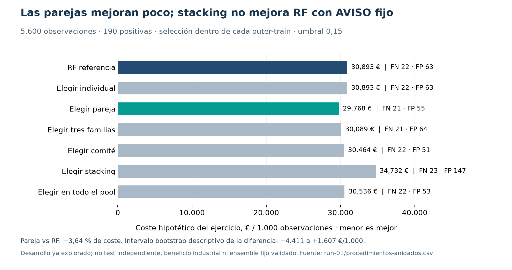

## Comparativa ampliada de modelos · CNC Guard · 04/11/2026

Conclusión: RF sigue siendo una referencia sólida, pero no podemos afirmar que sea la mejor opción en todas las métricas y políticas. La ampliación encuentra mejoras pequeñas con mezclas; todavía no justifica cambiar el modelo servido. El criterio principal combina fallos omitidos y falsas alarmas con los costes del ejercicio. Todo lo siguiente es clasificación del estado actual y evidencia de desarrollo.

## 1. Qué había y qué faltaba en el material de reunión

CG34 ya comparaba 40 configuraciones supervisadas y 10 de anomalías, con 831 unidades de entrenamiento y calibración. CG08 había probado 19 individuales y dos reglas de mezcla. El dossier de reunión citaba las decisiones, pero no ofrecía una tabla completa que permitiese cuestionar fácilmente RF. Esta adenda incorpora esa comparación y la búsqueda multimodelo que faltaba.

| Cobertura previa | Familias / métodos |
| --- | --- |
| CG34 supervisado | RF, GradientBoosting, HistGradientBoosting, logística, CART, Naive Bayes, LDA, QDA, kNN, AdaBoost, CatBoost, XGBoost, LightGBM, EBM, GAM/splines, MLP y constantes de referencia. |
| CG34 anomalías | Isolation Forest, LOF, One-Class SVM, covarianza robusta, PCA y autoencoder; 10 configuraciones. Sin verdad independiente de anomalía. |
| CG08 adicional | ExtraTrees, SVM RBF, BalancedRandomForest, RF calibrado y soft voting; condiciones y métricas distintas, no apiladas como una misma evaluación. |
| Desbalance y representación | Pesos de clase, SMOTENC en experimento separado, features físicas, ablaciones y calibración. Investigar una variante no acredita que esté en la API. |

## 2. Nueva ejecución: 2.998 configuraciones/reglas por outer

Se han verificado CRC y hash del archivo histórico, el manifiesto y 600 unidades originales inner/outer. Se reutilizan scores OOF auténticos: no se han cargado pickles ni vuelto a ajustar los modelos base. Se han entrenado 54 meta-modelos logísticos nuevos para evaluar stacking. Ejecución local serial, sin dependencias nuevas, sin cambios en API, modelos de entrega, contratos o umbrales operativos.

| Bloque | Configuraciones por outer | Cómo se elige sin mirar sus filas outer-held |
| --- | --- | --- |
| Individuales | 40 | Configuración fija histórica. |
| Pares ponderados | 2.340 | Todos los pares entre 40; pesos del primer miembro 25/50/75 %. |
| Tres familias | 560 | Todas las ternas de 16 familias no constantes. Mejor configuración por familia elegida con inner A; mezcla equiponderada. |
| Comités | 10 | Top2/3/5/8/16 según inner A; pesos iguales o inversos al puesto. |
| Stacking | 18 | Top3/5/8 según inner A; logística C=0,1/1/10, con/sin balanceo. |
| RF + rareza | 30 | Diez detectores y colas 1/3/5 % aprendidas sobre negativos inner, como proxy de normalidad; solo diagnóstico. |

Son 8.934 filas de configuración/política: A y B y C para 2.968 candidatos supervisados/ensembles; las 30 uniones de rareza solo tienen su regla binaria propia. El protocolo se guardó antes de calcular resultados, tras conocer los estudios previos. No es un preregistro anterior a toda exploración del dataset.

A optimiza el umbral dentro de outer-train con recall interno mínimo 76 %. B conserva 0,15; C conserva 0,70 como contraste, no reemplaza AVISO. Coste = 5.000 FN + 200 FP + 300 TP. No sumar validación, test y train: esta comparación usa las mismas 5.600 filas de train, 190 positivas, con 3 outer × 3 inner.

Stacking aprende de scores base OOF. Su umbral A se ajusta sobre las salidas del meta-modelo en su propio entrenamiento; la estimación interna puede ser optimista y la evaluación outer mide ese procedimiento. No se presenta como calibración meta-OOF independiente. Las 54 advertencias registradas son deprecaciones de opciones SciPy L-BFGS-B; no son avisos de convergencia. No se han ocultado.

## 3. Comparación justa: procedimientos elegidos solo dentro de entrenamiento

Cada selector puede escoger miembros distintos en cada outer. Estas filas evalúan procedimientos de selección, no un único ensemble fijo listo para desplegar. Las cifras globales usan 5.600 observaciones; los costes son escenarios del ejercicio, no ahorro observado.

| Procedimiento · B (0,15) | TP | FN | FP | Recall | Precision | €/1.000 |
| --- | --- | --- | --- | --- | --- | --- |
| RF referencia | 168 | 22 | 63 | 88,42 % | 72,73 % | 30 892,86 |
| Elegir en todo el pool | 168 | 22 | 53 | 88,42 % | 76,02 % | 30 535,71 |
| Elegir un individual | 168 | 22 | 63 | 88,42 % | 72,73 % | 30 892,86 |
| Elegir pareja ponderada | 169 | 21 | 55 | 88,95 % | 75,45 % | 29 767,86 |
| Elegir tres familias | 169 | 21 | 64 | 88,95 % | 72,53 % | 30 089,29 |
| Elegir comité | 168 | 22 | 51 | 88,42 % | 76,71 % | 30 464,29 |
| Elegir stacking | 167 | 23 | 147 | 87,89 % | 53,18 % | 34 732,14 |

La pareja seleccionada reduce el coste de 173.000 a 166.700 € en 5.600 observaciones: 6.300 € hipotéticos, un 3,64 %. Detecta un positivo neto adicional y reduce ocho falsas alarmas. No tiene un 3,64 % más de precisión ni demuestra un 3,64 % de ahorro industrial.

Bootstrap pareado condicional de predicciones fijas, 2.000 remuestras: diferencia pareja−RF de coste por 1.000, intervalo descriptivo 95 % [-4 410,71, 1 607,14] €. Incluye cero. No incorpora toda la variabilidad de entrenamiento, dependencia de folds ni miles de búsquedas; no demuestra superioridad estadística.

En los casos concretos, la pareja recupera 2 positivos omitidos por RF y pierde 1 que RF detectaba; elimina 28 falsas alarmas y añade 20. La diferencia neta no cuenta toda la historia.

| Outer | Pareja escogida dentro de ese train para B |
| --- | --- |
| 0 | pair:rf_reference+gb_no_derived@0.5 |
| 1 | pair:rf_reference+ebm_3@0.75 |
| 2 | pair:cart_depth3+lgb_15_True@0.25 |

La inestabilidad de miembros entre tres particiones y la pequeña mejora aconsejan conservar RF como referencia y retener ensembles como candidatos. El selector completo B reduce diez FP pero no FN; el stacking B aumenta tanto FN como FP. Más complejidad no mejora automáticamente el resultado.

## 4. Cambiar el umbral cambia el ganador

| Procedimiento · A (optimizado) | FN | FP | Recall | €/1.000 |
| --- | --- | --- | --- | --- |
| RF referencia | 22 | 95 | 88,42 % | 32 035,71 |
| Elegir en todo el pool | 20 | 160 | 89,47 % | 32 678,57 |
| Elegir un individual | 23 | 112 | 87,89 % | 33 482,14 |
| Elegir pareja ponderada | 20 | 135 | 89,47 % | 31 785,71 |
| Elegir tres familias | 18 | 169 | 90,53 % | 31 321,43 |
| Elegir comité | 24 | 108 | 87,37 % | 34 178,57 |
| Elegir stacking | 22 | 151 | 88,42 % | 34 035,71 |

El selector de tres familias A omite 18 positivos, pero genera 169 falsas alarmas. Frente a RF A mejora algo el coste; frente a RF B genera muchas más revisiones y su coste es mayor. Debe compararse modelo y política conjuntamente. Tampoco se asume que 0,15/0,70 signifiquen probabilidades calibradas iguales para modelos distintos.

## 5. Mejores filas observadas: diagnóstico, no selección independiente

| Top observado A | FN | FP | Recall | €/1.000 |
| --- | --- | --- | --- | --- |
| pair:xgb_d3_False+lgb_15_False@0.75 | 14 | 189 | 92,63 % | 28 678,57 |
| pair:ada_depth1+lgb_15_False@0.25 | 18 | 95 | 90,53 % | 28 678,57 |
| pair:gb_depth3+lgb_15_False@0.25 | 18 | 98 | 90,53 % | 28 785,71 |
| pair:cart_depth8+lgb_15_False@0.5 | 19 | 76 | 90,00 % | 28 839,29 |
| pair:ada_depth1+lgb_15_False@0.5 | 19 | 82 | 90,00 % | 29 053,57 |

| Top observado B | FN | FP | Recall | €/1.000 |
| --- | --- | --- | --- | --- |
| pair:cart_depth8+xgb_d3_True@0.75 | 17 | 102 | 91,05 % | 28 089,29 |
| pair:cart_depth8+lgb_15_True@0.75 | 19 | 75 | 90,00 % | 28 803,57 |
| triple:cart+gam+lgb | 20 | 52 | 89,47 % | 28 821,43 |
| triple:gam+gb+lgb | 20 | 57 | 89,47 % | 29 000,00 |
| triple:gb+lgb+mlp | 20 | 61 | 89,47 % | 29 142,86 |

Estos rankings miran los resultados outer después de probar miles de candidatos. Son útiles para formular hipótesis, pero elegir el primero y publicar su cifra como rendimiento esperado introduciría sesgo de selección. No se convierte CART+XGBoost, ni otro ganador observado, en el nuevo modelo servido.

## 6. Todos los individuales, con políticas comparables

| Configuración | FN | FP | Recall | €/1.000 |
| --- | --- | --- | --- | --- |
| rf_reference | 22 | 63 | 88,42 % | 30 892,86 |
| cart_depth8 | 23 | 69 | 87,89 % | 31 946,43 |
| lgb_15_True | 24 | 53 | 87,37 % | 32 214,29 |
| lgb_7_True | 19 | 181 | 90,00 % | 32 589,29 |
| xgb_d3_False | 25 | 48 | 86,84 % | 32 875,00 |
| cart_depth5 | 26 | 28 | 86,32 % | 33 000,00 |
| lgb_7_False | 26 | 30 | 86,32 % | 33 071,43 |
| cat_d6_True | 23 | 128 | 87,89 % | 34 053,57 |
| gb_depth3 | 28 | 19 | 85,26 % | 34 357,14 |
| xgb_d3_True | 15 | 338 | 92,11 % | 34 839,29 |
| cat_d4_True | 19 | 252 | 90,00 % | 35 125,00 |
| cat_d4_False | 28 | 63 | 85,26 % | 35 928,57 |
| lgb_15_False | 30 | 23 | 84,21 % | 36 178,57 |
| xgb_d6_True | 28 | 79 | 85,26 % | 36 500,00 |
| hist_reference | 30 | 43 | 84,21 % | 36 892,86 |
| xgb_d6_False | 31 | 38 | 83,68 % | 37 553,57 |
| cat_d6_False | 31 | 52 | 83,68 % | 38 053,57 |
| rf_no_derived | 28 | 190 | 85,26 % | 40 464,29 |
| gb_no_derived | 38 | 99 | 80,00 % | 45 607,14 |
| ebm_3 | 42 | 108 | 77,89 % | 49 285,71 |
| ebm_0 | 44 | 125 | 76,84 % | 51 571,43 |
| gam_5 | 54 | 140 | 71,58 % | 60 500,00 |
| knn15 | 57 | 123 | 70,00 % | 62 410,71 |
| knn5 | 52 | 254 | 72,63 % | 62 892,86 |
| knn35 | 62 | 106 | 67,37 % | 66 000,00 |
| gam_3 | 61 | 136 | 67,89 % | 66 232,14 |
| nb_1e-07 | 53 | 375 | 72,11 % | 68 053,57 |
| nb_1e-09 | 53 | 375 | 72,11 % | 68 053,57 |
| qda_0.5 | 67 | 219 | 64,74 % | 74 232,14 |
| qda_0.1 | 77 | 135 | 59,47 % | 79 625,00 |
| cart_depth3 | 85 | 9 | 55,26 % | 81 839,29 |
| lda | 79 | 205 | 58,42 % | 83 803,57 |
| logistic_reference | 6 | 2332 | 96,84 % | 98 500,00 |
| mlp_32 | 81 | 1651 | 57,37 % | 137 125,00 |
| always0 | 190 | 0 | 0,00 % | 169 642,86 |
| mlp_32_16 | 47 | 3523 | 75,26 % | 175 446,43 |
| mlp_16 | 32 | 4239 | 83,16 % | 188 428,57 |
| ada_depth1 | 0 | 5410 | 100,00 % | 203 392,86 |
| ada_depth2 | 0 | 5410 | 100,00 % | 203 392,86 |
| always1 | 0 | 5410 | 100,00 % | 203 392,86 |

Para A/C y los detalles por fold, consultar los CSV completos. En el estudio previo, XGBoost depth3 sin pesos con su umbral A obtuvo 30.339 €/1.000 frente a RF A 32.036; con B, RF obtuvo 30.893 frente a XGBoost 32.875. La frase defendible es «RF es una buena elección bajo el contrato y los criterios examinados», no «RF siempre es el mejor».

## 7. ¿Estamos aprovechando la información disponible?

Perfil de las 5.600 filas permitidas: 190 positivos y 5.410 negativos; sin nulos, sin sensores no finitos y sin filas duplicadas en las seis entradas. Hay 50 IDs distintos. Ese identificador no proporciona una trayectoria física por máquina: no se usa para aprender ni para crear ventanas temporales ficticias.

| Información | Tratamiento correcto |
| --- | --- |
| Cinco sensores + tipo | Se conservan Kelvin, RPM, Nm y minutos; dashboard puede convertir K a °C sin cambiar el significado. |
| Diferencia térmica | process_temp_K − air_temp_K; misma diferencia numérica en K y °C. |
| Potencia mecánica aproximada | rpm × torque × 2π/60, en W. El factor de conversión importa. |
| Carga combinada | tool_wear_min × torque_Nm en min·Nm; proxy descriptivo, no porcentaje de desgaste. |
| Desbalance | 190/5.600 = 3,39 %. Un clasificador siempre negativo tendría accuracy 96,61 % y recall 0 %. |
| Histórico de ingesta | Permite revisar lo observado y cobertura; no aporta por sí solo vida restante ni secuencia causal de degradación. |
| Tipos de fallo etiquetados | TWF/HDF/PWF/OSF/RNF se usan solo en diagnóstico posterior de errores. Son objetivos/resultados, no sensores disponibles para predecir machine_failure. |
| Datos desconocidos | No completar sensores, estados, flota o fechas con valores inventados; advertir fuera de rango y procedencia incompatible. |

| Ablación histórica | AP outer agrupada |
| --- | --- |
| RF con derivadas | 0,91 |
| RF sin derivadas | 0,75 |
| GB con derivadas | 0,91 |
| GB sin derivadas | 0,78 |

Las derivadas deterministas no crean información nueva respecto a los sensores originales, pero hacen más accesibles relaciones físicas para el modelo. La ablación respalda su utilidad en estas particiones. No demuestra causalidad ni que más variables siempre ayuden.

| Segmento observado | Filas | Positivos | FN RF B | FN pareja B | FP RF B | FP pareja B |
| --- | --- | --- | --- | --- | --- | --- |
| tipo H | 543 | 13 | 4 | 3 | 10 | 9 |
| tipo L | 3390 | 132 | 10 | 10 | 33 | 30 |
| tipo M | 1667 | 45 | 8 | 8 | 20 | 16 |
| failure_TWF = 1 | 17 | 17 | 16 | 14 | 0 | 0 |
| failure_HDF = 1 | 67 | 67 | 0 | 0 | 0 | 0 |
| failure_PWF = 1 | 53 | 53 | 0 | 1 | 0 | 0 |
| failure_OSF = 1 | 59 | 59 | 0 | 0 | 0 | 0 |
| failure_RNF = 1 | 9 | 1 | 1 | 1 | 0 | 0 |
| positivo sin subtipo marcado | 6 | 6 | 6 | 6 | 0 | 0 |
| positivo con desgaste >= 200 | 58 | 58 | 16 | 14 | 0 | 0 |

Los modos de fallo pueden solaparse; sus filas no se suman para obtener el total. En segmentos pequeños (por ejemplo H, 13 positivos) las diferencias tienen gran incertidumbre. No se han usado esos diagnósticos para elegir ni cambiar modelos.

El cuello de botella más claro está en TWF: RF omite 16 de 17 casos etiquetados y la pareja 14 de 17. Los seis positivos sin subtipo marcado se omiten con ambos. En contraste, HDF y OSF de esta cohorte se detectan completos. No significa que sepamos detectar siempre esos mecanismos fuera del dataset: identifica dónde hace falta más información o un estudio específico, sin utilizar el subtipo como entrada ni reparar etiquetas por inferencia.

Consistencia de etiquetas en el train: 8 filas negativas contienen algún subtipo marcado y 6 positivas no tienen subtipo marcado. Se preservan las etiquetas y se informa del desacuerdo; no se relabelan para mejorar métricas. RNF tiene un componente aleatorio según la documentación del generador, por lo que no podemos prometer reconstruirlo perfectamente a partir de sensores.

## 8. Qué falta para predecir mejor con fundamento

Con los datos actuales se puede ampliar representación, ajustar modelos, comparar reglas y mostrar desacuerdo, errores y cobertura. No se puede garantizar que se extrajo el máximo de información posible ni que se predice perfectamente el estado industrial de una máquina. Existe un límite de lo observado: faltan trayectorias físicas fiables, intervenciones y resultados posteriores, y etiquetas industriales independientes.

| Siguiente paso | Qué resolvería | Estado |
| --- | --- | --- |
| Confirmar inventario y procedencia SMB | Saber si las filas reales tienen sensores/unidades/identidades compatibles con entrenamiento. | No acreditado por este estudio offline. |
| Histórico físico con identificación estable, contexto de carga y ciclos | Permitir validación temporal, por máquina y evaluación de generalización a nuevas máquinas. | No inventar a partir de row IDs; requiere datos reales nuevos. |
| Etiquetas de avería, mantenimiento y tiempo de operación | Evaluar errores reales y plantear horizonte futuro o RUL con otro objetivo supervisado. | Fuera del contrato actual; no acreditado. |
| Datos complementarios disponibles: vibración/corriente, herramientas, carga | Podrían explicar modos no observables con los seis inputs. Solo incorporar si se miden antes del resultado y están disponibles en inferencia. | Hipótesis de adquisición, no datos existentes ni mejora garantizada. |
| Calibrar y verificar ensemble fijo con datos nuevos | Separar mejora real de la elección entre miles de combinaciones en desarrollo. | No se abre de nuevo el test antiguo inspeccionado. |
| Medir latencia, memoria, serialización y contrato del candidato | Determinar si el pequeño beneficio compensa complejidad operativa. | Esta ejecución no produce ni despliega un paquete ensemble de servicio. |

## 9. Recomendación y explicación para la reunión

Mensaje para el equipo: «Sí comparamos alternativas y acabamos de ampliar las mezclas. RF no gana siempre. Con las mismas observaciones, elegir una pareja mejora un poco el balance entre errores, pero el margen es incierto y los miembros cambian entre particiones. Conservamos RF como referencia de servicio y documentamos los ensembles como candidatos; no cambiamos el contrato por un ranking de desarrollo».

No se modifica la puntuación académica estimada automáticamente por tener más combinaciones. Esta evidencia fortalece la explicación de G10/G32/G38/G39/G45/G60/G62/G104, pero comprensión individual, interpretación docente, integración y ensayo siguen siendo puertas separadas.

## 10. Fuentes, reproducción y verificaciones

[Protocolo anterior a la nueva ejecución](protocol.json)

[Código de la ampliación](estudio.py)

[Auditoría por cálculo distinto](verificar.py)

[Resultados de verificación](run-01/VERIFICACION.json)

[Todos los candidatos y políticas](run-01/todas-combinaciones.csv)

[Procedimientos anidados](run-01/procedimientos-anidados.csv)

[Miembros escogidos solo con inner](run-01/seleccion-solo-inner.json)

[Perfil de datos](run-01/calidad-datos.json)

[Incertidumbre](run-01/incertidumbre.json)

[Estudio histórico CG34](fuentes/CG34_EXPLORACION_20261023.md)

[Estudio histórico CG08](fuentes/CG08_ALTERNATIVAS.md)

Repetir desde la raíz del repositorio, con el entorno existente: OMP_NUM_THREADS=1 OPENBLAS_NUM_THREADS=1 MKL_NUM_THREADS=1 .venv/bin/python exports/estudio-multimodelo-2026-11-04/estudio.py --output /ruta/nueva. La salida debe ser nueva; el input original permanece intacto. No se usa red al entrenar meta-modelos. El hash del archivo de evidencia es 640d75114324df4d8bafa20461cccf20da3850552c3bd6fa48080b9584e97896; base Git c34cabe.

Metodología: https://scikit-learn.org/stable/modules/generated/sklearn.ensemble.StackingClassifier.html y https://scikit-learn.org/stable/auto_examples/model_selection/plot_nested_cross_validation_iris.html. Dataset: https://archive.ics.uci.edu/dataset/601/ai4i%2B2020%2Bpredictive%2Bmaintenance%2Bdataset

## 11. Candidato multimodelo entrenado y utilizable en investigación

Se ha ajustado una mezcla fija CART depth3 (75 %) + LightGBM 7 hojas con pesos de clase (25 %) sobre las 5.600 filas train. La pareja procede de la selección screening OOF de entrenamiento entre 2.340 pares, no de elegir el mínimo del ranking outer. La selección fija se ha reproducido y verificado por separado. No confundir este candidato fijo con el procedimiento de selección de pareja de la sección 3.

Esta fase posterior añade dos ajustes base; la ampliación inicial no reentrenó bases y sí ajustó 54 meta-modelos. LightGBM 4.6.0 se instaló en un directorio de investigación separado de .venv y del runtime de la API. El nuevo ajuste usa SciPy 1.17.1, distinto de 1.13.1 en los artefactos históricos: sus bytes no heredan sin más sus resultados históricos. No se calcula rendimiento de generalización sobre las 32 filas de ejemplo, que pertenecen al train.

La recarga de ensemble.joblib conserva exactamente los scores de las 32 filas; el CLI de predicción se ha ejecutado en otro proceso y produce sus scores individuales, mezcla, aviso de soporte de sensores y semántica de estado actual. Cuatro casos inválidos se rechazan: etiqueta como entrada, tipo desconocido, sensor no finito y valor negativo. El cargador verifica versiones científicas, hashes de modelo y código antes de cargar el artefacto propio. No aceptar pickles ajenos.

- [Manifiesto del candidato](candidato/manifest.json)
- [Código de ajuste e inferencia](candidato.py)
- [Comprobación de selección fija](run-01/VERIFICACION_SELECCION_FIJA.json)
- [Ejemplo de seis entradas, sin etiquetas](candidato/ejemplo-seis-entradas.csv)
- [Predicciones de ejemplo, no métricas de validación](candidato/predicciones-ejemplo.json)
- [Versiones numéricas del candidato](candidato/requirements-candidato.txt)

Desde la raíz del repositorio, en el entorno científico con las versiones del manifiesto:

```sh
uv run --no-project --python 3.12 --with-requirements exports/estudio-multimodelo-2026-11-04/candidato/requirements-candidato.txt python exports/estudio-multimodelo-2026-11-04/candidato.py predict --input exports/estudio-multimodelo-2026-11-04/candidato/ejemplo-seis-entradas.csv --output /ruta/nueva-prediccion.json
```

Ese comando de entorno portátil está preparado, no ejecutado en esta revisión. El comando ejecutado utilizó .venv y el directorio aislado de LightGBM; consta en la procedencia local. Ningún paso cambia MODEL_MANIFEST, /predict, umbrales operativos ni el índice del dashboard. La decisión de servicio permanece separada del candidato de investigación.
