Actualización: [comparativa multimodelo ampliada](../estudio-multimodelo-2026-11-04/COMPARATIVA.html) y [PDF con modelos](resumen-reunion-con-modelos.pdf). Incluye candidato de investigación entrenado; no cambia el modelo servido ni la nota estimada.

# CNC Guard · reunión de sincronización

Sistemas · generalista ML/LLM · PM · desarrollo · dashboard | Corte consultado: 2026-11-04T08:39:37+00:00

Guía para compartir conocimientos sin exigir experiencia técnica. Preparada mediante lectura de código, rúbrica, informes versionados y consulta actual de GitHub. No se han vuelto a ejecutar los ensayos históricos ni se ha celebrado la reunión. Las fichas son diagramas explicativos; las capturas están identificadas como evidencia histórica local.

## 1. Lo que todos deben poder explicar en un minuto

CNC Guard recibe filas de sensores, comprueba que son utilizables, clasifica el estado actual con un modelo entrenado previamente y guarda una respuesta trazable. Los paneles ayudan a una persona a decidir qué revisar. No ordena parar máquinas y no estima cuándo van a fallar. Un score alto no es un porcentaje de desgaste ni una probabilidad calibrada de fallo mañana. [S04]

El trabajo nuevo reúne una ventanilla de lectura, un histórico verificable y Laneki conectado a eventos canónicos. Ya existen recorridos locales con servicios reales y el mismo evento en pantalla, pero con CSV sintético y un modelo de prueba. No equivalen a una campaña nueva desde SMB con todos los servicios simultáneos. [S10–S13]

| Versión | Qué podemos afirmar | Qué falta |
| --- | --- | --- |
| main · c34cabe | Laboratorio y evidencias históricas de octubre. Laneki en esta rama es prototipo/demo. | No incluye todavía la integración nueva de PR119. |
| Candidato PR119 · d7cfa18 | API GET, histórico comprometido, runtime y panel canónico; ensayos locales de noviembre documentados. | PR abierta, REVIEW_REQUIRED; cierre de imágenes y checks de ese SHA pendiente. |
| Aceptación de la entrega | Existen cierres técnicos y aceptaciones PM documentadas. | Comprensión individual, ensayo humano, aclaraciones docentes y justificante de entrega son actos separados. |

La PR119 se puede consultar en https://github.com/AABD-Ethazi-2627/T2-erronka1/pull/119. La instantánea de sus checks está en fuentes/pr119.json; su estado puede cambiar después de este corte. No atribuir al HEAD actual todos los ensayos de commits anteriores.

## 2. Mapa que se proyecta al empezar

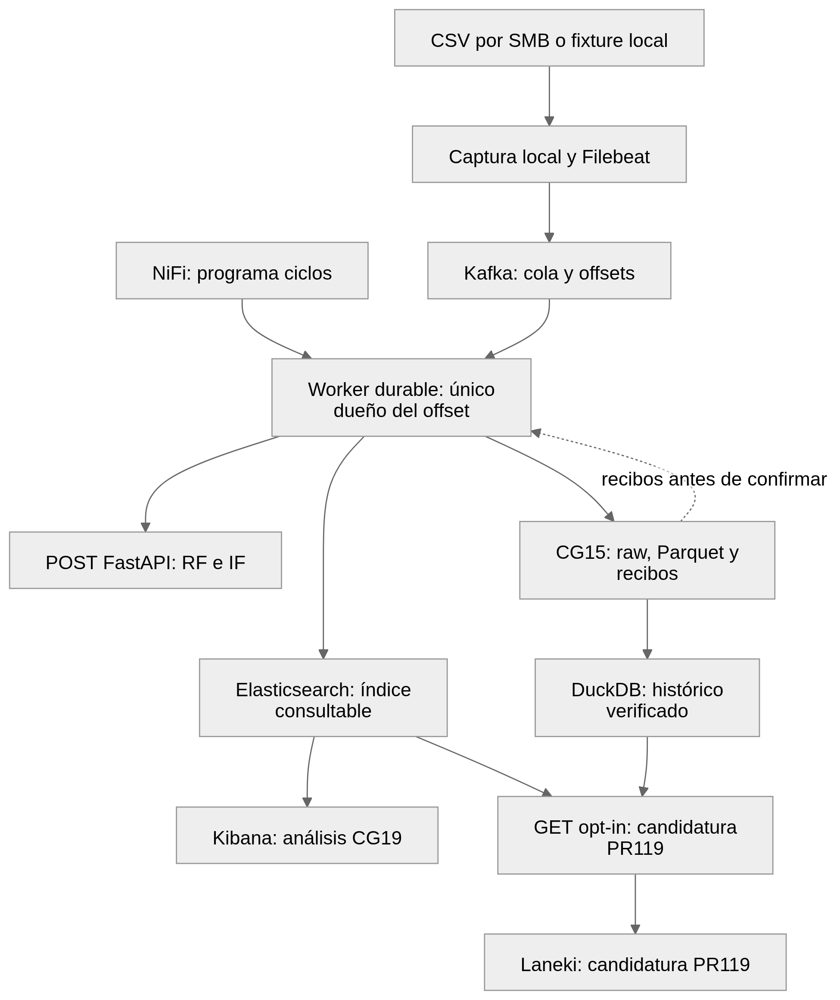

Arquitectura explicativa: ramas de visualización y lectura; no es una captura ni una prueba de ejecución simultánea.

Seguid una sola fila: llega al buzón, Filebeat la envía a Kafka, NiFi programa un ciclo, el worker valida y solicita el score. Antes de confirmar el mensaje exige los recibos del archivo y del índice configurados. Después Kibana o la lectura GET permiten mostrarla. Si el mismo evento se reintenta, se conserva su respuesta canónica; si cambia su contenido de forma incompatible, se rechaza el conflicto. [S05/S12]

## 3. Decisiones y adaptaciones que hay que compartir

| Decisión | Motivo comprensible | Consecuencia y cautela | Fuente |
| --- | --- | --- | --- |
| Clasificar el presente con AI4I reducido | Las filas docentes no demuestran evolución física continua. | Cinco sensores + tipo; fecha/ID para trazabilidad. Sin ETA/RUL/forecast. Literal G62 y cinco sensores/tipo pendientes de aclaración. | S03/S04 |
| Entrenamiento offline separado del servicio | Aprender cuesta más y debe poder revisarse. | La API carga el paquete; no reentrena por cada fila ni cambia el modelo por ver otra máquina. | S04 |
| Conservar RF; IF como rareza; alternativas en research | Una mejor cifra aislada no garantiza mejor servicio o calibración. | No promover boosting/AE/SMOTENC solo porque se investigaron. | S14 |
| SMB → copia local en vez de afirmar NFS | Es el origen disponible y se conserva sin modificarlo. | Aceptado por PM; equivalencia académica literal G49/G92 pendiente. | S03/S04 |
| NiFi programa; worker consume y persiste | Un único responsable del offset permite exigir recibos antes del ACK. | No decir que se ejecutó el flujo nativo ConsumeKafka/InvokeHTTP. | S05/S03 |
| Respuesta canónica, ledger y replay | Reintentar no debe cambiar silenciosamente un resultado ya guardado. | 409: conflicto; 422: entrada inválida; 503: servicio o almacenamiento no disponible. No resolverlos inventando datos. | S04/S12 |
| Archivo Parquet + catálogo SQLite + DuckDB | Separar conservación y consulta permite comprobar de dónde sale una fila. | Solo objetos comprometidos y verificados; GET no repara; backfill del índice antiguo explícito offline. | S12/S10 |
| Lecturas GET opcionales y con ámbito | El panel necesita leer sin mezclar fuentes, modelos o políticas. | Activación explícita; procedencia completa, cursores acotados y degradación visible. | S12 |
| Conservar nulos, parciales y ausencia de cobertura | Ausencia de dato no significa valor cero ni máquina sana. | Cero a cincuenta máquinas reales; no completar una flota por ID ni inventar series. | S12/S10 |
| Kibana y Laneki con evidencias distintas | Sirven a análisis y comunicación del estado, pero su entrega no es intercambiable automáticamente. | Main conserva Laneki demo; candidato tiene lectura canónica. Un servidor de API demo sigue siendo demo. | S09/S10/S02 |
| Política de alerta separada de decisión binaria | Los colores y la matriz de evaluación responden a reglas distintas. | OK <0,15; AVISO desde 0,15; CRITICA desde 0,70. Umbral F2 de desarrollo ≈0,1908228 no sustituye esas fronteras. | S20/S06 |
| Costes del ejercicio sin afirmar ahorro | Una tabla de costes sirve para comparar errores, no mide beneficio observado. | FN 5.000 €, FP 200 €, TP 300 €, TN 0 €. Escenarios históricos 1.200 €/h conservan su contexto. | S17/S03 |
| Capacidad medida con honestidad | Una API rápida puede convivir con una cola lenta. | En CG32 se guardan 1.860 eventos; las tres cargas de 10/s acumulan cola. p95 E2E 78–84 s; meta 1 s incumplida. | S07 |
| Dependencias fijadas y gates de seguridad | Reproducir y revisar los bytes importa tanto como arrancar. | Candidatos NiFi/Kibana siguen con trabajo pendiente; no cambiar gate para pintar verde. Docker mononodo no es HA. | S10/S15/S16 |

## 4. Quién explica qué y qué entrega al siguiente

| Área | Explicación sin jerga | Contrato con las demás áreas | Prueba de comprensión |
| --- | --- | --- | --- |
| Sistemas | De dónde vienen los archivos, dónde esperan y cómo se recupera un reinicio. | Comparte origen, puertos autorizados, montajes, permisos, imágenes y límites de recursos con dev. | Seguir un offset y distinguir recepción Kafka de archivo completado. |
| Generalista ML/LLM | Qué aprende RF, qué significa rareza y qué errores cuesta más cometer. | Entrega identidad del modelo, unidades, features, evaluación y límites al dev y al PM. El LLM facilita explicación y trabajo; no es el scorer CNC. | Explicar un falso negativo, un falso positivo y por qué el score no es ETA. |
| PM | Qué está en alcance, qué decisión está aceptada y qué queda por demostrar. | Mantiene criterio→evidencia→límite y separa aceptación PM de docente/usuario. | Explicar por qué PR abierta, test verde y entrega no son el mismo estado. |
| Dev | Cómo se valida una fila y se conserva su identidad al reintentar. | Publica contratos POST/GET, errores, procedencia y archivo legible para dashboard. | Mostrar mismo ID/clave en respuesta, archivo, ES y panel. |
| Dashboard | Qué significa cada gráfica y cuándo faltan datos. | Respeta unidad, UTC, cobertura, nulls, modo y ámbito recibidos; comunica fallos a dev/sistemas. | Filtrar una máquina y explicar denominador, antigüedad y origen de la vista. |

Este reparto es una propuesta por funciones para la reunión; no reasigna issues ni atribuye asistencia o trabajo a personas que no lo han confirmado.

## 5. Una imagen por servicio: fichas para explicar

### SMB y captura · El buzón de archivos

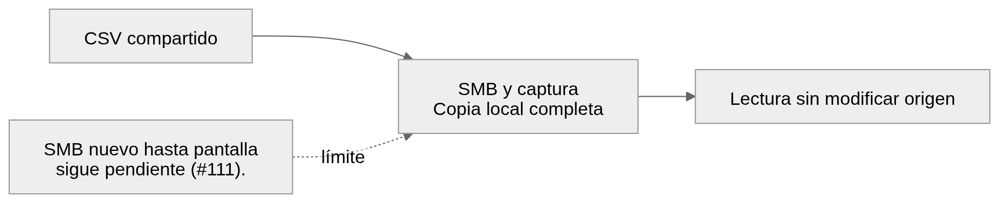

SMB y captura: esquema conceptual, no captura de ejecución.

No es una máquina conectada en directo. La copia conserva procedencia. Entrada: CSV compartido. Salida: Lectura sin modificar origen. Área que lo explica: Sistemas. Límite: SMB nuevo hasta pantalla sigue pendiente (#111). [S04/S03]

### Filebeat · El mensajero

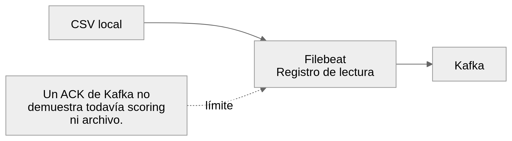

Filebeat: esquema conceptual, no captura de ejecución.

Recuerda por dónde iba leyendo y envía registros a la cola. Entrada: CSV local. Salida: Kafka. Área que lo explica: Sistemas. Límite: Un ACK de Kafka no demuestra todavía scoring ni archivo. [S04/S10]

### Kafka · La sala de espera

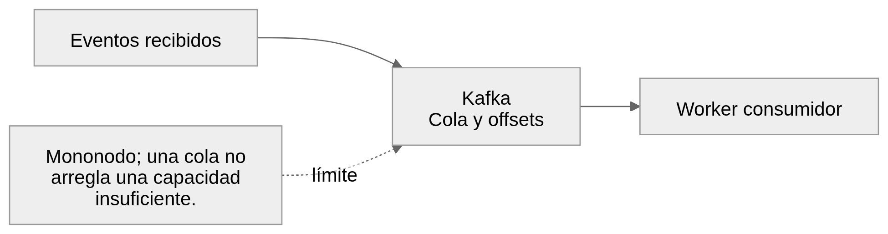

Kafka: esquema conceptual, no captura de ejecución.

Permite que el productor y el consumidor trabajen a ritmos diferentes. Entrada: Eventos recibidos. Salida: Worker consumidor. Área que lo explica: Sistemas + dev. Límite: Mononodo; una cola no arregla una capacidad insuficiente. [S05/S07/S10]

### NiFi · El coordinador de ciclos

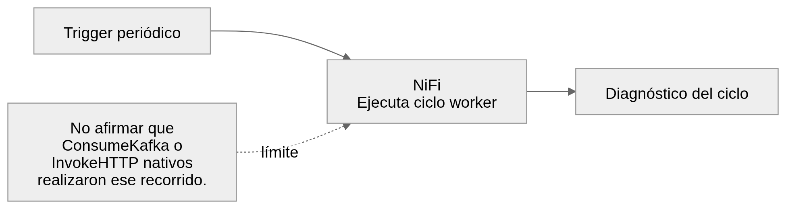

NiFi: esquema conceptual, no captura de ejecución.

En la vía aceptada, programa el worker mediante ExecuteStreamCommand. Entrada: Trigger periódico. Salida: Diagnóstico del ciclo. Área que lo explica: Sistemas. Límite: No afirmar que ConsumeKafka o InvokeHTTP nativos realizaron ese recorrido. [S05/S03]

### Worker durable · El repartidor con recibos

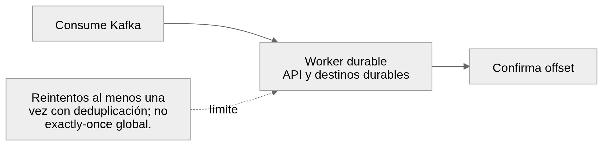

Worker durable: esquema conceptual, no captura de ejecución.

Pide el scoring y verifica recibos antes de dar por atendido el mensaje. Entrada: Consume Kafka. Salida: Confirma offset. Área que lo explica: Dev + sistemas. Límite: Reintentos al menos una vez con deduplicación; no exactly-once global. [S05/S10]

### RF e Isolation Forest · El clasificador y la señal de rareza

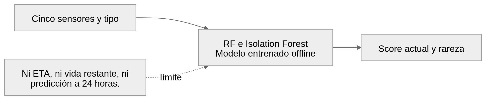

RF e Isolation Forest: esquema conceptual, no captura de ejecución.

RF aprende de etiquetas; IF señala observaciones raras. El LLM ayuda a trabajar, no puntúa las máquinas. Entrada: Cinco sensores y tipo. Salida: Score actual y rareza. Área que lo explica: Generalista ML/LLM + dev. Límite: Ni ETA, ni vida restante, ni predicción a 24 horas. [S04/S14/S06]

### FastAPI · La ventanilla común

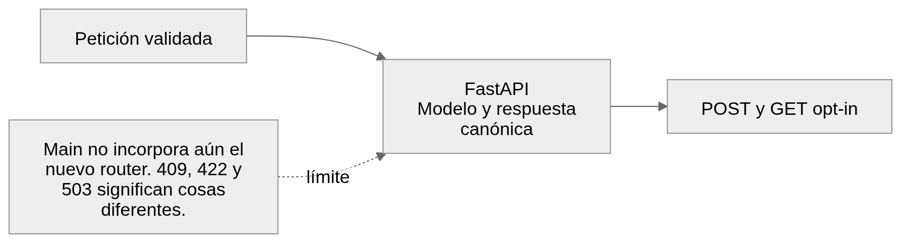

FastAPI: esquema conceptual, no captura de ejecución.

POST calcula o recupera respuesta; GET del candidato consulta datos guardados sin volver a entrenar. Entrada: Petición validada. Salida: POST y GET opt-in. Área que lo explica: Dev. Límite: Main no incorpora aún el nuevo router. 409, 422 y 503 significan cosas diferentes. [S04/S12/S10]

### CG15: SQLite, Parquet y DuckDB · El archivo y su catálogo

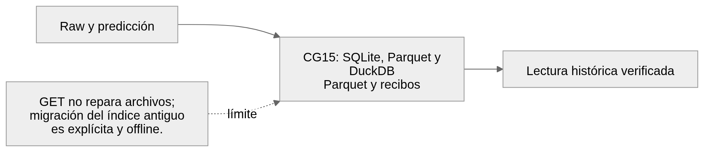

CG15: SQLite, Parquet y DuckDB: esquema conceptual, no captura de ejecución.

SQLite registra compromisos; Parquet guarda objetos; DuckDB consulta. No son tres copias redundantes. Entrada: Raw y predicción. Salida: Lectura histórica verificada. Área que lo explica: Dev + sistemas. Límite: GET no repara archivos; migración del índice antiguo es explícita y offline. [S05/S12/S10]

### Elasticsearch · El índice de consulta

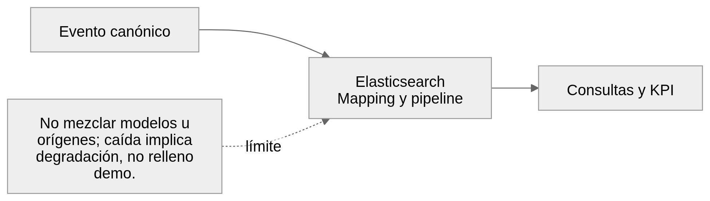

Elasticsearch: esquema conceptual, no captura de ejecución.

Hace localizables eventos y sensores conservando fuente, modelo y política. Entrada: Evento canónico. Salida: Consultas y KPI. Área que lo explica: Sistemas + dev. Límite: No mezclar modelos u orígenes; caída implica degradación, no relleno demo. [S02/S10/S12]

### Kibana · El panel de análisis del laboratorio

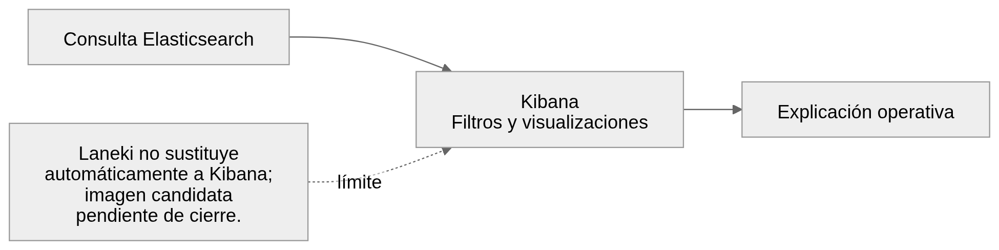

Kibana: esquema conceptual, no captura de ejecución.

Tiene evidencias históricas propias y entregables CG19. Sigue siendo parte de la rúbrica. Entrada: Consulta Elasticsearch. Salida: Explicación operativa. Área que lo explica: Dashboard + sistemas. Límite: Laneki no sustituye automáticamente a Kibana; imagen candidata pendiente de cierre. [S02/S04]

### Laneki / Streamlit · El panel para contar el estado

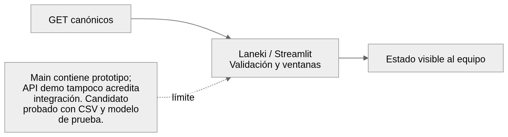

Laneki / Streamlit: esquema conceptual, no captura de ejecución.

Hasiera, Makinak, Datuak y Abisuak muestran estado, histórico, procedencia y degradación en el candidato. Entrada: GET canónicos. Salida: Estado visible al equipo. Área que lo explica: Dashboard + dev. Límite: Main contiene prototipo; API demo tampoco acredita integración. Candidato probado con CSV y modelo de prueba. [S09/S10/S12]

### Docker, runtime y acceso · Las cajas y las llaves

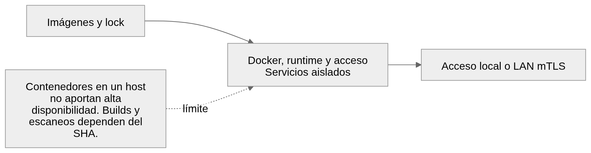

Docker, runtime y acceso: esquema conceptual, no captura de ejecución.

Fija dependencias, montajes y límites; permite repetir el entorno. El gateway LAN es opcional. Entrada: Imágenes y lock. Salida: Acceso local o LAN mTLS. Área que lo explica: Sistemas. Límite: Contenedores en un host no aportan alta disponibilidad. Builds y escaneos dependen del SHA. [S19/S10/S15/S16]

## 6. Pantallas que sí existen, con su contexto

Estas imágenes se copian de evidencias locales conservadas. Se han comprobado sus bytes al empaquetar, pero no se han vuelto a arrancar servicios ni capturado pantallas en esta revisión. No hay capturas disponibles de todas las consolas de servicios; sus fichas anteriores son diagramas, no pantallas simuladas. [S10/S11]

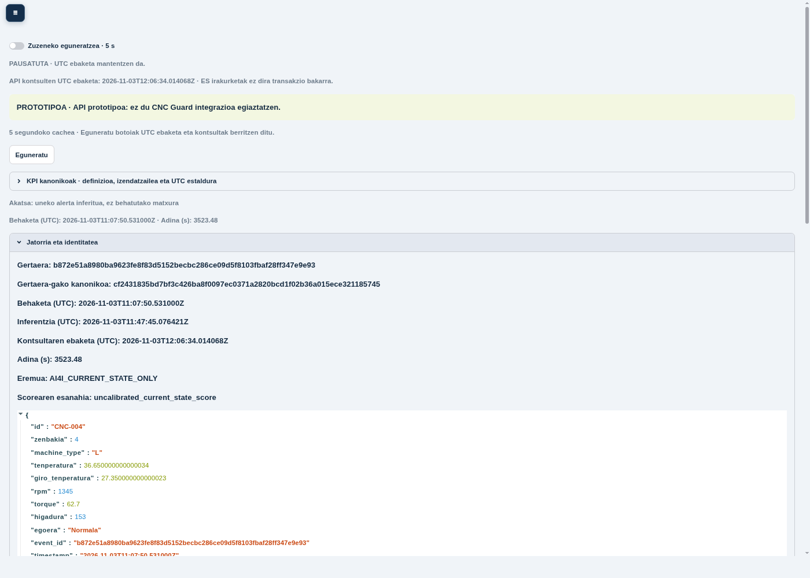

Laneki en imagen local, 03/11; CSV sintético y modelo de prueba. No captura del main ni de sensores industriales.

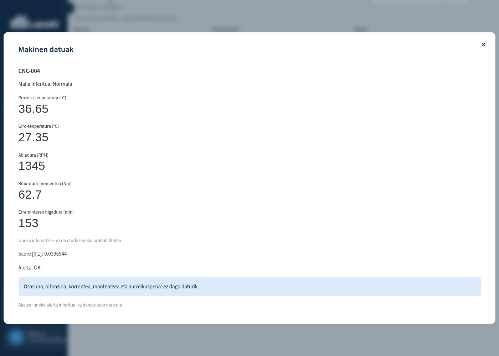

Detalle visible en la sesión local de imagen; captura exitosa documentada, distinta del clic inicial fallido.

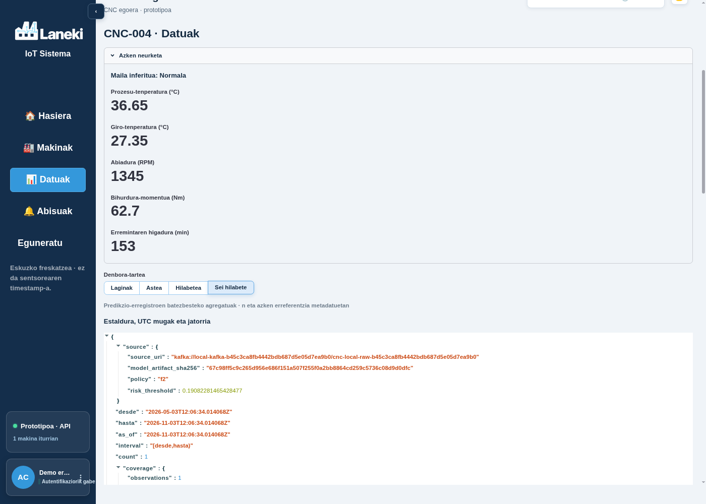

Selección de seis meses; elegir una ventana no acredita seis meses de cobertura.

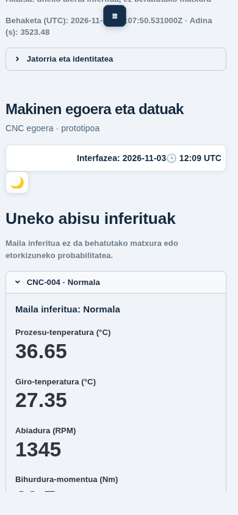

Vista móvil del ensayo local de la imagen, 390 × 844.

![Kibana: evidencia histórica CG20 del 22/10. Recorrido con RiskDouble/AnomalyDouble; no RF industrial ni captura nueva de la PR119. [S02]](imagenes/kibana-historico.png)

Kibana: evidencia histórica CG20 del 22/10. Recorrido con RiskDouble/AnomalyDouble; no RF industrial ni captura nueva de la PR119. [S02]

## 7. Qué demuestran las cifras y qué no

| Dato | Lectura correcta | No permite concluir |
| --- | --- | --- |
| Desarrollo reutilizado: 1.200 filas, 41 positivos; F2: TP32/FN9/FP9/TN1150 | Recall 32/41 = 78,05 %; precision 32/41 = 78,05 %. Umbral binario F2 fijo ≈0,1908228. [S06] | No test independiente, no matriz online y no evaluación del bundle local nuevo. |
| AVISO: TP32/FN9/FP12/TN1147; CRITICA: TP27/FN14/FP0/TN1159 | Elevar umbral reduce avisos y también deja pasar positivos. [S06] | No asumir que todos los scores/colores tienen la misma matriz. |
| Campaña CG32: 1.860 eventos guardados; pérdidas, duplicados finales y pendientes: cero | Resultado observado en siete corridas delimitadas. [S07] | No durabilidad ante pérdida del host ni throughput industrial. |
| Tres corridas 10/s: p95 HTTP 14,365–15,116 ms y E2E 78,135–83,859 s | Servicio de scoring rápido; recorrido global con cola y drenaje. [S07] | No cumple p95 E2E ≤1 s; tasas de oferta no son capacidad sostenida. |
| Recorrido nuevo en imagen: mismo evento en replay, CG15, ES, GET y navegador | Servicios reales locales, CSV sintético y modelo de prueba identificados. [S10] | No modelo industrial aprobado ni campaña SMB/NiFi/Kibana completa simultánea. |

## 8. Valoración predictiva frente a los 40 criterios

Índice orientativo de preparación: main 8.11/10; candidato PR119 8.32/10. Es mi juicio por criterio, con media simple y pesos iguales de 1/40. No es una fórmula docente ni una predicción estadística. La diferencia mide evidencia adicional disponible en el candidato y no concede puntos oficiales por una PR sin integrar.

Estimación para una defensa basada en el estado disponible: banda de trabajo 7–8,5/10; si se integra y verifica el candidato, se resuelven las equivalencias con el docente y los participantes dominan el recorrido, escenario razonable 8–9/10. Son escenarios de criterio profesional, sin probabilidades ni intervalos de confianza. Una defensa débil o una lectura docente estricta puede quedar por debajo de esas bandas. No hay evidencia para prometer un 10.

La fuente exacta contiene 40 descriptores de AURRERATUA (10), no todas las escalas inferiores: por eso los decimales no deben interpretarse como precisión de medida. Los pesos no forman aquí una ponderación global válida: hay 15%% y celdas sin peso. Se conserva el valor original; no se normalizan módulos ni se inventan porcentajes. A01/A02 siguen pendientes. [S01/S03]

Guía usada al valorar: 9 indica evidencia amplia con límites explícitos; 8–8,5 indica evidencia buena con una puerta de cobertura o explicación pendiente; 7–7,5 indica adaptación literal, evidencia parcial o aceptación pendiente relevante. Una fuente o un test no prueba que cada integrante sepa explicarlo. La estimación es sobre preparación del proyecto, no sobre la nota individual.

| Celda | Criterio resumido | Main | PR119 | Evidencia y reserva |
| --- | --- | --- | --- | --- |
| G5 | Principios y autonomía | 8 | 8 | S02/S04 · Explicar aprendizaje offline, inferencia actual y decisión humana; comprobar comprensión individual. |
| G10 | Clasificación y comparación de modelos | 9 | 9 | S14 · RF, boosting, IF y AE investigados; justificar límites y por qué no se promueve un ganador por una sola métrica. |
| G14 | Costes, umbrales y viabilidad | 8 | 8 | S03/S07/S17 · Separar costes del ejercicio, score y latencia total. La meta E2E de 1 s no se alcanzó. |
| G16 | Riesgos legales y éticos | 8 | 8 | S02 · Análisis documental aceptado por PM; defensa pendiente. No equivale a certificación. |
| G17 | Privacidad y secretos | 8.5 | 8.5 | S02 · Finalidad y separación del control laboral documentadas; conservar límites del laboratorio. |
| G19 | Seguridad desde el diseño | 8 | 8 | S02/S15/S16 · Controles de laboratorio; candidatura con cierre de imágenes NiFi/Kibana pendiente. |
| G20 | Privacidad en el conjunto del diseño | 8 | 8 | S02 · Documentación aceptada; no demuestra cumplimiento universal de cualquier uso futuro. |
| G23 | IA específica frente a general | 7.5 | 7.5 | S02/S08 · Contenido preparado, explicación personal sin acreditar. El LLM no es el modelo CNC. |
| G24 | Reglas frente a ML | 7.5 | 7.5 | S02/S08 · Distinguir score aprendido y reglas fijas de aviso en la exposición. |
| G31 | Tipos de aprendizaje y datos | 8 | 8 | S14/S08 · Investigación amplia; rareza no es fallo confirmado, y falta explicación individual. |
| G32 | Técnicas y herramientas elegidas | 8.5 | 8.5 | S04/S14 · Ecosistema y alternativas documentados; evitar defensa basada solo en nombres de herramientas. |
| G36 | EDA y preparación | 9 | 9 | S02 · Tratamiento reproducible del CSV reducido; no crear cronología física. |
| G38 | Features y fuga de información | 8.5 | 8.5 | S02/S14 · Features físicas y aislamiento del ajuste; no atribuir al runtime técnicas solo investigadas. |
| G39 | Evaluación e interpretación | 8 | 8 | S06/S10 · Matriz conciliada sobre desarrollo reutilizado; evaluación del modelo local de prueba no vinculada. |
| G41 | API y servicio robusto | 8.5 | 9 | S04/S10/S12 · Candidatura añade GET e imagen verificada localmente; merge y campaña completa separados. |
| G45 | Adecuación y desbalance | 8 | 8 | S06/S17 · Recall de desarrollo supera referencia literal; adecuación industrial no demostrada. |
| G46 | Fiabilidad de extremo a extremo | 7.5 | 8 | S07/S10 · Recuperación y balances históricos; ensayo nuevo acotado no demuestra todo el stack simultáneo. |
| G49 | Automatización del streaming | 7 | 7.5 | S03/S05/S10 · SMB y worker aceptados por PM; literal NFS y valoración docente pendientes; SMB nuevo no probado. |
| G52 | Elección de Python | 8.5 | 8.5 | S02/S04 · Justificación y uso coherentes; preparar comparación breve y limitaciones. |
| G55 | Estructura modular y validación | 9 | 9 | S04/S12 · Separación entrenamiento/servicio y contratos; candidatura añade lectura acotada. |
| G60 | Modelo, desbalance y métricas | 8.5 | 8.5 | S14/S06 · Estudios comparables; explicar accuracy engañosa y no llamar calibrado al score sin evidencia. |
| G61 | Implementación y umbrales | 8.5 | 8.5 | S06/S20/S03 · 0,15/0,70 preservados; distinguir regla binaria de evaluación y modelo exacto desplegado. |
| G62 | Mejoras, CV e histórico | 7 | 7.5 | S03/S14/S12 · Histórico de observaciones no es histórico causal por máquina para entrenar; literal G62 pendiente. |
| G65 | Información útil para mantenimiento | 7.5 | 8 | S02/S10 · Nuevo panel con evento visible; falta ensayo de equipo y decisión simulada explicada. |
| G66 | Coherencia de formatos | 8.5 | 9 | S02/S10/S12 · Contratos y procedencia; candidatura conserva identidad y nulls, comprobados en recorrido local. |
| G68 | Índices e ingest pipelines | 9 | 9 | S02/S10 · Instalación y validación documentadas; no implica migración de índices compartidos. |
| G71 | Gráficas, filtros y agregaciones | 8 | 8.5 | S02/S10 · Kibana histórico y nuevo panel tienen evidencias distintas; explicar denominadores y ventanas. |
| G72 | Sensores y decisión de mantenimiento | 7.5 | 8 | S08/S17/S10 · Decisiones simuladas y costes; no se acredita intervención ni ahorro real. |
| G77 | Extracción y archivo íntegro | 8.5 | 9 | S02/S10/S12 · Archivo/recibos; candidatura verifica índice, bronze y Parquet; no prueba pérdida de host. |
| G80 | Carga y eficiencia segura | 8 | 8 | S07/S15 · Carga real medida con límites y mejora; no cumple meta E2E, quedan gates de imágenes. |
| G85 | Mononodo frente a redundancia | 8 | 8 | S02/S07 · Límites documentados; falta demostración de comprensión oral; no hace falta inventar HA. |
| G87 | Dashboard claro y completo | 8 | 8.5 | S02/S09/S10 · Main conserva prototipo Laneki; candidato tiene imágenes y navegación local verificadas. |
| G90 | Kafka, offsets y reinicios | 8.5 | 9 | S07/S10 · ACK tras persistencia; replay nuevo por stdin no es redelivery forzada del broker. |
| G92 | Transformación, API y rutas | 7.5 | 8 | S03/S05/S10 · NiFi programa worker; no se presenta InvokeHTTP/ConsumeKafka nativo como ejecutado. |
| G95 | Calidad de datos | 8.5 | 8.5 | S02/S12 · Rechazos y coherencia documentados; explicar nulo, formato inválido y duplicado. |
| G96 | Interrupciones y duplicados | 8.5 | 9 | S07/S10 · Cero pérdidas en campaña acotada y replay; no equivale a exactly-once distribuido. |
| G100 | Selección de señales y resultados | 8 | 8.5 | S02/S10 · Identidad y sensores preservados; score no es riesgo futuro ni medida de desgaste. |
| G101 | Limpieza y transformación | 8.5 | 9 | S02/S12 · Validación y archivo; no rellenar faltantes con datos plausibles. |
| G104 | Interpretar alertas y costes | 7.5 | 8 | S17/S08/S10 · Casos preparados; ahorro, coste esperado y decisión operativa real no demostrados. |
| G105 | BI y presentación | 7.5 | 8 | S08/S10 · Material y panel preparados; explicación humana y entrega aún no acreditadas. |

## 9. Reunión propuesta: 60 minutos y un evento común

| Minutos | Dinámica | Resultado que registrar después |
| --- | --- | --- |
| 0–5 | PM fija alcance y las dos versiones. Cada persona dice qué entiende por estado actual. | Versión elegida para el ensayo y dudas de alcance. |
| 5–15 | Sistemas recorre arquitectura: fuente, cola, trigger, worker y archivo. | Otra área explica qué ocurre si el consumidor se detiene. |
| 15–25 | ML/LLM explica cinco sensores + tipo, RF/IF, FP/FN y políticas. | Cada persona responde por qué un aviso no predice una avería mañana. |
| 25–35 | Dev sigue un event_key por POST, ledger, Parquet, ES y GET. | IDs/huellas observados, errores 409/422/503 y modo realmente utilizado. |
| 35–45 | Dashboard explica vista actual, detalle, histórico, KPI, filtros y cobertura. | Otra persona interpreta una captura y reconoce dónde no hay datos. |
| 45–53 | Ronda cruzada: cada área explica una decisión ajena usando una ficha. | Lagunas reales de comprensión; no marcar 4/4 por tener un guion. |
| 53–60 | PM recorre pendientes de rúbrica, elige responsables y fecha de respuesta. | Acuerdos reales, responsable confirmado, evidencia esperada y fecha; no aprobación ficticia. |

Si los servicios no están disponibles, usar las capturas e informes como ensayo documental. Identificarlo así en el acta: una presentación con imágenes no sustituye una demostración viva. Para ejecutar, usar el ensayo preparado [S18] y las guías de la candidatura, con entorno autorizado e identidad fijada.

## 10. Cinco preguntas para comprobar que se compartió el conocimiento

| Pregunta | Respuesta mínima esperada |
| --- | --- |
| ¿Qué pasa si Kafka recibe y ES está caído? | El ACK del productor no cierra el trabajo. El worker exige destinos/recibos antes del commit y deja reintento o error trazable. |
| ¿Qué cambia al subir el umbral de aviso? | Cambian FP/FN y carga de revisión; no se mejora automáticamente el modelo ni se convierte el score en forecast. |
| ¿Una ventana de seis meses demuestra seis meses de medidas? | No. Es una selección; deben mostrarse cobertura, conteos y ausencia de datos. |
| ¿Por qué un histórico no habilita RUL? | Requiere cronología y objetivo causal fiables. Agregar snapshots del dataset no crea degradación física observada. |
| ¿Por qué no atribuimos ya un 10? | Faltan explicación/ensayo humanos, interpretación docente y entrega; existen límites de imágenes, cobertura y rendimiento. |

## 11. Acciones que más protegen el resultado

| Prioridad | Acción concreta | Responsable propuesto | Criterios afectados |
| --- | --- | --- | --- |
| 1 | Elegir main o candidato y fijar commit/modelo/entorno. Para candidato, cerrar checks y revisión antes de integrar. | PM + dev + sistemas | G19/G41/G49/G55/G80/G92 |
| 1 | Realizar explicaciones cruzadas y ensayo con un mismo evento; registrar errores y dudas reales. | Las cinco funciones; participantes humanos por confirmar | G5/G23/G24/G31/G65/G71/G72/G104/G105; #37/#26 |
| 1 | Confirmar con docente pesos, equivalencias SMB/worker, literal G62, entradas y modalidad de entrega. Usar consulta ya preparada. | PM/portavoz confirmado en el equipo | A01–A05/A07; G49/G62/G92; #82 |
| 2 | Separar prueba local sin SMB (#110) de aceptación nueva SMB (#111); cerrar balance de IDs y procedencia del evento de la demo. | Sistemas + dev + dashboard | G46/G49/G66/G77/G90/G96; #104–#111 |
| 2 | Congelar documentos y capturas de la versión elegida; comprobar idioma de defensa, canal, hora y recibo real. | PM + dashboard + equipo | G87/G105; #27 |
| 3 | Explicar cuello de botella medido y límites mononodo; no gastar la reunión prometiendo nuevas arquitecturas sin verificar. | Sistemas + dev | G14/G46/G80/G85 |

## 12. Glosario de bolsillo

| Palabra | Explicación |
| --- | --- |
| Inferencia | Aplicar un modelo ya entrenado a una fila. |
| Entrenamiento | Aprender patrones con datos autorizados y un procedimiento evaluable. |
| Score | Salida numérica del modelo; su interpretación depende del objetivo y su evaluación. |
| FP / FN | Avisar cuando la etiqueta es negativa / no detectar una etiqueta positiva. |
| Offset / ACK | Posición en la cola / confirmación de una etapa concreta. |
| Replay / idempotencia | Repetir un evento / conservar el resultado sin duplicarlo indebidamente. |
| Ledger / recibo | Registro de lo comprometido / prueba verificable de aceptación por un destino. |
| Hash / procedencia | Huella de bytes / información que explica origen y transformaciones. |
| KPI / cobertura | Indicador con denominador definido / qué datos realmente abarca. |
| p95 / lag | Tiempo bajo el que cae el 95 % de observaciones / trabajo pendiente en cola. |
| HA | Continuidad ante fallos mediante redundancia; no aportada por muchos contenedores en un solo host. |
| Opt-in / degradado | Activado explícitamente / servicio que comunica una limitación real. |

## 13. Fuentes incluidas para comprobar decisiones

Las copias siguientes fijan bytes de Git y permiten revisar este dossier offline. Los enlaces internos que ya traían esos documentos pueden apuntar fuera de esta selección. El manifiesto del paquete registra hashes, commits y procedencia de capturas. La lectura y el hash no reproducen los ensayos ni certifican aceptación humana.

- [S01: docs/rubrica/fuente.json](fuentes/S01-fuente.json) · `c34cabe0c851ba4b7688e1a3a4448d9898002f1e`

- [S02: docs/rubrica/ESTADO_20261028.md](fuentes/S02-ESTADO_20261028.md) · `c34cabe0c851ba4b7688e1a3a4448d9898002f1e`

- [S03: docs/rubrica/ACLARACIONES_20261023.md](fuentes/S03-ACLARACIONES_20261023.md) · `c34cabe0c851ba4b7688e1a3a4448d9898002f1e`

- [S04: README.md](fuentes/S04-README.md) · `c34cabe0c851ba4b7688e1a3a4448d9898002f1e`

- [S05: docs/CG14_AUTOMATIC_GRAPH.md](fuentes/S05-CG14_AUTOMATIC_GRAPH.md) · `c34cabe0c851ba4b7688e1a3a4448d9898002f1e`

- [S06: docs/evidence/CG10_PRECISION_20261022.md](fuentes/S06-CG10_PRECISION_20261022.md) · `c34cabe0c851ba4b7688e1a3a4448d9898002f1e`

- [S07: docs/evidence/CG32_CAMPAIGN_20261028.md](fuentes/S07-CG32_CAMPAIGN_20261028.md) · `c34cabe0c851ba4b7688e1a3a4448d9898002f1e`

- [S08: docs/demo/PENDING_HANDOFF_20261028.md](fuentes/S08-PENDING_HANDOFF_20261028.md) · `c34cabe0c851ba4b7688e1a3a4448d9898002f1e`

- [S09: dashboard_laneki/README.md](fuentes/S09-README.md) · `c34cabe0c851ba4b7688e1a3a4448d9898002f1e`

- [S10: docs/evidence/LOCAL_CONTAINERS_20261103.md](fuentes/S10-LOCAL_CONTAINERS_20261103.md) · `d7cfa18f13b9f2cfd585c1f00d2d4cf71f4c80a9`

- [S11: docs/evidence/LOCAL_PIPELINE_BROWSER_20261103.md](fuentes/S11-LOCAL_PIPELINE_BROWSER_20261103.md) · `d7cfa18f13b9f2cfd585c1f00d2d4cf71f4c80a9`

- [S12: docs/backend/READ_API.md](fuentes/S12-READ_API.md) · `d7cfa18f13b9f2cfd585c1f00d2d4cf71f4c80a9`

- [S13: docs/memoria/RECONCILIACION_20261103.md](fuentes/S13-RECONCILIACION_20261103.md) · `d7cfa18f13b9f2cfd585c1f00d2d4cf71f4c80a9`

- [S14: docs/evidence/ML_DECISION_REVIEW_20261023.md](fuentes/S14-ML_DECISION_REVIEW_20261023.md) · `c34cabe0c851ba4b7688e1a3a4448d9898002f1e`

- [S15: docs/evidence/NIFI_CI_BLOCKERS_20261104.md](fuentes/S15-NIFI_CI_BLOCKERS_20261104.md) · `d7cfa18f13b9f2cfd585c1f00d2d4cf71f4c80a9`

- [S16: docs/evidence/WIRE5_REVIEW_STATUS_20261104.md](fuentes/S16-WIRE5_REVIEW_STATUS_20261104.md) · `d7cfa18f13b9f2cfd585c1f00d2d4cf71f4c80a9`

- [S17: docs/evidence/DOCENTE_FORO_20261023.md](fuentes/S17-DOCENTE_FORO_20261023.md) · `c34cabe0c851ba4b7688e1a3a4448d9898002f1e`

- [S18: docs/demo/ENTSEGU_PRESTATUA_20261028.md](fuentes/S18-ENTSEGU_PRESTATUA_20261028.md) · `c34cabe0c851ba4b7688e1a3a4448d9898002f1e`

- [S19: docker-compose.yml](fuentes/S19-docker-compose.yml) · `c34cabe0c851ba4b7688e1a3a4448d9898002f1e`

- [S20: scoring/alert_policy.py](fuentes/S20-alert_policy.py) · `c34cabe0c851ba4b7688e1a3a4448d9898002f1e`
